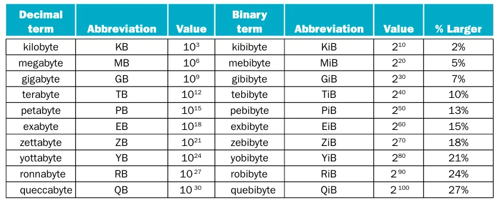
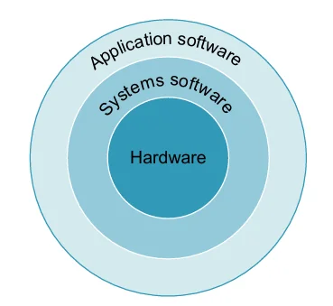
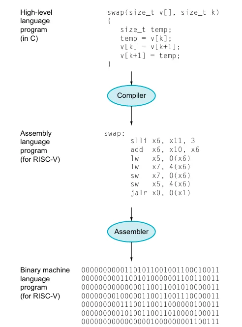
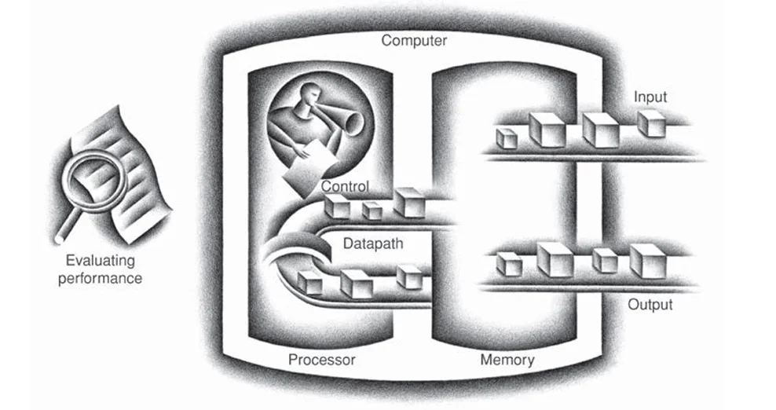
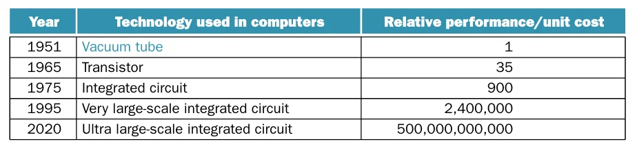
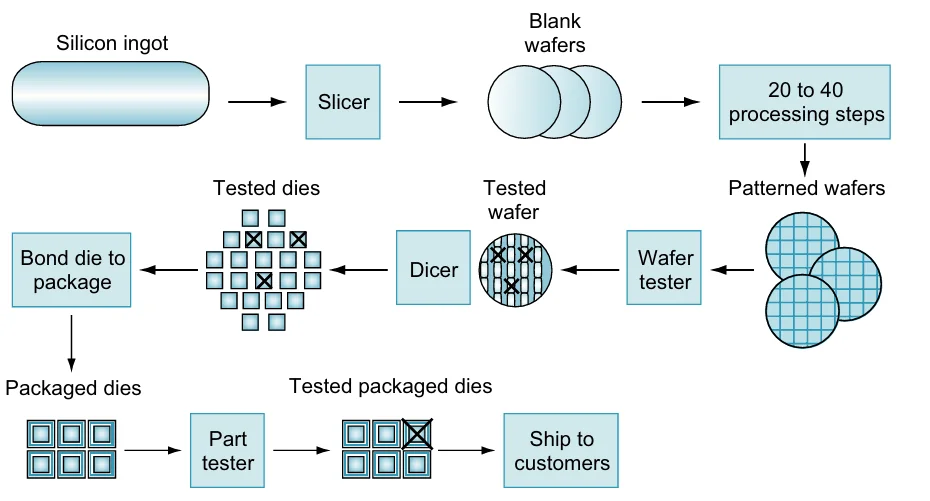
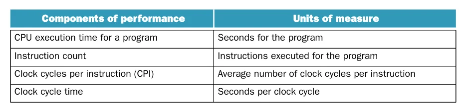

## Computer Classes

### Traditional Classes

**PC**(personal computer)是为个人用户进行设计，致力于为个人用户以较低的成本提供不错的性能，通常运行第三方软件。包含显示器、键盘和鼠标

**服务器**(server)是用于为多用户运行大型程序的计算机，通常只能通过网络访问

服务器包含了相当广泛的成本与能力不同的计算机，其中低端的服务器一般用于文件存储，小型的商业应用以及网络服务。而另一个极端则是**超级计算机**(supercomputer)，通常用于科学与工程计算

**嵌入式计算机**(embedded computer)是在另一个设备中运行预先定义的应用或者一组软件的计算机，也是数量最庞大的计算机类别

### Post-PC Era

**个人移动设备**(personal mobile device, PMD)通常包括智能手机和平板，其通过无线设备连接互联网，使用电池供电，使用触屏作为输入

## Seven Great Ideas

- 使用**抽象**简化设计(use abstraction to simplify design)
- 加速经常性事件(make common case fast)
- 通过**并行**提高性能(performance via parallelism)
- 通过**流水线**提高性能 (performance via pipeline)
- 通过**预测**提高性能 (performance via prediction)
- **内存层级**(memory hierarchy)
- 通过**冗余**增加可靠性 (dependability via redundancy)

## Below Your Program

计算机硬件只能执行非常简单的低级指令，从复杂的应用到原始的指令通常会涉及多个层级的翻译。这是抽象的一个例子

下图展示了常见的软件分级方式

**系统软件**(system software)位于应用软件与硬件之间，现代计算机最重要的两类系统软件是**操作系统**(operating system)和**编译器**(compiler)

在用户进程与硬件之间的操作系统接口提供了相当多的功能，其中最重要的功能包括：

- 处理基本的输入输出操作
- 分配存储与内存
- 当多个应用同时使用计算机时提供相应的保护

编译器则将用高级语言编写的程序翻译为硬件可以执行的指令

计算机指令是计算机能够理解和服从的位的集合，可以将其看作是一串二进制数字。由于直接使用二进制指令过于复杂，因此很快便出现了接近人类思考方式的**汇编语言**(assembly language)以及能够将汇编语言的符号翻译为二进制指令（**机器语言**(machine language)）的**汇编器**(assembler)

虽然这已经是一个巨大提升，但汇编语言仍与自然语言相去甚远。因此，出现了**高级语言**(high-level language)以及将高级语言翻译为汇编语言的编译器。下图展示了它们之间的关系

高级语言有以下几个优点：

1. 允许程序员以接近自然语言的方式进行思考
2. 提升了程序员的生产力
3. 使程序独立于开发它的计算机

## The Technology of Building Processors and Memories

计算机的底层硬件执行相同的基本功能：输入数据、输出数据、处理数据以及保存数据

一个计算机的五个组件包括**输入**、**输出**、**存储器**、**数据通路**以及**控制单元**（后两个组件合称为**处理器**）

它们的关系如下图所示

下图展示了不同时期用于构建处理器和存储器的技术以及它们的性价比

**晶体管**(transistor)是由电进行控制的开关，**集成电路**(integrated circuit, IC)是相当多的晶体管组合在一个芯片中。为了突出晶体管数量的巨大进步，新的术语**超大规模集成电路**(very large-scale integrated circuit, VLSI)被创造

下图展示了集成电路的大致生产过程

**硅锭**(silicon ingot)将被切为厚度不超过0.1英寸的**晶圆**(wafer)，然后经过一系列步骤得到**图案化晶圆**(patterned wafer)，这些步骤可能会损坏晶圆，被称为**缺陷** (defects)，因此将晶圆切分为独立的矩形**晶粒**(die)，也被称为**芯片**(chip)

可以使用下面三个公式计算集成电路的成本

$$
\begin{aligned}
\text{Cost per die}&=\frac{\text{Cost per wafer}}{\text{Dies per wafer}\times\text{yield}} \\\\
\text{Dies per wafer}&\approx\frac{\text{Wafer area}}{\text{Die area}} \\\\
\text{Yield}&=\frac{1}{(1+(\text{Defects per area}\times\text{Die area}))^N}
\end{aligned}
$$

> 其中 $N$ 为经验参数，通常取 4

## Performance

### Defining Performance

通常需要使用不同的方式来衡量计算机的性能

个人计算机用户更在意从开始到完成一个任务的时间，即**响应时间**(response time)或**执行时间**(execution time)；而数据中心则更关注一段时间内完成的总任务数量，即**吞吐量**(throughput)或**带宽**(bandwidth)

减少响应时间通常会提高吞吐量，改变响应时间或者吞吐量的其中一个通常会影响另一个

在目前我们只考虑响应时间，因此可以将性能定义为
$$
\text{Performance}_X=\frac{1}{\text{Execution time}_X}
$$
这意味着如果计算机 X 的性能大于计算机 Y ，那么 X 的执行时间小于 Y

如果 X 的性能比 Y 快 $n$ 倍，则
$$
\frac{\text{Performance}_X}{\text{Performance}_Y}=\frac{\text{Execution time}_Y}{\text{Execution time}_X}=n
$$

!!! note "更快的含义"
    "X 比 Y 快 $n$ 倍"指的是 X 的执行时间是 Y 的 $1/n$，而不是执行时间缩短了 $n$ 倍

### Measuring Performance

时间是衡量计算机性能的指标，其中**运行时间**(elapsed/wall clock/response time)是完成任务的总耗时，包括磁盘和内存的访问、I/O 操作等

**CPU 时间**是进行一个任务时 CPU 进行计算的时间，不包括等待 I/O 或者其他程序的时间

CPU 时间进一步可以分为用户 CPU 时间（程序运行花费的时间）和系统 CPU 时间（执行与该程序相关的操作系统任务的耗时）

### CPU Performance and Its Factors

**时钟周期**(clock cycle)通常是处理器时钟的时间，以恒定的速度运行，**时钟频率**(clock rate)是时钟周期的**倒数**

CPU 时间和时钟周期以及时钟频率满足如下的关系
$$
\begin{aligned}
\text{CPU execution time for a program}&=\text{CPU clock cycles for a program}\times \text{Clock cycle time} \\\\
&=\frac{\text{CPU clock cycles for a program}}{\text{Clock rate}}
\end{aligned}
$$

上面的公式说明可以通过下面几种方法提高性能：

- 减少程序需要的时钟周期数
- 减少时钟周期的长度
- 减少其中一个因素，就有可能会增加另一个因素，所以需要权衡两者的关系

程序的执行时间一定取决于这个程序的指令数量，一个程序所需要的 CPU 时钟周期数可以表示为
$$
\text{CPU clock cycles}=\text{Instructions for a program}\times\text{Average clock cycles per instruction}
$$

术语 **CPI**(clock cycles per instruction)是执行每条指令所需的平均时钟周期数，整个程序的 CPI 可以用程序的总时钟周期数除以总指令数得到。CPI 提供了一种比较同一指令集的不同实现性能的方式
$$
\begin{aligned}
\text{CPU time}&=\text{Instruction count}\times\text{CPI}\times\text{Clock cycle time} \\\\
&=\frac{\text{Instruction count}\times\text{CPI}}{\text{Clock rate}}
\end{aligned}
$$

$$
\text{Time}=\text{Seconds/Program}=\frac{\text{Instructions}}{\text{Program}}\times\frac{\text{Clock cycles}}{\text{Instruction}}\times\frac{\text{Seconds}}{\text{Clock cycle}}
$$

以下几个因素可以决定性能：

- 算法
- 编程语言、编译器和架构
- 处理器和内存系统
- I/O 系统（硬件和操作系统）

!!! info "MIPS"

## Power Wall

CMOS 是集成电路上最常用的工艺，它的能耗主要来自于**动态能耗**(dynamic energy)：晶体管在高低电平之间切换的时候会消耗能量。动态功耗与以下因素相关
$$
\text{Power} \propto \frac{1}{2} \times \text{Capacitive load} \times \text{Voltage}^2 \times \text{Frequency switched} 
$$
降低电压会让晶体管变得更容易漏电，这会造成更多的功耗。如果晶体管开始更多地泄漏，整个工艺可能会变得难以控制。

!!! note "功耗与能耗"
    **能耗**(energy)等于**功耗**(power)乘以时间。即使功耗不变，缩短执行时间也能降低总能耗，因此性能与能效并不是相互独立的目标

## Pitfalls and Fallacies

!!! bug "Fallacy"
    - 计算机在低负载时耗电很少
    - 性能和能效是两个不相关的目标

!!! failure "Pitfall"
    - 期望某个方面的改进能让整体性能提高，并且幅度与改进的大小成正比。

    Amdahl 定理说明某项改进所能带来的性能提升取决于该改进功能的使用程度
    $$
    \begin{aligned}
    \text{Execution time after improvement}=\frac{\text{Execution time affected by improvement}}{\text{Amount of improvement}} +\text{Execution time unaffected}
    \end{aligned}
    $$

    - 使用性能方程的一个子集作为性能指标

