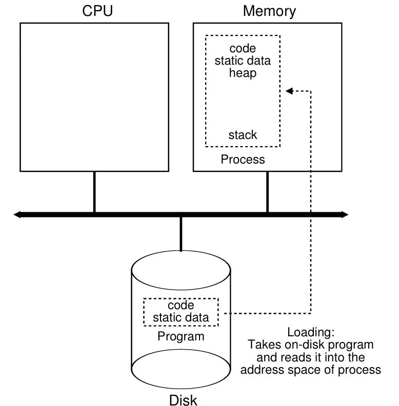
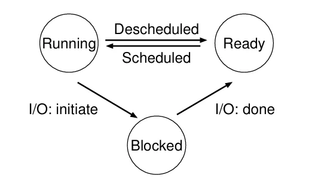
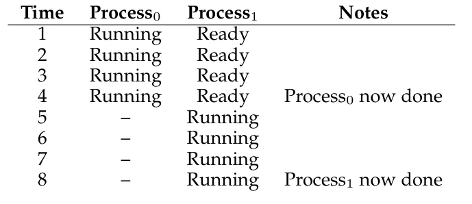
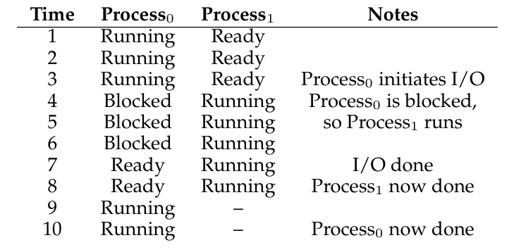
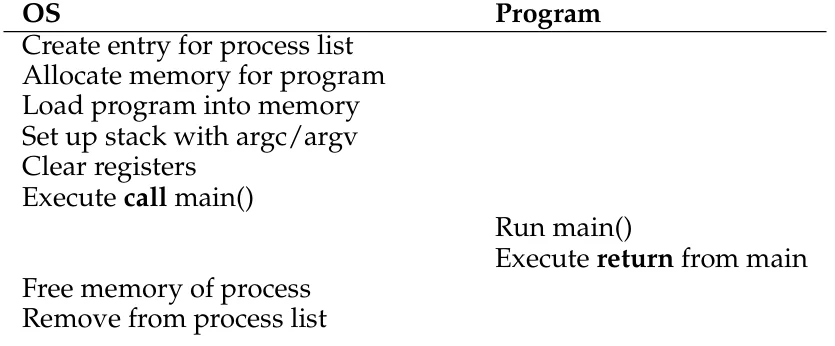
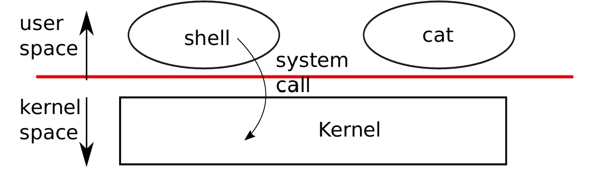
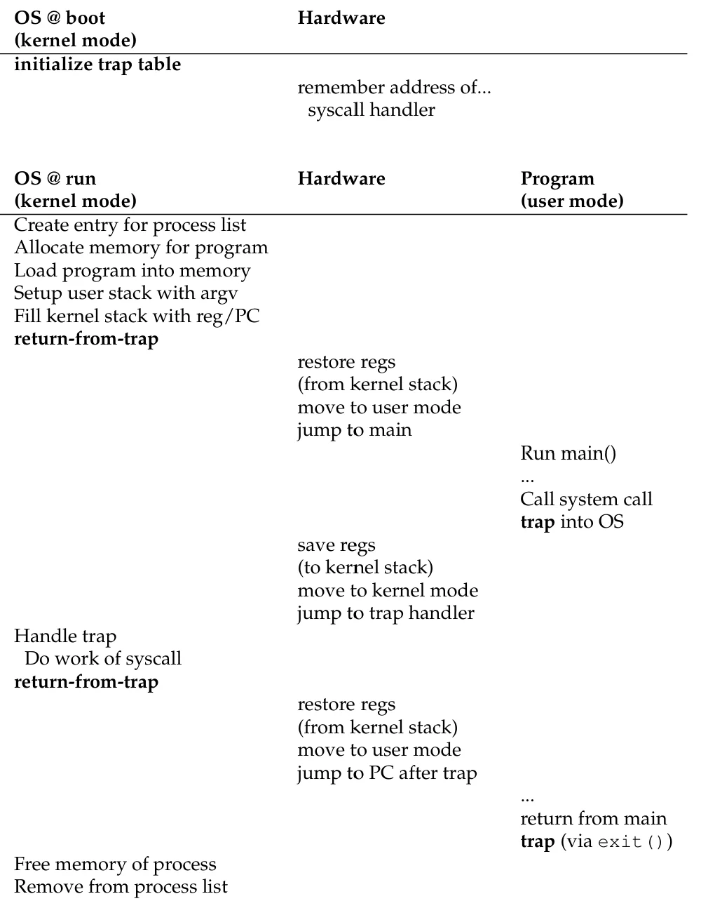
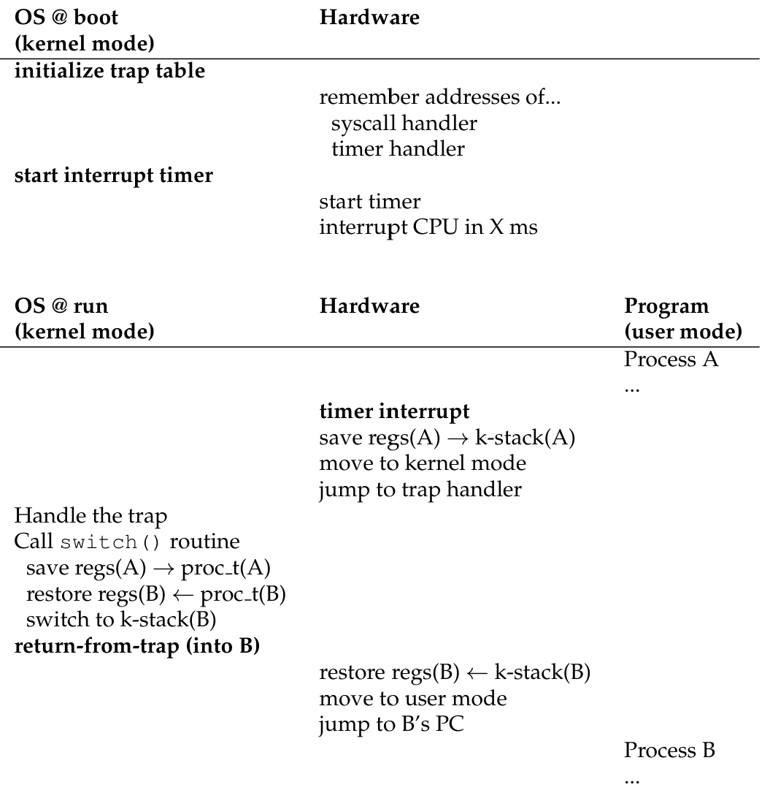

## The Abstraction: Process

**进程**(process) 的非正式定义是正在运行的程序，是操作系统提供的最基本的抽象。操作系统通过**虚拟化**(virtualization)CPU 创造出几乎有无限个 CPU 可用的假象。

**时分共享**(time-sharing)通过运行一个进程，然后停止该进程并运行另一个进程，不断重复这个过程从而创造出存在相当多虚拟 CPU 的假象。时分共享的潜在代价是性能，共享 CPU 会导致单个程序运行得更慢

!!! info "时分共享与空分共享"
    **时分共享**通过让一个项目使用一段时间资源，然后切换另一个项目，以此类推，实现资源共享

    **空分共享**将空间分为多个部分，供不同的任务进行使用

进程的**机器状态**(machine status)是进程的组成部分，主要包括

- **地址空间**(address space)
- 寄存器（包括一些特殊的寄存器，如程序计数器 `pc`、栈指针 `sp`、帧指针 `fp`）
- I/O 信息

## Process Create

程序通常以一个**可执行格式**(executable format)保存在硬盘（闪存）中，为了运行一个程序，操作系统首先需要将程序的**代码**和**静态数据**加载到内存中（即该进程的地址空间），过程如下图所示



> 早期的操作系统通常会将程序的所有内容加载到内存，而现代操作系统使用**懒加载**(lazy)，只加载程序执行所需要的内容

然后，操作系统需要进行一些初始化操作，例如：为程序分配**栈**和**堆**，完成与 I/O 相关的操作

最后，操作系统跳转到该程序的起始处（`main()`），将控制权交给新创建的进程，并开始运行该程序

!!! note "机制与策略"
    **机制**(mechanism)用来实现所需功能的低级方法或协议  
    **策略**(policy)是操作系统做出决定所需的算法

    操作系统通常会采用**模块化**设计，将高级策略与低级机制进行分离。这允许在不改变机制的情况下重新设计策略

## Process Status

对于一个简化的情况，一个进程在给定的时间存在三种状态：

- **运行**(running)：程序正在处理器上运行，即正在执行指令
- **就绪**(ready)：程序已经准备运行但出于某些原因操作系统并没有选择运行它
- **阻塞**(blocked)：程序执行了某些操作，直到某些事件的发生才会准备运行




从就绪到运行意味着该进程被**调度**(scheduled)，而从运行到就绪意味着该进程被**取消调度**(descheduled)

> 当一个进程已经退出，但父进程还没有通过 `wait()` 读取它的退出状态时，则称该进程处于**僵尸状态**(zombie state)。此时进程的内存等资源已被释放，仅在进程表中保留一项以保存退出状态

!!! example "例子"
    

    

即使是在这个简单的例子中，操作系统也需要决定相当多的内容

1. 操作系统需要在 $\text{Process}_0$ 发起 I/O 操作时运行 $\text{Process}_1$ ，使 CPU 保持繁忙从而提高资源利用率
2. 操作系统决定在 I/O 操作完成时不切换回 $\text{Process}_0$

## Data Structures

操作系统需要记录每个进程的状态，因此需要维护一些用于追踪进程的数据结构，例如记录所有进程的**进程列表**(process list)

每个进程的信息被保存在一个被称为**进程控制块**(process control block, PCB)的结构体中，其中通常包含

- **寄存器上下文**(register context)：进程被暂停时保存其寄存器内容，以便之后恢复运行
- 进程的**状态**(running / ready / blocked)
- 进程号(**PID**)、父进程、打开的文件、地址空间等信息

下面是xv6 中的进程控制块 `struct proc`：
```c
// Saved registers for kernel context switches.
struct context {
  uint64 ra;
  uint64 sp;

  // callee-saved
  uint64 s0;
  uint64 s1;
  uint64 s2;
  uint64 s3;
  uint64 s4;
  uint64 s5;
  uint64 s6;
  uint64 s7;
  uint64 s8;
  uint64 s9;
  uint64 s10;
  uint64 s11;
};

enum procstate { UNUSED, USED, SLEEPING, RUNNABLE, RUNNING, ZOMBIE };

// Per-process state
struct proc {
  struct spinlock lock;

  // p->lock must be held when using these:
  enum procstate state; // Process state
  void *chan;           // If non-zero, sleeping on chan
  int killed;           // If non-zero, have been killed
  int xstate;           // Exit status to be returned to parent's wait
  int pid;              // Process ID

  // wait_lock must be held when using this:
  struct proc *parent; // Parent process

  // these are private to the process, so p->lock need not be held.
  uint64 kstack;               // Virtual address of kernel stack
  uint64 sz;                   // Size of process memory (bytes)
  pagetable_t pagetable;       // User page table
  struct trapframe *trapframe; // data page for trampoline.S
  struct context context;      // swtch() here to run process
  struct file *ofile[NOFILE];  // Open files
  struct inode *cwd;           // Current directory
  char name[16];               // Process name (debugging)
};
```

## Process API

**UNIX**操作系统提供以下几类进程 API

=== "`fork()`"
    可以使用 `fork()` 系统调用来创建新的进程。`fork()` 会创建一个与父进程几乎完全相同的子进程：它会复制父进程的地址空间、寄存器等状态，因此子进程从 `fork()` 之后的位置开始执行

    `fork()` 在父进程中返回子进程的 **PID**，而在子进程中返回 `0`，程序可以通过返回值区分父子进程。同时，父子进程的执行顺序是不确定的，操作系统会根据调度策略来决定哪个进程先执行

=== "`exec()`"
    可以使用 `exec()` 系统调用来替换当前进程的代码和数据。`exec()` 会将指定的可执行文件加载到当前进程的地址空间中，替换当前进程的代码和数据。它并**没有创造**新的进程，而是将当前运行的程序替换为另一个新的程序。`exec()` 调用成功时不会返回，失败时返回 -1

=== "`exit()`"
    可以使用 `exit()` 系统调用来终止当前进程。`exit()` 可以携带一个**退出状态**(exit status)作为参数，用于向父进程传递执行结果

    进程退出后，其占用的内存、打开的文件等资源会被操作系统回收，但退出状态会一直保留，直到父进程通过 `wait()` 读取为止

=== "`wait()`"
    可以使用 `wait()`（或 `waitpid()`）系统调用来等待子进程结束。`wait()` 推迟父进程的执行，直到某个子进程退出或停止后才返回

    `wait()` 返回已结束子进程的 **PID**，并可以通过参数获得该子进程的**退出状态**，从而得知子进程是正常退出还是异常终止

=== "`kill()`"
    可以使用 `kill()` 系统调用来向指定进程发送**信号**(signal)

    进程可以根据收到的信号做出不同的反应：`SIGTERM` 请求进程正常终止，`SIGKILL` 强制立即终止进程，`SIGSTOP` 和 `SIGCONT` 则分别用于暂停和恢复进程

## Limited Direct Execution

操作系统通过时分共享在多个正在运行的任务之间共享物理 CPU ，从而虚拟化 CPU。这会导致两个问题：一是**性能**，二是**控制权**

**受限直接执行**(limited direct execution, LDE)可以在保持控制权的同时获得高性能。直接执行的部分表示程序直接在 CPU 上运行，当操作系统开始执行一个程序时，它将在进程列表中创建一个进程条目，并[创建进程](#process-create)。整个过程如下图所示（没有限制）



上面的过程引出了两个新的问题

!!! question "直接执行的问题"
    1. 操作系统如何确保程序不会执行我们不希望它执行的操作
    2. 操作系统如何停止进程并切换到另一个进程从而实现虚拟化

受限的部分为这两个问题提供了解决方案

### Restricted Operations

通过引入处理器模式的方法来确保程序执行受限操作（如发起 I/O）时不会影响其他进程

- **用户模式**(user mode)：进程不能完全访问硬件资源，当进程执行受限操作时会导致处理器发出异常
- **内核模式**(kernel mode)：其可以访问机器的全部资源并且执行一些特权操作

> 操作系统运行在内核模式

为了让用户模式的进程能够执行一些特权操作，操作系统通过**系统调用**(system call)将一些关键功能暴露给用户模式的进程，例如访问文件系统，创建和销毁进程，与其他进程交流以及分配更多内存。每个系统调用拥有一个**系统调用号**(system call number)用以区分，用户代码需要将对应系统调用号放在寄存器或者栈的指定位置。操作系统在陷阱处理程序中处理系统调用时，会检查这个编号是否有效，如果有效则执行相应的代码

程序通过执行特殊的**陷阱**(trap)指令来执行系统调用，这条指令将同时跳转到内核并进入内核模式。当系统调用结束之后，操作系统调用一个特殊的**从陷阱返回**(return-from-trap) 指令返回发起调用的程序并回到用户模式



操作系统在启动时会告诉硬件当发生异常时应该运行什么代码（陷阱处理程序），同时内核会在启动时设置**陷阱表**(trap table)，而设置陷阱表本身是一种**特权操作**



从图中可以看出，LDE 的过程可以分为两个阶段

- 操作系统**启动**时，内核会初始化陷阱表，CPU 会保存陷阱处理程序的地址
- 操作系统**运行**时：程序通过系统调用陷入内核，进入内核模式；在执行完相应的操作后，操作系统调用**从陷阱返回**(return-from-trap) 指令返回发起调用的程序并回到用户模式

### Switching Between Processes

当一个程序在 CPU 上运行时，此时，操作系统并没有在运行。那么操作系统应该如何实现进程切换？

- **协作方式**(cooperative)：等待系统调用

    早期的操作系统相信进程运行良好，当程序运行足够长的时间时会放弃 CPU 让操作系统做一些其他任务。大多数进程应该**通过系统调用**将 CPU 控制权转交给 OS（比如 `yield`），当应用进行了一些非法操作时也会将控制权交给 OS 

    当程序进入**死循环**时，此时操作系统没有办法获得控制权，只能**重启**(reboot)系统

- **非协作方式**：OS 进行控制

    非协作方式会设置一个**计时器**(timer)，每隔几毫秒发起一次**时钟中断**(timer interrupt)，此时当前正在运行的进程将停止，操作系统内部预先定义的**中断处理函数**会将控制权转移给操作系统

    操作系统在启动时会设置当中断发生时应该执行的代码，同时启动计时器（计时器也可以关闭，开关计时器均为特权操作）

---

在操作系统获得控制权后，**调度器**(scheduler)会决定是继续运行当前运行的进程，还是切换至另一个进程

如果决定切换进程，操作系统需要执行**上下文切换**(context switch) ，保存**当前执行进程**的一些寄存器值（包括通用目的寄存器、PC、内核栈指针等），并恢复**将要执行进程**的一些寄存器值，这样能确保在执行完从陷阱返回指令后，系统继续执行的是另一个进程。

??? tip "xv6 上下文切换的实现"
    ```asm
    .globl swtch
    swtch:
            sd ra, 0(a0)
            sd sp, 8(a0)
            sd s0, 16(a0)
            sd s1, 24(a0)
            sd s2, 32(a0)
            sd s3, 40(a0)
            sd s4, 48(a0)
            sd s5, 56(a0)
            sd s6, 64(a0)
            sd s7, 72(a0)
            sd s8, 80(a0)
            sd s9, 88(a0)
            sd s10, 96(a0)
            sd s11, 104(a0)
    
            ld ra, 0(a1)
            ld sp, 8(a1)
            ld s0, 16(a1)
            ld s1, 24(a1)
            ld s2, 32(a1)
            ld s3, 40(a1)
            ld s4, 48(a1)
            ld s5, 56(a1)
            ld s6, 64(a1)
            ld s7, 72(a1)
            ld s8, 80(a1)
            ld s9, 88(a1)
            ld s10, 96(a1)
            ld s11, 104(a1)
            ret
    ```

下图展示了时钟中断的时间线：



在协议中保存 / 恢复寄存器有两种情况：

- 时钟中断时：运行进程的用户寄存器被保存在硬件中
- OS 决定切换进程时：内核寄存器被显式保存在软件中（即 OS）

### Concurrency

在处理中断时发生中断会发生什么？这涉及了后面将会讨论的内容：**并发**(concurrency)

这个问题有两种解决办法

1. 在处理中断时直接关闭计时器从而禁用中断
2. 通过**锁**(lock)保护内部数据结构的并发访问，使得多个活动能在内核中同时进行