在[之前的章节](1.md)中介绍了进程这一抽象背后的**机制**，而本节关注的是相应的**策略**：当多个任务竞争 CPU 时，操作系统应该按照什么顺序运行它们，即**调度策略**(scheduling policy)

## Workload Assumptions

首先来看一些能够简化分析难度的假设，这些假设与系统中运行的进程有关，这些进程有时统称为**工作负载**(workload)。确定工作负载是构建调度策略的关键

这里对操作系统中运行的进程（也称为**任务**(jobs)）做出如下假设：

1. 每个任务的执行时间相同
2. 所有任务同时到达
3. 所有任务一旦开始就会运行到结束为止
4. 所有任务只使用 CPU（即没有 I/O 操作）
5. 每个任务的运行时间是已知的

虽然这些假设看起来有一些不切实际，但是已经足以说明问题，我们会在后面一步步放松这些假设

## Scheduling Metrics

在做出以上假设之后，还需要一个指标来比较不同的调度方式。同样，为了保持简单，这里使用**周转时间**(turnaround time)作为指标
$$
T_{\text{turnaround time}}=T_{\text{completion}}-T_{\text{arrival}}
$$

上面已经假设了所有任务同时到达，因此 $T_{\text{arrival}}=0$ ，那么 $T_{\text{turnaround time}}=T_{\text{completion}}$

周转时间是一个性能指标，另一个需要关注的指标是**公平性**(fairness)，可以使用 **Jain 公平性指数**(Jain's fairness index)进行测量

除此之外，**响应时间**(response time)也是一个衡量调度方法的指标，它是任务从到达系统到第一次被执行的时间，即
$$
T_{\text{response time}}=T_{\text{first run}}-T_{\text{arrival}}
$$

## First in, First out (FIFO)

最基本的调度算法是 **FIFO**(first in, first out)或 **FCFS**(first come, first served)

FIFO 相当简单并且易于实现，下面来看一个简单的例子

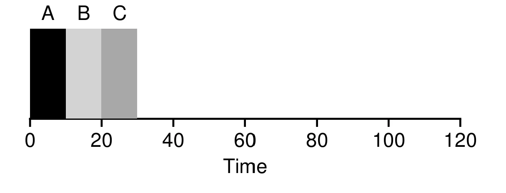

假设有三个任务 $A,B,C$ 按照如上图的顺序执行，$A$ 在 10 s 时结束，$B$ 在 20 s 时结束，$C$ 在 30 s 时结束。它们的平均周转时间为 $\frac{10+20+30}{3}=20$

接下来，我们放宽上面的第一条假设，现在每个任务的执行时间不同。下面这个例子展示了 FIFO 的不足之处

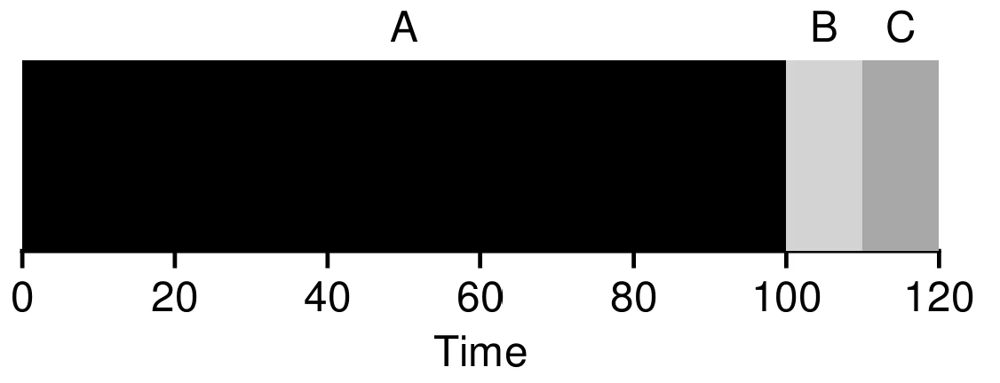

此时， $A$ 在 100 s 时结束，而 $B$ 在 110 s 时结束，$C$ 在 120 s 时结束。它们的平均周转时间为 $\frac{100+110+120}{3}=110$

这种短任务被迫排在长任务之后等待的问题通常被称为**护航效应**(convoy effect)

## Shortest Job First (SJF)

可以使用**最短任务优先**(shortest job first, SJF)来解决这个问题，它会先运行最短的任务，然后运行第二短的任务，以此类推

上面的例子在使用 SJF 时的情况如下

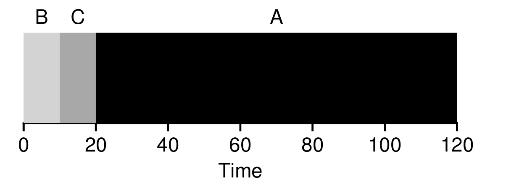

此时， $B$ 在 10 s 时结束，而 $C$ 在 20 s 时结束，$A$ 在 120 s 时结束。它们的平均周转时间为 $\frac{10+20+120}{3}=50$ 。SJF 的结果远好于 FIFO

在假设所有任务同时到达的情况下，SJF 确实是最佳的调度方法。现在，放宽上面的第二条假设，每个任务的到达时间各不相同。下面是一个例子

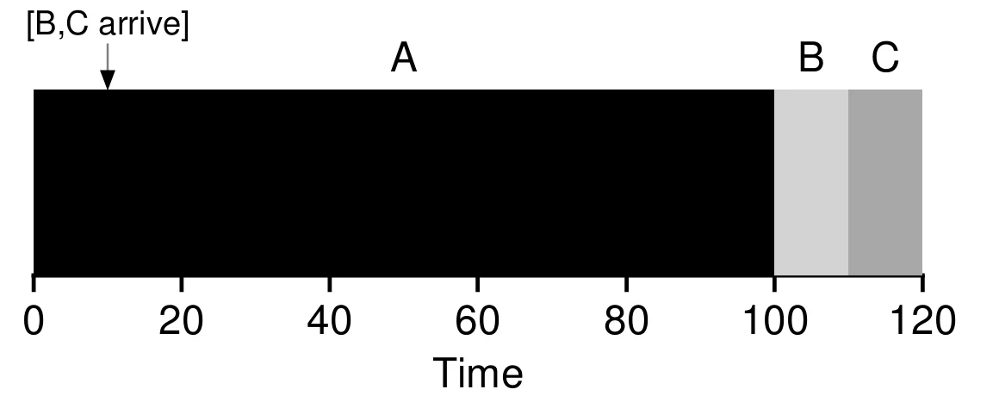

从上图可以看到，虽然 $B,C$ 的运行时间更短，但还是要等到 $A$ 运行完它们才能运行，平均周转时间为 $\frac{100+(110-10)+(120-10)}{3}\approx103.33$

## Shortest Time-to-Completion First (STCF)

为了解决 SJF 的问题，我们需要放宽上面的假设 3 ，即所有任务一旦开始就会运行到结束为止

使用之前介绍的时钟中断和上下文切换，当任务 $B$ 到达时，调度器停止运行 $A$ 并开始运行 $B$ ，这被称为**最短完成时间优先**(Shortest Time-to-Completion First, STCF)

当一个新任务到达时，STCF 会运行所有任务中剩余时间最短的任务，如下图所示

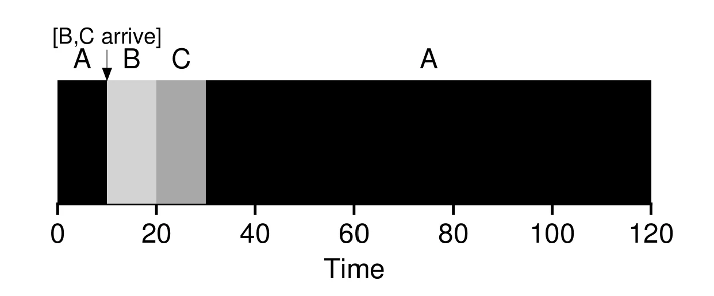

当 $B,C$ 到达时，调度器会先运行 $B$ 再运行 $C$，而不是等待 $A$ 运行结束再运行 $B,C$ 。此时，平均周转时间为 $\frac{(120-0)+(20-10)+(30-10)}{3}=50$

在当前的假设下，STCF 是最佳的调度方法

## Round Robin

STCF 的响应时间表现不佳，为解决这个问题，需要设计一种新的调度算法

让每个任务运行一个**时间片**(time slice)，然后切换到任务队列中的另一个任务，这被称为**轮转**(round robin, RR)

> 时间片的长度必须为时钟中断周期的整数倍

下面来看一个例子，假设任务 $A,B,C$ 同时到达并且需要运行 5 s ，而时间片的长度是 1 s，则如下图所示（上面是 SJF, 下面是 RR）

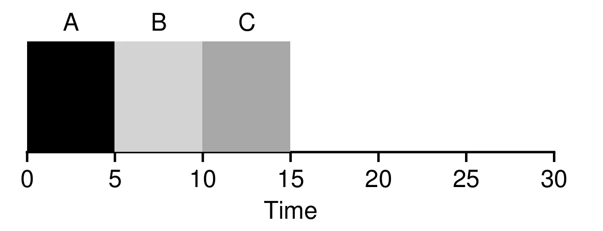    

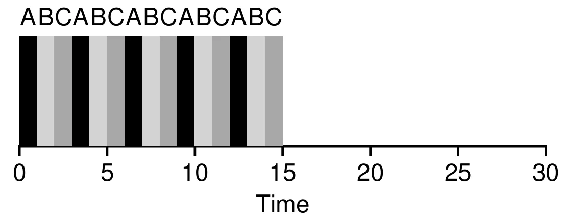

可以看到，SJF 的平均响应时间为 $\frac{0+5+10}{3}=5$ ，而 RR 的平均响应时间为 $\frac{0+1+2}{3}=1$
但是 RR 在周转时间上表现非常差，在上面的例子中，SJF 的平均周转时间为 $\frac{5+10+15}{3}=10$ ，而 RR 的平均周转时间为 $\frac{13+14+15}{3}=14$

时间片的长度对于 RR 非常重要，时间片长度越短，响应时间越低；但是，如果时间片长度过短，上下文切换的成本会显著增加。因此，选择时间片长度时需要权衡响应时间和上下文切换的成本

!!! tip "周转时间与响应时间的权衡"
    到现在为止，我们已经看到了两类调度方法：

    - 优化周转时间但响应时间差：SJF, STCF
    - 优化响应时间但周转时间差：RR

## Incorporating I/O

现在放宽上面的第 4 条假设，任务不仅运行在 CPU 上，还会涉及 I/O

当进程发起 I/O 请求时它不需要使用 CPU ，此时该进程被**阻塞**(blocked)以等待 I/O 完成。调度器需要做出决定，让另一个进程运行。当 I/O 完成时，会发生中断，操作系统会将进程的状态由阻塞变为就绪，调度器也需要决定运行哪一个进程

假设有两个需要 50 ms CPU 时间的任务 $A$ 和 $B$，其中 $A$ 每运行 10 ms 需要执行 10 ms 的 I/O 操作。调度器先运行 $A$ 再运行 $B$ ，如下图

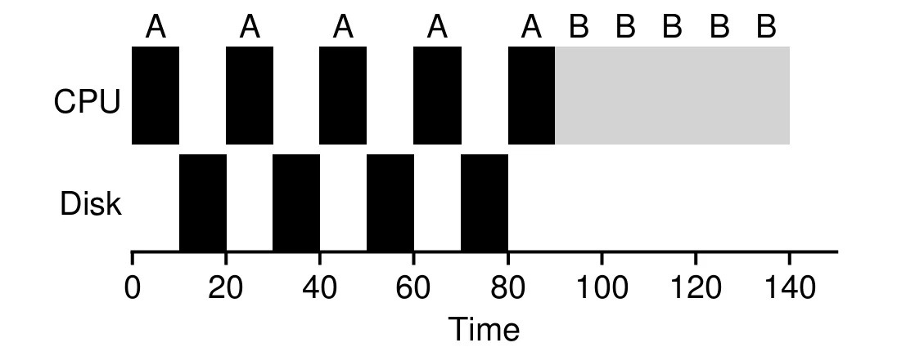

在上面的例子中 $A$ 的 CPU 时间被分成了 5 份，可以将每个 10 ms 的子任务看作是 5 个独立的任务，便可以得到下面的情况

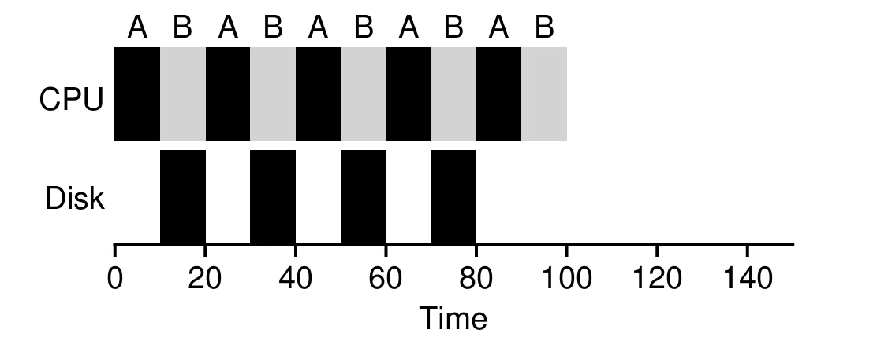

在任务 $A$ 等待 I/O 完成时，CPU 会执行任务 $B$。两个任务的**重叠**(overlap)可以更好地利用系统资源

## Multilevel Feedback Queue (MLFQ)

现在来看最后一个假设，通常情况下，操作系统并不知道任务的执行时间。

**多级反馈队列**(multilevel feedback queue, MLFQ)尝试解决两个问题：

- 优化周转时间
- 最小化响应时间

### Basic Rules

MLFQ 有多个**优先级**(priority level)的队列，在任意时刻，一个任务只存在于某一个队列中。MLFQ 会根据优先级决定运行哪个任务：高优先级的任务先执行；对于多个同优先级的任务，使用**轮转**执行这些任务

可以将这两条规则总结为

1. 如果 Priority(A) > Priority(B)，则运行 A 而不运行 B
2. 如果 Priority(A) = Priority(B)，A 和 B 通过轮转的方式运行

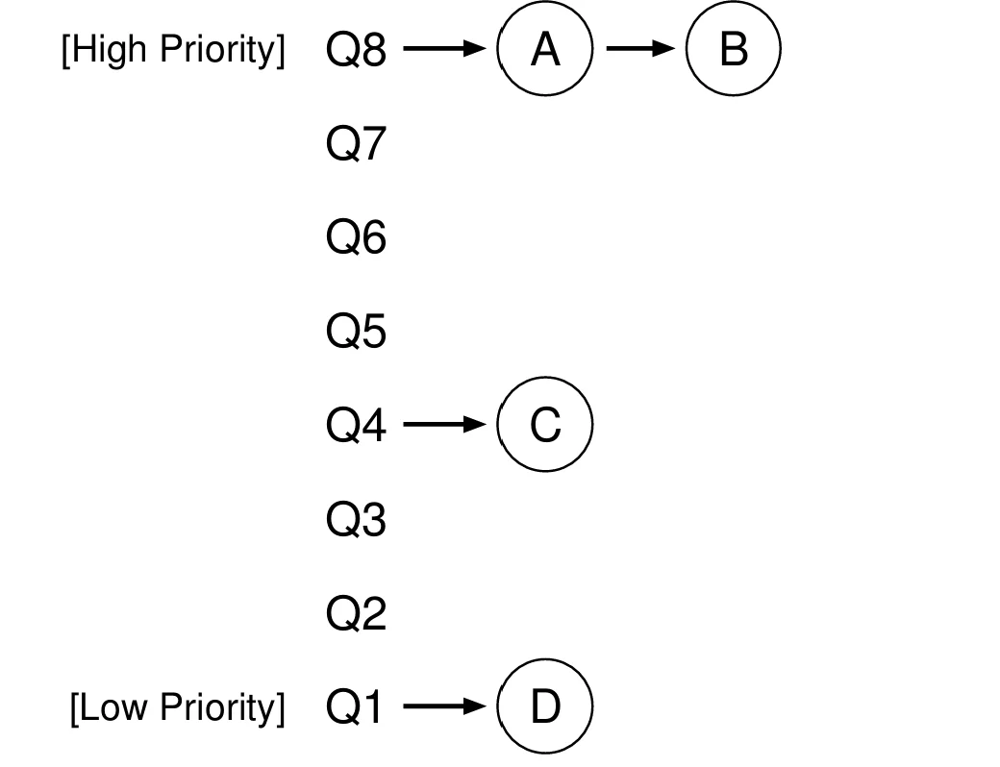

MLFQ 的关键在于设置优先级，每个任务的优先级会根据它的行为而变化。MLFQ 会尝试在进程运行时进行学习，根据进程之前的行为预测其未来的行为

### Change Priority

工作负载中既有运行时间短、频繁放弃 CPU 的交互式任务，也有长时间运行的 CPU 密集型任务。因此需要引入一个新的概念**配额**(allotment)来表示在调度器降低任务的优先级之前，其可以在给定优先级上运行的时间

> 为了简化讨论，这里假设配额与单个时间片相等

下面是对于 MLFQ 的第一次尝试：

3. 当一个任务进入系统，将它的优先级设为最高
4. 优先级的调整规则：
    - 当一个任务的配额使用完之后，下调它的优先级
    - 如果一个任务在配额用尽前放弃了 CPU，那么保持它的优先级不变

!!! warning "第一版规则的缺陷"
    按照这四条规则运行，MLFQ 仍然存在以下问题：

    - **饥饿**(starvation)：如果系统中存在相当多的交互式任务，它们将占用所有的 CPU 资源，而长任务得不到 CPU 时间
    - **与调度器博弈**(game the scheduler)：程序可以在配额用尽之前频繁地发起 I/O 或放弃 CPU，使进程保持在高优先级，从而获得更多资源
    - **程序行为随时间改变**：原本长时间运行的进程可能进入交互阶段，但按照目前的方法，它无法与系统中的其他交互式任务一样获得高优先级

### Priority Boost

为了解决上面的三个问题，需要周期性的提升系统中所有任务的优先级：

5. 在一段时间周期 $S$ 后，将系统中所有进程的优先级提升到最高

这条新规则的引入解决了饥饿和程序的行为会随时间改变的问题。
假设系统中有两个交互式任务和一个长任务，左边为不提升优先级的情况，长任务发生了饥饿；右边为周期性（100 ms）提升优先级的情况

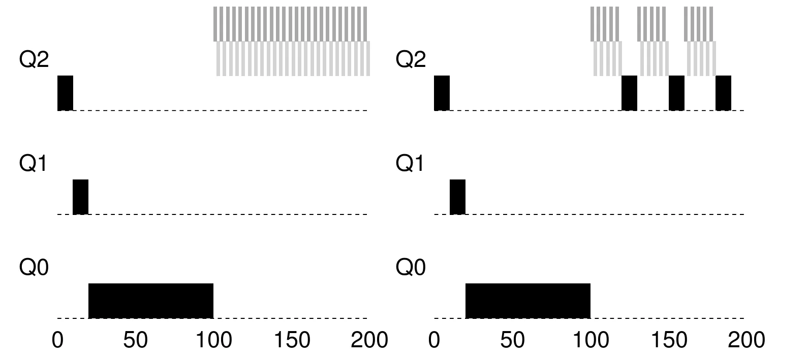

周期 $S$ 被称为 **voodoo 常量**：如果 $S$ 太大，长任务将会饥饿；如果 $S$ 太小，交互式任务无法正常共享 CPU。因此，$S$ 的数值通常由系统管理员设定，或通过**机器学习**来决定

### Better Accounting

现在还剩下最后一个问题，如何防止程序与调度器进行博弈

这个问题的解决方法是在多级反馈队列的每个级别上更好地记录 CPU 时间，将之前 Rule 4 的两条内容重写为

4. 当一个进程用尽了给定优先级的配额，就下调它的优先级（不管它放弃 CPU 多少次）

下图展示了新的规则下进程的运行情况

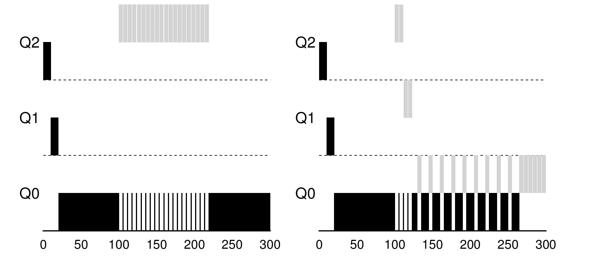

!!! abstract "MLFQ 最终规则"
    1. 如果 Priority(A) > Priority(B)，则运行 A 而不运行 B
    2. 如果 Priority(A) = Priority(B)，A 和 B 通过轮转的方式运行
    3. 当一个任务进入系统，将它的优先级设为最高
    4. 当一个进程用尽了给定优先级的配额，就下调它的优先级（不管它放弃 CPU 多少次）
    5. 在一段时间周期 $S$ 后，将系统中所有进程的优先级提升到最高

### Other Issues

关于 MLFQ 的一个主要问题是如何确定其参数，例如队列的数量、每级队列的时间片长度，以及优先级提升的周期 $S$。这些参数并没有普适的答案，通常需要根据具体的工作负载进行调优

## Proportional Share

### Lottery Scheduling

**比例份额**(proportional-share)调度器是一种确保所有进程能获得一定比例的 CPU 时间的调度器。**彩票调度**(lottery scheduling)是一种经典的比例份额调度算法，通过抽签来决定下一个运行的进程：需要更多 CPU 的进程持有更多彩票，从而有更高的概率中签

在彩票调度中，**彩票数**(tickets)代表了进程应该获得资源的比例

假设有两个进程 $A$ 和 $B$ ，$A$ 有 75 票而 $B$ 有 25 票，这意味着 $A$ 将获得 75%的 CPU 资源，而 $B$ 将获得剩下的 25%。调度器会周期性地进行抽奖选择出获胜的票，在这个例子中，一共有 100 票，调度器会选择一个 [0,99] 的数作为获胜者。假设进程 $A$ 持有 [0,74] 票，进程 $B$ 持有 [75,99] 票

下面是彩票调度获胜票的一个例子：
$$
63, 85, 70, 39, 76, 17, 29, 41, 36, 39, 10, 99, 68, 83, 63, 62, 43, 0, 49, 12
$$

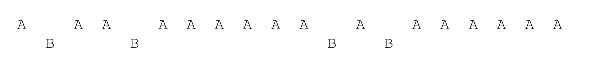

#### Ticket Mechanisms

**彩票货币**(ticket currency)允许拥有一些货币的用户将票分配给它们的任务，操作系统会自动将这些货币转换为全局的彩票数


**彩票转让**(ticket transfer)允许一个进程将自己的彩票临时交给另一个进程。这种机制在客户端/服务端交互的场景中尤其有用，客户端可以将彩票转让给服务端从而加速服务端执行请求的速度。服务端执行结束后会将这部分彩票归还给客户端。

**彩票通胀**(ticket inflation)允许一个进程临时提升或降低自己拥有的彩票数量。在竞争环境中，进程之间互相不信任，这种机制并没有什么意义。但是在进程之间相互信任的环境中，如果一个进程知道它需要更多 CPU 时间，只需要增加自己的彩票，从而在不需要与任何其他进程通信的情况下将自己的需求告知操作系统

#### Implementation

实现彩票机制只需要一个良好的随机数生成器来决定获胜者，一个数据结构（例如链表）用于保存进程和总票数。对于三个票数分别为 100,50,250 的进程 A,B,C ，下面是一种可能的情况

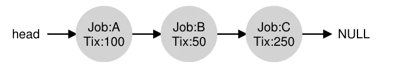

在决定运行进程时，首先从总票数中选择一个获胜者，然后遍历链表找到对应的进程即可。相关代码如下

```c
// counter: used to track if we've found the winner yet
int counter = 0;

// winner: use some call to a random number generator to
//         get a value, between 0 and the total # of tickets
int winner = getrandom(0, totaltickets);

// current: use this to walk through the list of jobs
node_t *current = head;

// loop until the sum of ticket values is > the winner
while (current) 
{
 	counter = counter + current->tickets;
  	if (counter > winner) 
  		break;  // found the winner
  		
  	current = current->next;
} 
 // 'current' is the winner: schedule it...

```

为了保证算法更加高效，可以按照**票数从大到小**的顺序排列链表中的进程

假设有两个运行时间相同($R$)且票数均为 100 的进程，将一个**公平指标**(fairness metric) $F$ 简单定义为两个进程完成时间的比值。当两个进程几乎同时完成时，$F$ 接近 1。因此，一个完全公平的调度器将会实现 $F=1$
下图为任务长度与公平性的关系

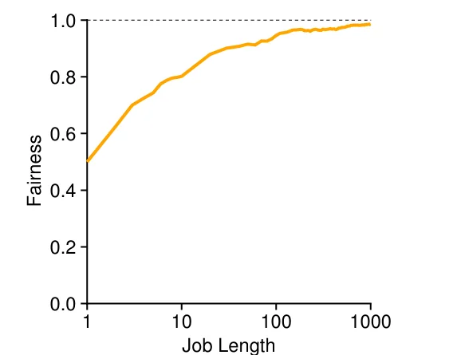

对于一组任务，如何分配票数仍是一个开放问题

!!! info "随机算法的优点"
    彩票调度一大特点是它使用了**随机算法**，随机算法有以下优点：

    1. 随机算法避免了传统算法在边界情况下的错误
    2. 随机算法非常轻量，只需要记录很少的状态
    3. 随机算法非常高效

### Stride Scheduling

**步长调度**(stride scheduling)是一种确定性的公平共享调度器，系统中的每个进程都拥有一个步长，每当进程运行时，就增加它的计数器（**行程值**(pass value)）以记录其总体进展

调度器将会根据步长和行程值选择下一个运行的进程：选择行程值最低的进程。下面是对应的**伪代码**

```c
curr = remove_min(queue); 	// pick client with min pass 
schedule(curr); 				// run for quantum 
curr->pass += curr->stride;  // update pass using stride 
insert(queue, curr); 			// return curr to queue
```

假设有三个步长分别为 100,200,40 的进程 A,B,C ，它们的运行情况如下

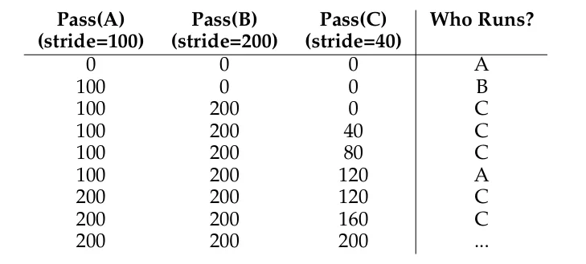


从图中可以看出，C 运行了 5 次、A 运行了 2 次，B 运行了 1 次，运行次数恰好与其步长成反比。彩票调度只能在一段时间之后以概率的方式逼近这个比例，而步长调度可以在每个调度周期后做到完全正确。

但是步长调度需要保存一个全局状态，当一个新的进程进入系统时，不太容易设置它当前的行程值（若将其设为 0，该进程将长期独占 CPU）。而彩票调度则没有这个问题

### Completely Fair Scheduler (CFS)

现代 Linux 实现了一种高效且可扩展的公平调度算法：**完全公平调度**(completely fair scheduler, CFS)。CFS 致力于在非常短的时间内做出调度决策

CFS 通过**虚拟运行时**(vruntime)在所有进程中公平地分配 CPU ，在每个进程运行时，与物理时间（真实时间）成比例的增加该进程的 vruntime ，一般情况下每个进程的**增长速率相同**。调度器会运行 vruntime 最小的进程

如果 CFS 太过频繁的切换进程，公平性会上升，但是性能会因上下文切换的成本而下降；
反之，性能将会提升，但是公平性会因此下降

CFS 通过多个控制参数来决定进程切换的频率：

- `sched_latency`：CFS 使用这个值来确定在切换进程之前进程的运行时间，通常设置为 48 ms。CFS 会将 `sched_latency` 除以 CPU 上的进程数从而得到每个进程的时间片

!!! example "例子"
    假设有 4 个进程 A,B,C,D,那么每个进程的时间片为 $48 ms / 4 = 12 ms$.假设在 100ms 时CD两个进程执行完成，那么剩余的 A,B 两个进程的时间片为 $24 ms$ 如下图所示

    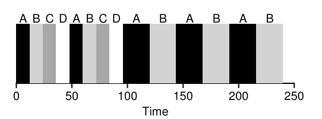

- `min_granularity`：用于解决进程太多导致时间片太小的问题，通常设置为 6 ms。CFS 计算出的时间片不会小于这个值

CFS 利用了周期性的时钟中断，这意味着调度器必须在固定的时间内做出决策

CFS 通过 UNIX 的**进程优先级**(nice level)机制允许特定的进程获得更多的系统资源。进程优先级可以被设置为一个 -20 到 19 的整数，默认为 0 ，**数字越小优先级越高**，数字越大优先级越低

假设有 $n$ 个进程，可以使用下面的公式计算出该进程的时间片

$$
\text{time\_slice}_k=\frac{\text{weight}_k}{\sum_{i=0}^{n-1}\text{weight}_i}\cdot\text{sched\_latency}
$$

CFS 使用下面的公式计算进程的 vruntime
$$
\text{vruntime}_i=\text{vruntime}_i+\frac{\text{weight}_0}{\text{weight}_i}\cdot\text{runtime}_i
$$

CFS 使用**红黑树**来保存进程，并且只保存正在运行的进程。如果一个进程不在运行，那么将被移除并保存在其他地方。CFS 会将刚刚被唤醒的进程的 vruntime 设置为树中最小的 vruntime，防止该进程独占 CPU

## Multiprocessor Scheduling (TODO)

