## Address Space

早期的操作系统并没有为内存提供太多的抽象，机器上物理内存的布局类似下图

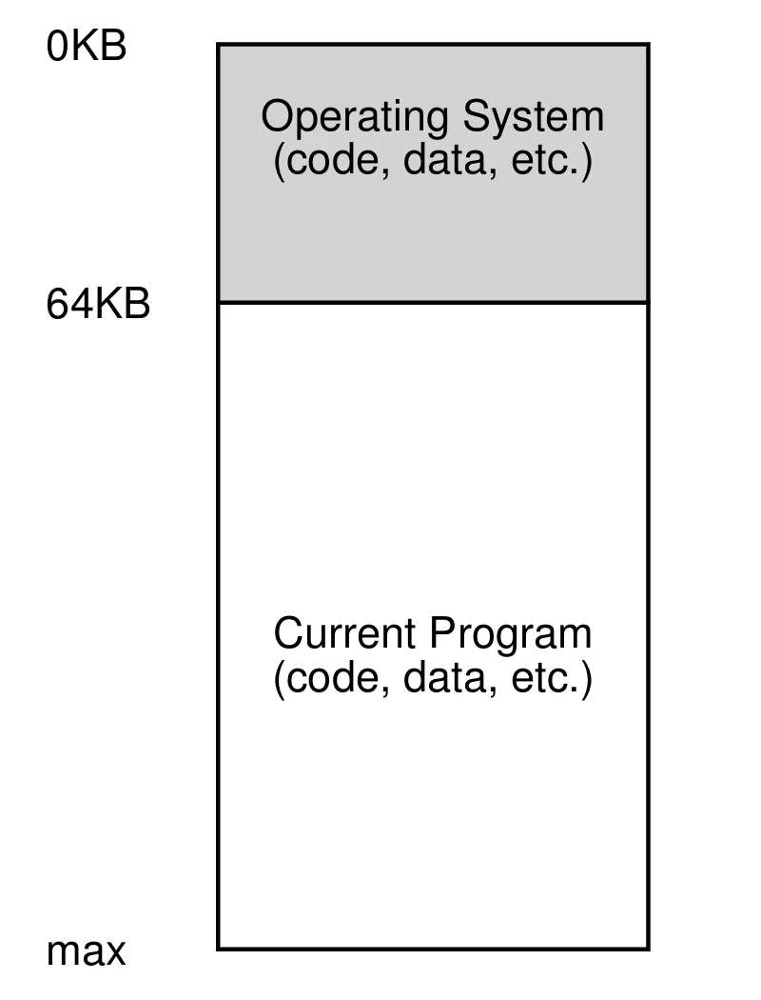{width="300px"}

此时的操作系统只是一些驻留在内存中的库函数，而当前正在运行的程序则占据剩下的内存

在这之后出现了**多道程序**(multiprogramming)，即内存中同时存在多个等待运行的程序，操作系统会在它们之中进行切换。这种方法提升了 CPU 的利用率

然后，随着时分共享的出现，多个用户开始同时使用计算机，**交互性**(interactivity)因此变得越来越重要

一种实现时分共享的方式是运行一个程序一段时间，然后暂停并将其全部状态保存到硬盘中。接着，从硬盘中加载另一个程序的状态并开始运行。但是这种方法**太慢**了

为了更高效地实现时分共享，操作系统将需要切换的进程留在内存中。对于一个单 CPU 系统来说，当 OS 运行一个程序时，其他程序则在就绪队列中等待运行。当操作系统需要切换到另一个进程时，只需要将当前运行的进程的上下文保存到栈中，然后将下一个进程的上下文从栈中加载到寄存器中。假设系统中有 $A,B,C$ 三个程序，其在内存上的布局类似于下图

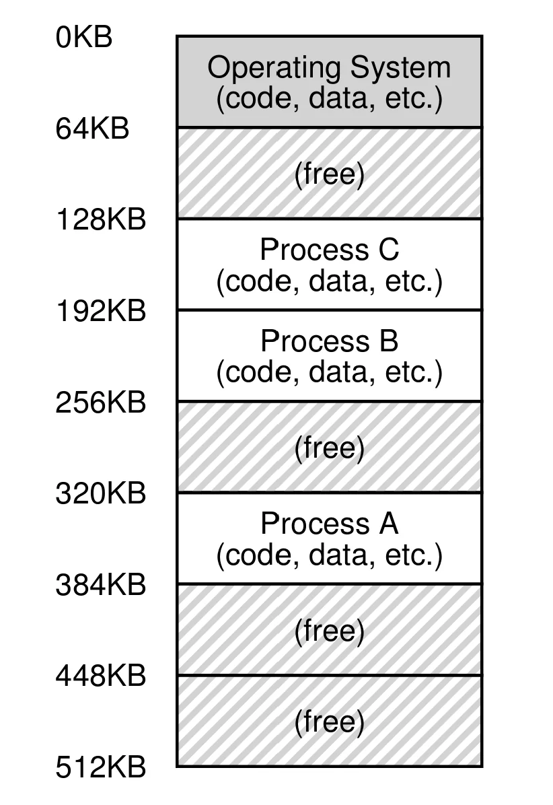{width="300px"}

这种实现方式让**保护**(protection)成为了一个重要的问题，因为我们不希望一个进程访问甚至写入其他进程的内存

为了解决上述问题，操作系统将物理内存抽象为**地址空间**(address space)，这是系统中正在运行的进程视角下的内存

进程的地址空间主要包含三部分：

- **代码段**：程序的代码（指令）
- **栈**：函数调用时产生的变量，包括局部变量，函数参数，返回值
- **堆**：动态分配的由用户管理的内存，例如 C 语言中的 `malloc` 和 Java 中的 `new`

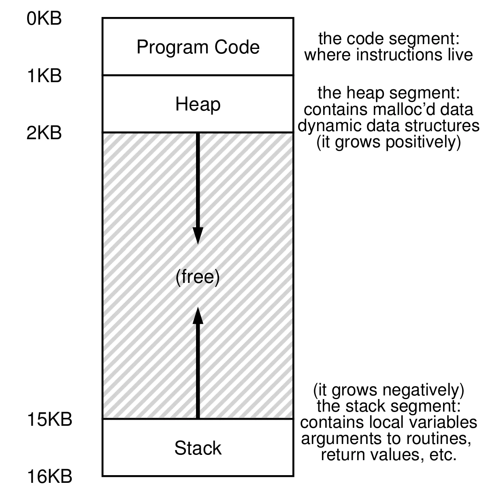{width="400px"}

进程的代码是固定不变的，而栈会向**低地址**方向增长，堆会向**高地址**方向增长。将堆和栈放在地址空间的两端是为了让它们都能增长。图中的表示只是一种约定，在多线程程序中没有一个类似这样完美的划分方案

地址空间是操作系统提供给正在运行的程序的抽象，操作系统通过**虚拟化内存**(virtualizing memory)为程序提供了一种其被加载到了一个特定**虚拟地址**并且拥有整个内存的假象

### Goals

**虚拟内存**(virtual memory)的三个目标是：

- **透明性**(transparency)：程序意识不到内存在被虚拟化，表现得像独占物理内存
- **效率**(efficiency)：时间上不让程序明显变慢；空间上翻译结构本身不能占太多内存
- **保护**(protection)：任何内存访问或取指都不能触及地址空间之外的内容（其他进程与 OS 自身），实现进程间**隔离**(isolation)

> **隔离原则**指的是对于两个进程，其中一个失败不会影响另一个；微内核把隔离思想进一步用于 OS 内部

## Address Translation

我们将使用类似于[受限直接执行](./1.md#limited-direct-execution)的机制在保证**效率**与**控制权**的同时虚拟化内存，虚拟化内存的目标是创造进程独占整个内存的假象

效率意味着需要借助硬件的支持，而控制权意味着操作系统必须确保进程不能读写其他进程的内存

硬件会将由指令提供的虚拟地址转换为**物理地址**(physical address)进而访问物理内存，这被称为**基于硬件地址翻译**(简称**地址翻译**)，可以将这个过程看作一种特殊的受限直接运行。硬件为虚拟化内存提供了高效的底层**机制**，而操作系统需要管理内存，利用控制权适时干预内存的使用

为了简化讨论，现在做出如下假设：

- 地址空间必须放置在连续的物理内存中
- 地址空间的大小不能太大
- 每个地址空间大小相同

### Dynamic Relocation

实现地址翻译最早的方法是**基址与界限**(base and bounds) ，也称为**动态重定位**(dynamic relocation)

通过在每个 CPU 中增加**基址寄存器**(base)和**界限寄存器**(bounds)，可以将地址空间放置在特定的物理地址，同时保证进程只能访问它们自己的地址空间

在程序开始运行时，操作系统会决定其在物理内存的位置并将基址寄存器设为该值，当进程需要访问内存时，处理器会通过下面的方式完成地址翻译
$$
\text{physical address}=\text{virtual address}+\text{base}
$$

!!! note ""
	进程产生的内存引用都是**虚拟地址**；硬件将虚拟地址加上基址得到可以访问内存的**物理地址**

界限寄存器用来实现**保护**，处理器会先检查虚拟地址是否合法，即虚拟地址是否小于界限寄存器的值且**不为负值**。如果虚拟地址不合法，处理器将产生一个异常，由操作系统处理，进程可能被终止。有以下两种方式定义界限寄存器：

1. 界限寄存器保存地址空间的大小
2. 界限寄存器保存地址空间结束位置的物理地址

两种方法在逻辑上是等价的，但是为了简化实现，通常使用第一种方法

基址寄存器和界限寄存器是在每个芯片上都有的硬件结构，因此也被称为**内存管理单元**(memory management unit, MMU)

因为地址的重定位发生在运行时，且可以在进程开始运行之后移动地址空间，因此被称为**动态重定位**

!!! example "动态重定位示例"
	假设一个进程的地址空间大小为 4 KB，并且被放置在物理地址为 16 KB 的内存中。下面是几个地址翻译的结果

	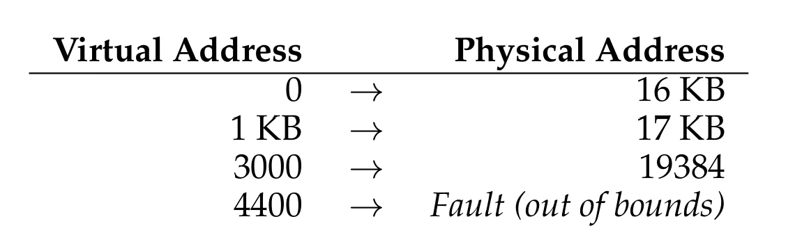

### Hardware and OS Support

下表给出了为了实现动态重定位我们需要用到的硬件支持

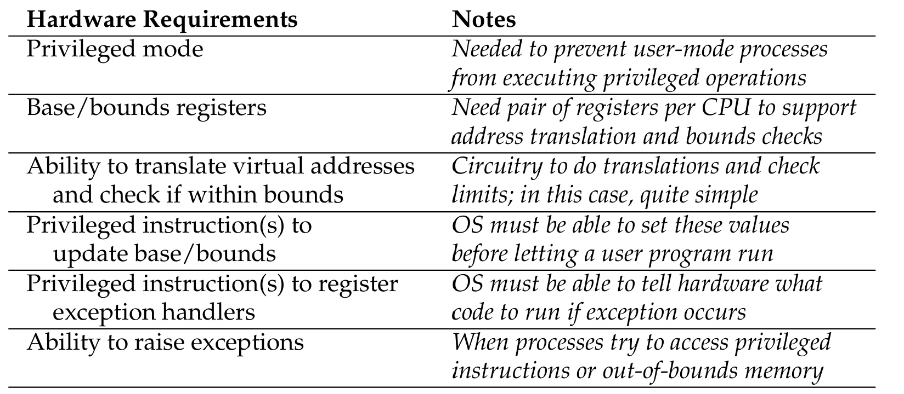

除了需要相应的硬件支持，操作系统也需要解决一些新的问题

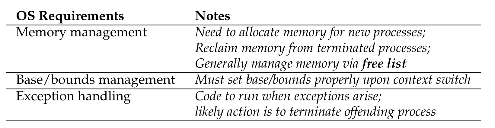

下图给出了在使用动态重定位的情况下，操作系统及硬件在程序运行时需要的操作

=== "OS@Boot"
	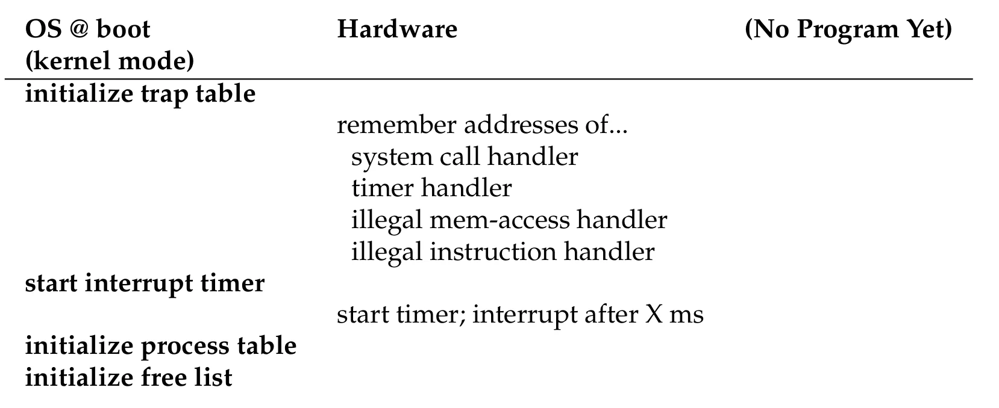
=== "OS@Run"
	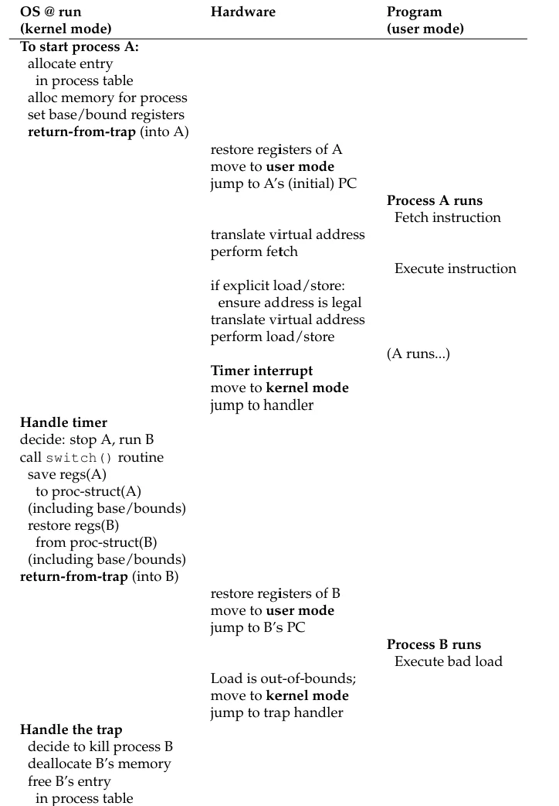{width="400px"}

因为程序的栈和堆并不是很大，所以在这两个部分之间的未使用内存通常会浪费，这种情况被称为**内部碎片**(internal fragmentation)。按照我们目前的方法，可能有足够的物理内存容纳更多进程，但目前只能将一个地址空间放在固定大小的槽中，因此可能会产生更多的内部碎片

## Segmentation

**分段**(segmentation)通过为地址空间中的每个逻辑**段**(segment)分配一组 base-bounds 寄存器来解决内部碎片

一个段是地址空间中特定长度的连续部分，通常情况下，有三个逻辑段：**堆段**，**栈段**和**代码段**。分段机制允许操作系统只为进程实际使用的段分配空间，从而消除了堆和栈之间未使用空白区域的物理浪费

### Refer to Segment

硬件主要有两种方法来确定引用哪个段的地址

- **隐式方法**(implicit)：硬件根据地址的组成来决定段
如果地址由程序计数器生成，那么地址位于代码段；如果地址基于栈或者基指针，那么地址位于栈段；其余地址位于堆段

- **显式方法**(explicit)：用虚拟地址的高几位来指明逻辑段

我们使用了三个逻辑段，因此需要 2 位来表示，对于使用 14 位地址的地址空间，它的地址结构如下图

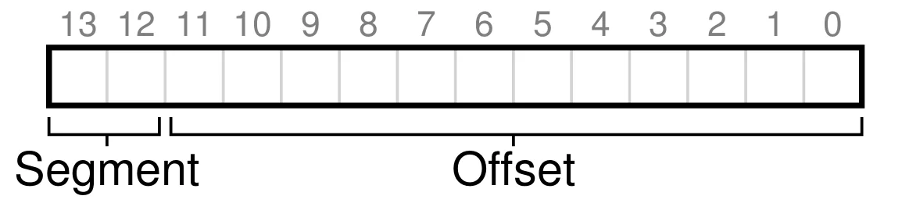

!!! example "虚拟地址表示"
	虚拟地址 4200 的二进制表示如下
	
	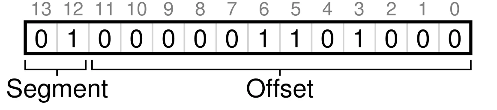

如果使用 `01` 代表堆段，那么该地址的高两位表明了硬件应该访问堆段的内存；而低 12 位则表示地址在该段内的**偏移**(offset)，即 `0000 0110 1000` (`0x068`)

如果基址和界限寄存器是数组，可以通过下面的方式得到物理地址（伪代码）
```c
Segment = (VirtualAddress & SEG_MASK) >> SEG_SHIFT

Offset = VirtualAddress & OFFSET_MASK
if (Offset >= Bounds[Segment])
	RaiseException(PROTECTION_FAULT)
else
	PhysAddr = Base[Segment] + Offset
	Register = AccessMemory(PhysAddr)
```

> 在上面的例子中，`SEG_MASK` 为 `0x3000` ，`SEG_SHIFT` 为 12，`OFFSET_MASK` 为 `0xFFF`

注意我们使用高两位表示分段，但是只有三个段，有一个段都没有使用。为了完全利用虚拟地址空间，一些系统将代码段和堆段使用相同的位进行表示

这种方法的另一个问题是限制了每个段的最大值


### Stack

栈与堆和代码段不同，它是**反向增长**(grows backwards)的，因此需要增加一个位来表示段的增加方向，如下图

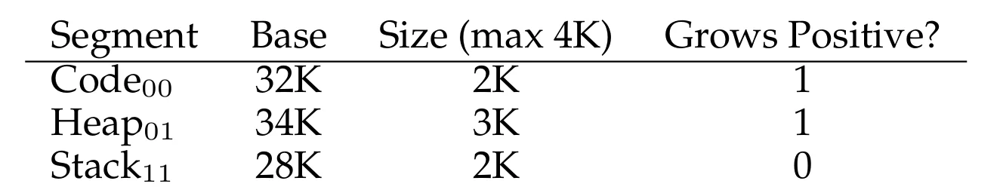

栈的基址寄存器表示的是它的最大地址，因此在进行地址翻译时，应该使用下面的公式
$$
\begin{aligned}
\text{backwards offset}=\text{offset}-\text{bounds} \\\\
\text{physical address}=-\text{backwards offset}+\text{base}
\end{aligned}
$$
此时，MMU 要求反向 Offset 的**绝对值**不得超过该段的最大界限 Bounds

### Support for Sharing

可以在地址空间之间**共享**特定的段从而节省内存，通常会共享**代码段**

为了实现共享，硬件需要为每个段增加一些**保护位**，来表明该段是否可以被读写或执行（如下图）。通过将代码段设为**可读可执行**，多个进程可以共享同一份代码。而每个进程仍拥有各自的私密内存

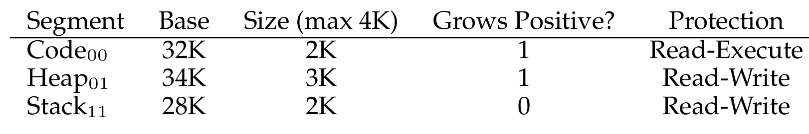

现在，硬件除了需要判断虚拟地址是否在界限内，还需要检查内存访问是否有权限。如果一个进程尝试写入只读段或者执行不可执行段，硬件将会抛出异常并由操作系统完成后续操作

### Fine-grained and Coarse-grained

上面大部分例子中只使用了三个段，可以将这种分段方式看作**粗粒度**(coarse-grained)；与之相对，一些早期的系统允许使用大量的小段，这种分段方式被称为**细粒度**(fine-grained)。可以使用保存在内存中的**分段表**(segment table)实现细粒度分段

> 在进行上下文切换时，操作系统也需要保存（和恢复）进程的基址与界限寄存器

### External Fragmentation

之前[假设](#address-translation)每个地址空间有相同的大小，而现在每个进程有多个大小不同的物理段，随着进程的频繁创建、退出，或者堆段的动态伸缩，物理内存会被切割成大量的小空闲块，这会导致**外部碎片**(external fragmentation)

操作系统通过**紧凑**(compact)来解决这个问题，操作系统会暂停所有进程将它们的内存复制到连续的内存区域，然后更改其段寄存器的值使其指向新的物理地址。然而，紧凑的**性能极差**：频繁在 DRAM 中复制大量字节，且拷贝期间所有进程必须挂起

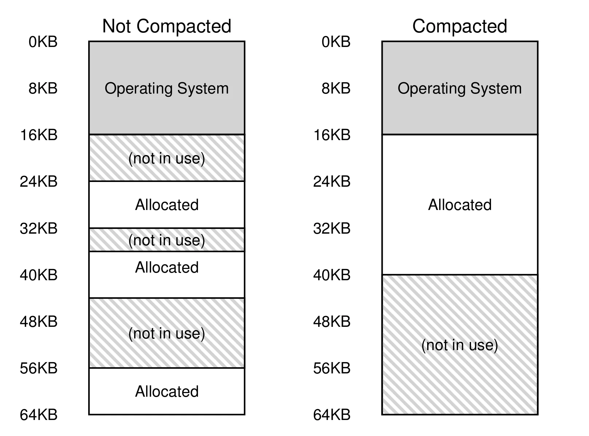

另一种方法是使用**空闲链表**(free list)，有上百种关于空闲链表的算法，比如**最优匹配**(best-fit)，**最差匹配**(worst-fit)，**第一次匹配**(first-fit)，**buddy 算法**(buddy algorithm)等等

## Free-Space Management

在分配可变大小的空间时，空闲空间管理将会变得相当复杂。不论是使用用户级的内存管理库（`malloc()` 和 `free()`）还是使用分段实现虚拟内存的操作系统，都会造成**外部碎片**

由库管理的内存通常被称为**堆**(heap)，而在堆中管理空闲空间的数据结构通常是**空闲链表**(free list)，其本身不一定是链表。空闲链表保存着内存空间中所有空闲块的引用

为了简化讨论，只考虑外部碎片。并且假设分配器管理的是连续的字节区域

### Low-Level Mechanisms

#### Splitting and Coalescing

空闲链表包含一组用于描述堆中空闲空间的元素，对于下面这个 30 字节的堆

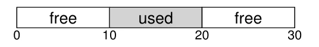

堆中的空闲链表包含两个元素


在这个例子中，超过 10 字节的请求将会失败；恰好 10 字节的请求两个空闲块均可满足；而对于小于 10 字节的请求，分配器将会找到一块可以满足需求的空闲块，将其分为两部分。其中一部分用于返回，另一部分仍留在空闲链表中，这个操作被称为**分裂**(splitting)

假如需要分配 1 个字节的空间，`malloc()`将会返回 20 ，空闲链表如下图

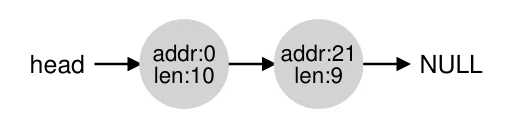

与分裂对应的操作是**合并**(coalescing)。在释放内存中的一个空闲块时，分配器会检查要归还的块的地址以及附近的空闲块；如果新释放的空间正好紧挨着一个（或两个）已有的空闲块，就把它们合并成一个更大的空闲块，合并可以确保分配器有较大的空闲区域可供应用程序使用

在上面的例子中，如果释放了被使用的块，空闲链表如下图

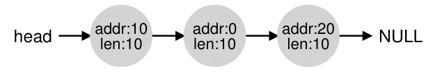

而下图为合并之后的空闲链表


#### Tracking The Size Of Allocated Regions

在调用 `free(void* ptr)` 时并不需要传递分配区的大小，大部分分配器都会将额外信息保存在内存中的 **头块**(header block) 中，通常放置在被分配块的前面。头块通常包含被分配块的大小以及一个**幻数**(magic number)用于检查完整性

```c
typedef struct {
	int size;
	int magic;
} header_t;
```

考虑一个例子，假设用户调用 `malloc(20)` 请求分配 20 字节的空间，那么堆将会如下图所示

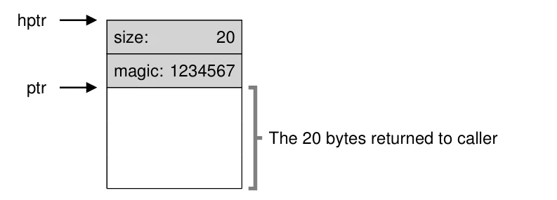

当用户调用 `free(ptr)` 时，库函数通过简单的指针算术计算出头块的起始地址
```c
header_t *hptr = (header_t *)ptr - 1;
```

在得到头块的指针后，库函数会检查幻数的值并且计算分配区域的总大小（头块的大小加上分配区域的大小），当用户请求 $N$ 字节时，分配器会寻找大小至少为 $N$ 字节加上头块大小的空闲块

#### Embedding A Free List

我们需要在空闲空间内部构建一个链表，假设有一个 4096 字节(4 KB)的空间需要管理，首先需要初始化链表。在一开始，链表只有一个大小为 4096 的节点，下面的代码描述了这个节点
```c
typedef struct __node_t {
	int size;
	struct __node_t* next;
} node_t;
```

下面的代码展示了初始化堆的方式
```c
node_t* head = mmap(NULL, 4096, PROT_READ|PROT_WRITE, MAP_ANON|MAP_PRIVATE, -1, 0);
head->size = 4096 - sizeof(node_t);
head->next = NULL;
```

在运行完这个程序之后，此时链表中只有一项（大小为 4088），头指针包含了区域的起始地址，假设该值为 16 KB(虚拟地址)，如下图

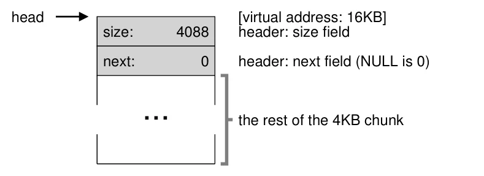

现在假设需要分配 100 字节的空间，库首先会寻找一块足够放下这些字节的块，然后这个块会被分为两部分。如下图所示

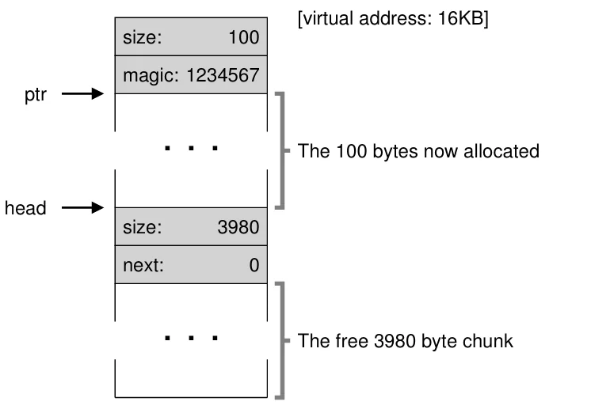

在分配三次 100 字节的块后，堆如下图所示

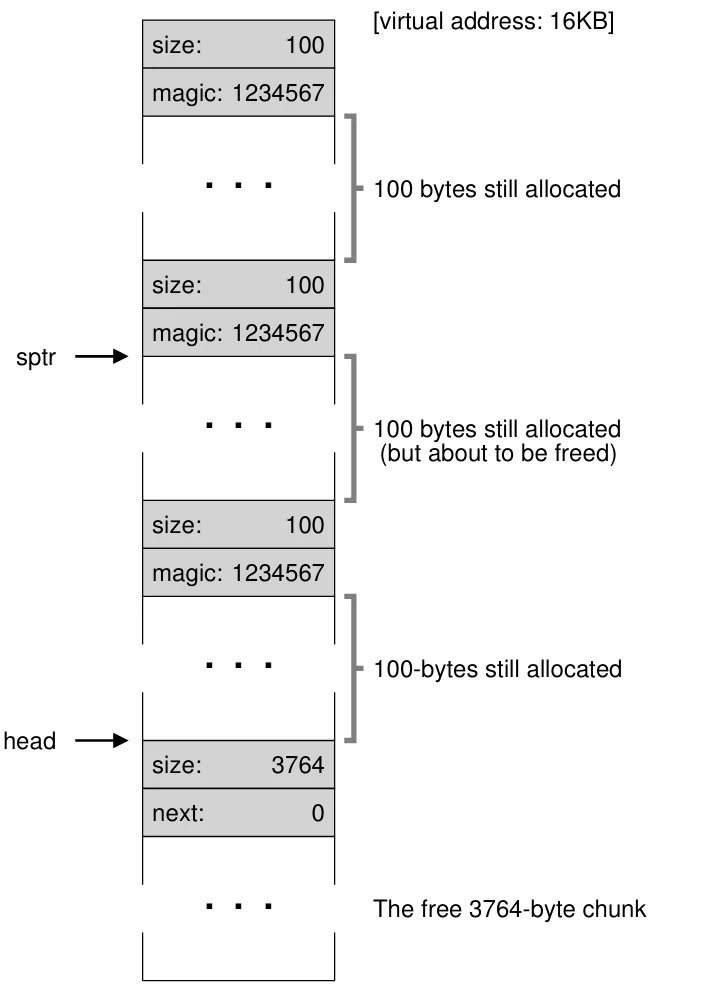{width="400px"}

此时若程序调用 `free(16500)` 归还中间那个 100 字节的块，库函数会从头块算出空闲区域的大小，并把释放的块插回空闲链表。假设在链表**头部插入**，堆中就出现了一个 100 字节的小空闲块和一个 3764 字节的大空闲块，如下图

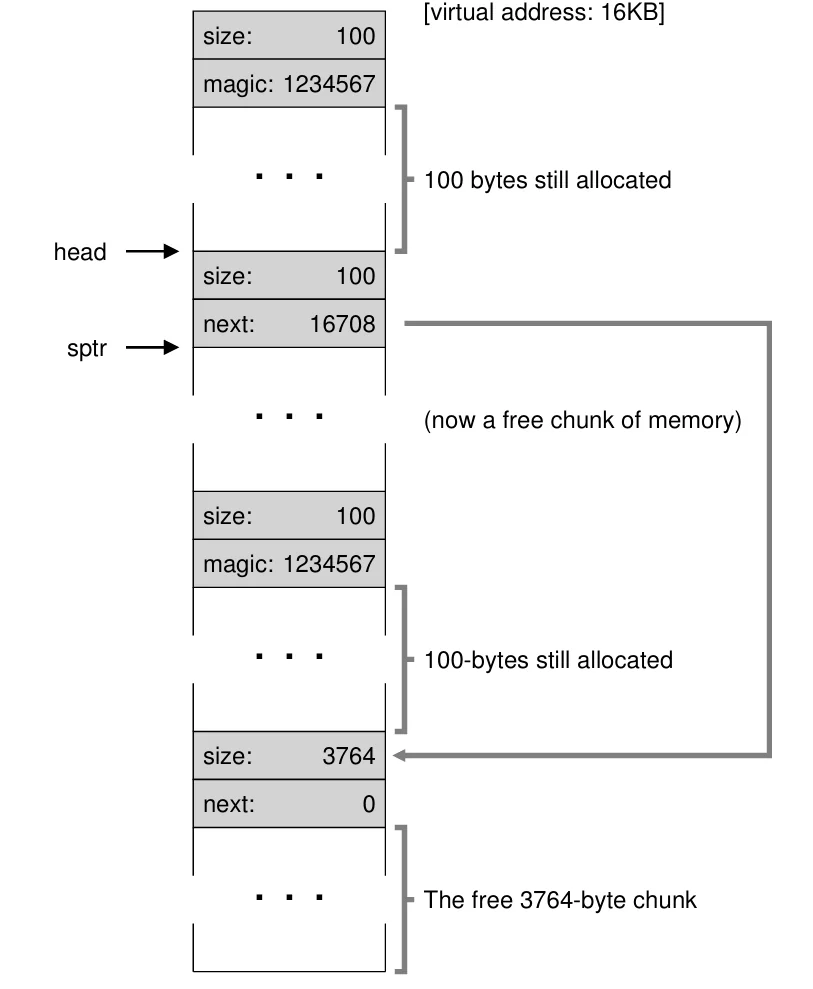{width="400px"}

最后假设剩下的两个已经分配的块也被释放，但**忘记合并**，堆将被切成一堆小块，解决办法是遍历链表，合并相邻的空闲块，使堆重新恢复成完整的一大块

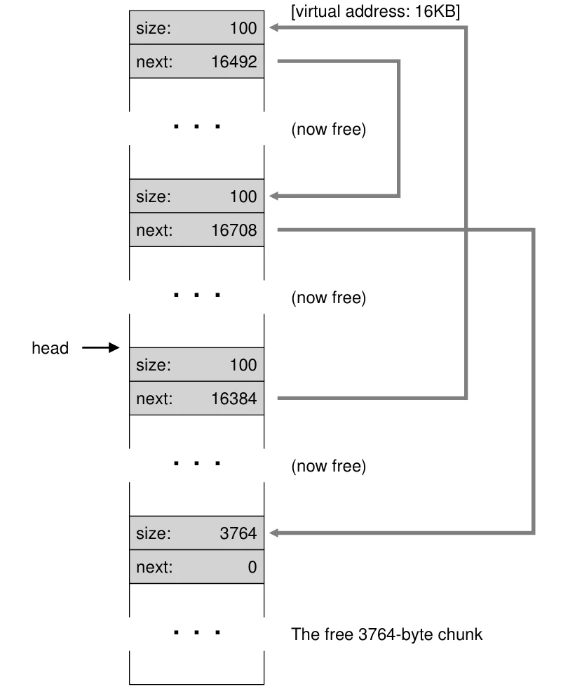{width="400px"}

如果堆中没有足够的空间，分配器直接返回 `NULL`

大多数分配器从一个较小的堆开始，空间耗尽时向操作系统发起某种系统调用来**扩大堆**，然后再从新增的区域中分配块

### Basic Strategies

接下来讨论管理空闲空间的基本策略。理想的分配器既要速度快，又要使碎片最小化。但分配与释放的请求是任意的，因此**任何特定策略在特定的请求序列下都可能表现得很糟糕**，所以没有最佳的方法

- **最佳适配**(best fit)：遍历整个空闲链表，找出所有不小于请求大小的空闲块，然后返回其中**最小**的。一次遍历即可找到正确的块
    - 优点：返回与用户请求最接近的块，减少空间浪费
    - 缺点：需要遍历整个空闲链表，性能开销很大

- **最差适配**(worst fit)：找到空闲链表中**最大**的块，分配请求所需的大小，把剩下的空间留在空闲链表上
    - 缺点：需要遍历整个空闲链表；并且会产生额外的碎片

- **首次适配**(first fit)：直接返回**第一个**找到的足够大的块
    - 优点：速度**快**，不需要遍历整个空闲链表
    - 缺点：可能会让链表开头堆满小对象
    - 一般选择**按地址排序**(address-based ordering)，让空闲链表按空闲块的地址顺序维护，这样**合并更容易**，碎片也更少

- **下次适配**(next fit)：不再从链表头部开始搜索，而是额外保存一个指针，记录**上次搜索到的位置**
    - 性能与 first-fit 相当，避免了穷尽搜索