## Introduction
操作系统有两种方式来解决空间管理问题：

- 使用**可变大小**(variable-size)的块，也就是[分段](./3.md#segmentation)，分段将空间划分为不同大小的块，这将会造成碎片
- 使用**固定大小**(fixed-size)的块，被称为**分页**(paging)

分页将地址空间划分为被称为**页**(page)的**固定大小**的单元，相应地将物理内存看作由被称为**页帧**(page frame)的固定大小的槽组成的数组

分页主要有以下优点：

- **灵活性**(flexibility)：逻辑上相邻的页可以放在任意物理页帧中，无需连续内存
- **简单性**(simplicity)：固定大小的块使分配与回收简单，且不存在需要合并的外部碎片

### Overview

!!! info "分页"
	[计算机组成原理](../co/5.md#virtual-memory)中有对分页的讨论

对于一个由 4 个 16 字节的页组成的 64 字节地址空间，以及一个由 8 个页帧组成的物理内存，如下图所示

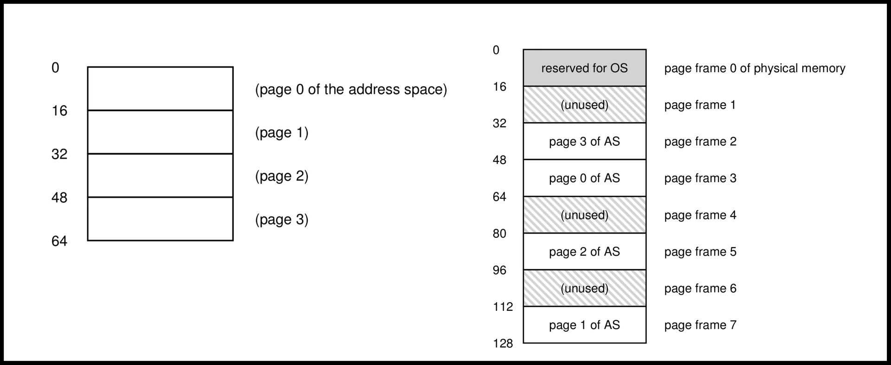

页表是一个**每个进程都有的**(per-process)数据结构，记录了地址空间中的每个虚拟页被放置在物理内存的哪个页帧中，操作系统进行上下文切换时也需要加载对应进程的页表。页表的主要作用是保存每个虚拟页对应的页帧，如上图所示的例子中，页表将包含以下 4 项：

```txt
VP0 --> PF3
VP1 --> PF7
VP2 --> PF5
VP3 --> PF2
```

假设我们需要进行一次内存访问：
```asm
ld a0, <virtual address>
```

这条指令将 `<virtual address>` 地址处的内容加载进寄存器 `a0`

为了翻译进程产生的虚拟地址，首先需要将虚拟地址划分为两部分：

- **虚拟页号**(virtual page number, VPN)：用于在地址空间中选择页
- **偏移量**(offset)：用于在页中选择字节

在这个例子中，进程的地址空间为 64($2^6$) 字节，因此虚拟地址为 6 位

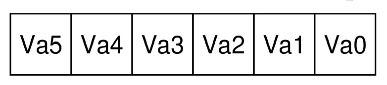

因为页的大小为 16 字节，每个地址空间有 4 个页，所以 VPN 为 2 位，offset 为 4 位

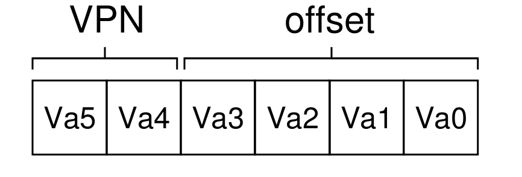

例如，我们需要将虚拟地址 21 处的数据加载到寄存器 `a0`
```asm
ld  a0, 21
```

21 的二进制为 `010101`，可以得到其 VPN 和 offset 如下图

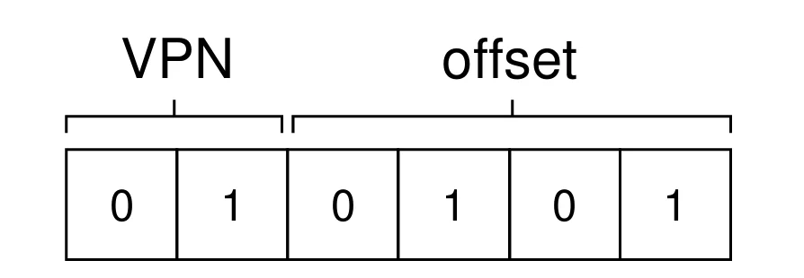

根据 VPN 索引页表，可得到对应的**物理页帧号**(physical frame number, PFN)或**物理页号**(physical page number, PPN)，本例中为 7（二进制为 111），只需要将 VPN 替换为 PFN 即可完成地址翻译

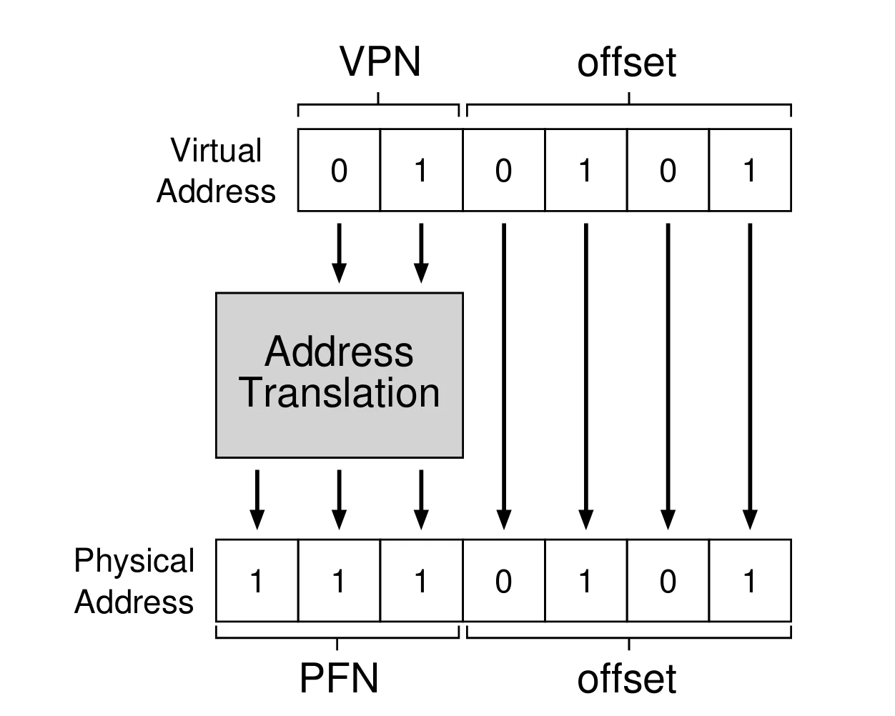

因为页与页帧大小相同（均为 16 字节），offset 保持不变，从而得到最终的物理地址为 `1110101`，即 117

页表可以变得很大，对于一个页大小为 4 KB 的 32 位地址空间，虚拟地址将被分为 12 位的 offset 和 20 位的 VPN。假设一个**页表项**(page table entry, PTE)需要 4 字节，那么一个页表的大小为 $2^{20}\times 4=4\text{MB}$

因为页表很大，所以无法将页表保存在芯片上的硬件中，通常将页表保存在内存中的某处

### Page Table Entry

页表可以是**任何数据结构**，最简单的形式是一个数组，被称为**线性页表**(linear page table)。硬件通过 VPN 索引该数组，并在对应下标的 PTE 中得到 PFN

下图为 RISC-V 的页表项

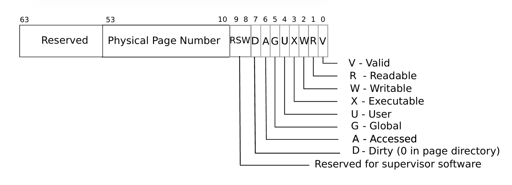

除了 PFN(PPN)之外，PTE 中还包括：

- **有效位**(valid)：表明翻译是否有效
- **保护位**(protection)：即图中的RWX，用于表明页是否可读可写可执行
- **用户位**(user)：表明用户模式下的指令能否访问该页
- **脏位**(dirty)：表明页是否被修改
- **访问位**(access)：表明页是否被访问过

!!! note "有效位"
    有效位是实现稀疏地址空间的关键：只需要将不使用的页标记为无效，操作系统就不会为这些页分配物理页帧，从而节约大量内存

### Address Translation

当进程发起一次内存访问时，硬件需要将虚拟地址翻译为物理地址。在这个过程中，硬件首先要找到页表中正确的页表项，这一步由**页表基址寄存器**(page-table base register, PTBR)完成，其保存了页表的起始地址。这个过程如下
```c
VPN = (VirtualAddress & VPN_MASK) >> SHIFT 
PTEAddr = PTBR + (VPN * sizeof(PTE))
```

> 在上面的例子中，`VPN_MASK` 应为 `0x30`，`SHIFT` 应为 `4`

在得到 PTE 的物理地址后，硬件会从 PTE 中提取出 PFN，并将其与 offset 拼接得到物理地址，这个过程如下：
```c
offset = VirtualAddress & OFFSET_MASK
PhysAddr = (PFN << SHIFT) | offset
```

下面的代码展示了使用分页访问内存的完整过程
```c
// Extract the VPN from the virtual address 
VPN = (VirtualAddress & VPN_MASK) >> SHIFT 

// Form the address of the page-table entry (PTE) 
PTEAddr = PTBR + (VPN * sizeof(PTE)) 

// Fetch the PTE 
PTE = AccessMemory(PTEAddr) 
// Check if process can access the page 
if (PTE.Valid == False) 
	RaiseException(SEGMENTATION_FAULT) 
else if (CanAccess(PTE.ProtectBits) == False) 
	RaiseException(PROTECTION_FAULT) 
else 
	// Access OK: form physical address and fetch it 
	offset = VirtualAddress & OFFSET_MASK 
	PhysAddr = (PTE.PFN << PFN_SHIFT) | offset 
	Register = AccessMemory(PhysAddr)
```

因此，分页模式下每次内存访问实际上都需要两次内存访问：一次用于读取页表项，一次用于读取数据

!!! failure "线性页表的缺点"
    - 需要一次额外的内存访问来获取页表项，这将严重影响性能
    - 页表项中包含的信息量很大，需要占用大量的内存空间

## Translation Lookaside Buffer (TLB)

因为页表通常存储在物理内存中，所以地址翻译需要一次额外的内存访问来获取 VPN 到 PFN 的映射关系，这将严重影响性能。可以利用硬件加速地址翻译，即在 MMU 上增加一个被称为 **TLB**(translation lookaside buffer)的**缓存**，其保存了虚拟页到物理页帧的映射关系

### Basic Algorithm

对于一个由硬件管理的线性页表，TLB 的基本算法如下：

1. 从虚拟地址中分解出 VPN
2. 检查 TLB 中是否包含该 VPN 的映射关系，如果有，则 **TLB 命中**(TLB hit)；否则，**TLB 缺失**(TLB miss)
3. 根据查询结果处理：
    - 如果 TLB 命中，从对应的 TLB 项中取得 PFN，与虚拟地址中的 offset 拼接即可得到物理地址，进而访问内存
    - 如果 TLB 缺失，硬件会访问页表寻找映射关系。如果该虚拟地址是**有效**且**可访问**的，硬件将会更新 TLB，然后重新执行这次内存访问

整个过程的伪代码如下所示：
```c
VPN = (VirtualAddress & VPN_MASK) >> SHIFT 

(Success, TlbEntry) = TLB_Lookup(VPN) 
if (Success == True) // TLB Hit 
	if (CanAccess(TlbEntry.ProtectBits) == True) 
		Offset = VirtualAddress & OFFSET_MASK 
		PhysAddr = (TlbEntry.PFN << SHIFT) | Offset 
		Register = AccessMemory(PhysAddr) 
	else 
		RaiseException(PROTECTION_FAULT) 
else // TLB Miss
	PTEAddr = PTBR + (VPN * sizeof(PTE)) 
	PTE = AccessMemory(PTEAddr) 
	if (PTE.Valid == False) 
		RaiseException(SEGMENTATION_FAULT) 
	else if (CanAccess(PTE.ProtectBits) == False) 
		RaiseException(PROTECTION_FAULT) 
	else 
		TLB_Insert(VPN, PTE.PFN, PTE.ProtectBits) 
		RetryInstruction() 
```

### Example: Access an Array

假设有一个包含 10 个 4 字节整数的数组，位于虚拟地址 100。同时假设虚拟地址为 8 位，页大小为 16 字节。那么这个数组在内存中的状态如下：

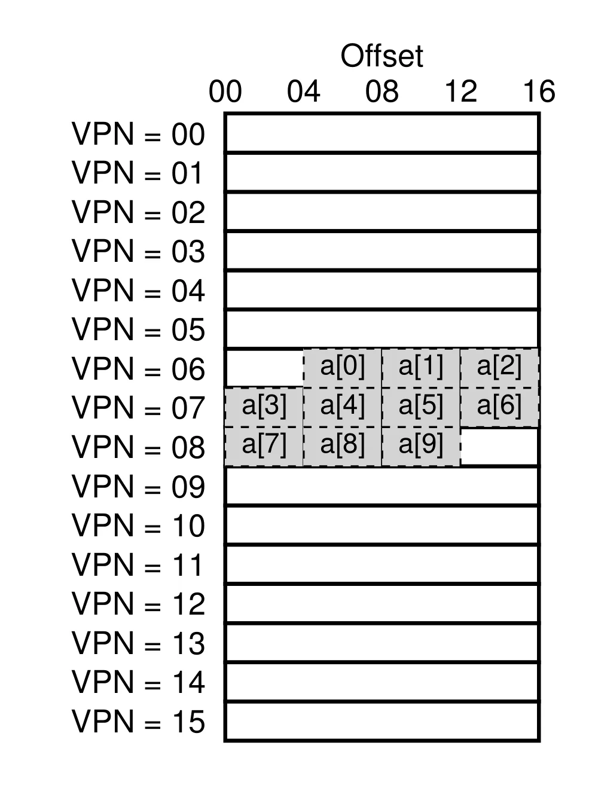

假设需要对这个数组中的元素进行求和，为了简化讨论，忽略对 `i` 和 `sum` 的内存访问，只考虑对数组元素的访问
```c
int sum = 0;
for (int i = 0; i < 10; ++i) {
	sum += a[i];
}
```

当数组的第一个元素 `a[0]` 被访问时，因为之前程序并没有访问过该数组，因此会导致 TLB 缺失，硬件会将 VPN=06 这一页对应的映射关系加入到 TLB 中，因此对于 `a[1]` 和 `a[2]` 的访问将会命中。以此类推，对 `a[3]` 和 `a[7]` 的访问将会缺失，其余访问将会命中

整个过程将会造成 7 次命中，3 次缺失，因此**命中率**为 $70\%$。注意在这个例子中，页大小是影响命中率的重要因素：如果页大小变得更大，命中率也将随之上升。对于一个典型的 4 KB 的页（假设数组不跨越页边界），整个过程只会造成一次缺失

> TLB 通过[空间局部性](../co/5.md#introduction)提高性能

### Handle TLB Miss

硬件和操作系统都可以处理 TLB 缺失：

- 硬件：更古老的 **CISC** 处理器会完全由硬件处理 TLB 缺失。处理器通过页表基址寄存器在物理内存中找到页表，在页表中“**游走**”(walk)，寻找正确的页表项并提取出映射，然后更新 TLB
- 操作系统：更现代的 **RISC** 处理器在 TLB 缺失时只抛出异常，这将暂停当前的指令流，提升特权级并跳转到**陷阱处理函数**(trap handler)。陷阱处理函数将寻找页表并使用特权指令更新 TLB，完成后从陷阱返回，硬件将再次尝试执行该指令


!!! warning "TLB 缺失处理程序"
	这里的从陷阱返回与之前的从陷阱返回有所不同，它不会执行下一条指令，而是重新执行造成陷阱的指令

	在执行 TLB 缺失处理程序时，操作系统需要确保不会造成无限的链式 TLB 缺失

软件管理 TLB 的优点是：

- 灵活性：操作系统可以在不改变硬件的情况下使用任意的数据结构实现页表
- 简单性：硬件只需要抛出异常，剩下的工作将由操作系统完成

### TLB Contents

一个典型的 TLB 可能有 32、64 或 128 项，使用[**全相联**](../co/5.md#caches)(fully-associative)组织，一个 TLB 项可能包含以下内容：
$$
\text{VPN}\quad|\quad\text{PFN}\quad|\quad\text{other bits}
$$
这里的**其他位**(other bits)通常包括：

- 有效位：表示该项是否为有效翻译
- 保护位：即 RWX，表示该项是否可读可写可执行
- **地址空间标志位**(address-space identifier, ASID)：表示该项是哪个进程的页，详见下文
- 脏位：表示该项是否被修改

### TLB Issues

#### Context Switch

TLB 包含的虚拟地址到物理地址翻译仅对当前正在运行的进程有效。当从一个进程切换到另一个进程时，操作系统和硬件必须确保即将运行的进程不会使用之前进程的翻译

假设两个进程 P1 和 P2 将第 10 个页分别映射到物理页 100 和 170，如下图

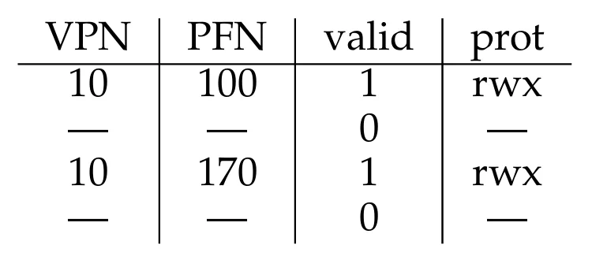

硬件无法区分哪一项对于当前进程是有意义的，因此需要一些方法使 TLB 在上下文切换之后仍能正常工作

最简单的方法是在上下文切换时通过一条显式的硬件指令**刷新** TLB，刷新操作只是将 TLB 中所有项的有效位设为 0。每当一个程序需要运行时，就要刷新一次 TLB，如果进程切换频繁，代价也将十分高昂

另一种方法是操作系统会提供一个**地址空间标识符**，进程将会根据 ASID 选择合适的 TLB 项，如下图

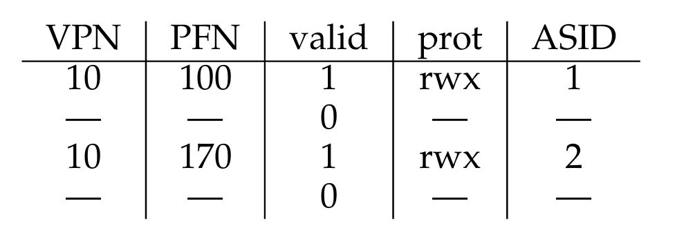

当两个进程共享同一个物理页时（如代码段），将会出现 VPN 不同但 PFN 相同的情况，如下图

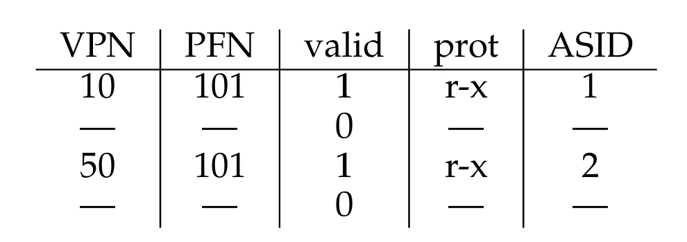

#### Replacement Policy

当向 TLB 中增加一个新项时，需要替换一个旧项，常见的策略是**最近最少使用**(least recently used, LRU)


## Smaller Tables

现在来看线性页表的第二个问题：页表太大，需要使用太多内存。对于 32 位地址空间，页大小为 4 KB 的页表需要 4 MB 内存，而每个进程都拥有一个页表，因此通常需要几百 MB 的内存用来存放页表

下面来看几种解决方案

### Bigger Page

减少页表大小最简单的方法就是使用更大的页，同样是 32 位地址空间，如果使用 16 KB 的页，那么一个页表就只需要 1 MB

这种方法会造成**内部碎片**，即页内的空间不能完全利用，内存将很快被这些过大页填满而大部分又没有被使用。因此，大多数系统都选择相对较小的页大小

!!! info "多种页大小"
	很多架构系统可以为一个小程序在地址空间的特殊位置分配一个大页，用于存放经常使用的程序。这样做的目的主要是减少 TLB 缺失的次数

### Paging and Segments

首先来看一个例子，这里使用页大小为 1 KB 的 16 KB 地址空间，地址空间与页表如下图所示

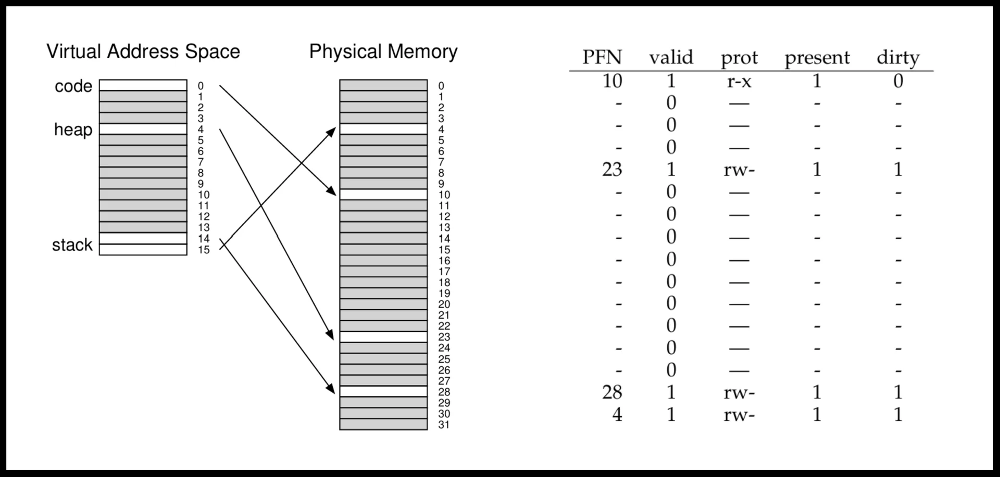

从图中可以看出，页表中的大部分页都没有使用，造成了严重的浪费。因此，可以考虑将**分段**与**分页**相结合，为每个段分配一个页表。这里使用基址寄存器表示该段页表的物理地址，而界限寄存器表示该页表的结束地址

对于一个页大小为 4 KB 的 32 位地址空间，将其分为四个段。在这里我们只使用其中三个，分别表示栈、堆和代码段。其中地址的最高两位表示段，最低 12 位表示 offset，其余为 VPN，如下图所示

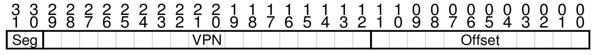

对于一个正在运行的程序，现在它将有三个页表。在进行上下文切换时，需要将这些寄存器（三组基址和界限寄存器）全部进行替换。

当发生 TLB 缺失时，硬件根据**段位**(segment bits)决定使用哪一组基址界限寄存器，然后取出其中的页表基址，并将其与 VPN 拼接，组成 PTE 的地址：
```c
SN  		  = (VirtualAddress & SEG_MASK) >> SN_SHIFT 
VPN 		  = (VirtualAddress & VPN_MASK) >> VPN_SHIFT 
AddressOfPTE = Base[SN] + (VPN * sizeof(PTE))
```

> 每个界限寄存器保存着段内最大的有效页的值

然而，这种方法有以下问题：

- 仍然依赖**分段**，而分段的灵活性较差。例如，一个很大但使用稀疏的堆，它的页表依然会浪费大量空间
- 重新引入**外部碎片**：大部分内存以页为单位管理，但页表可以是任意大小（PTE 的整数倍），在内存中为它们寻找空闲空间变得更加复杂

### Multi-level Page Table

**多级页表**(multi-level page table)在不使用分段的情况下解决了相同的问题，它使用类似**树**的结构。多级页表将页表划分为页大小的单元，如果某一整页的 PTE 全部无效，就不为这一页分配内存；同时引入一个被称为**页目录**(page directory)的数据结构，用于记录页表中每一页的位置，或表明该页中没有有效页

如下图所示

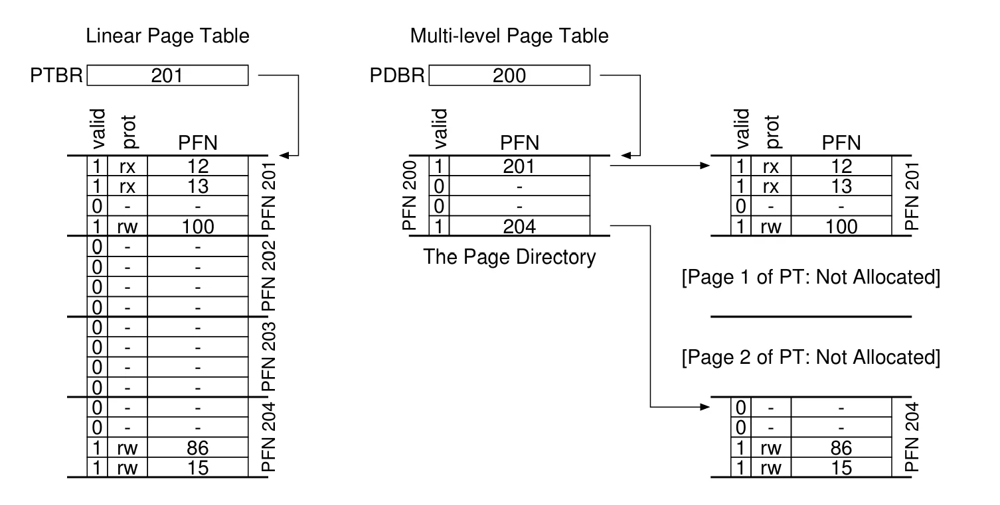

上图左边展示的是线性页表，即使中间两个页全都没有使用，也需要为其分配内存；而右边是一个多级页表，页目录标记了只有两个页是有效的，因此只有两个页留在内存中

在一个简单的二级页表中，页目录的每个项指向页表中的一个页。页目录包含数个**页目录项**(page directory entry, PDE)，每个 PDE（至少）包含一个有效位和一个 PFN

PDE 有效位的含义与之前的情况（PTE 和 TLB 项）有一些不同：如果 PDE 指向的页中有一个 PTE 有效，则 PDE 也是有效的；如果 PDE 无效，则其指向的页中没有任何有效的 PTE

多级页表相较于之前的方法主要有以下优点：

1. 多级页表只为地址空间中实际使用的页分配空间，因此页表通常很紧凑，也更容易支持稀疏地址空间
2. 页表中的每个部分都整齐地位于一个页中，便于进行内存管理。通过页目录增加一级**间接寻址**(indirection)，可以将页表的页放置在物理内存中的任何位置

多级页表是一个典型的**时间-空间权衡**(time-space trade-off)：在获得更小页表的同时，也提高了处理 TLB 缺失的时间成本。另一个问题是**复杂性**(complexity)，在 TLB 缺失、需要查找页表时，多级页表无疑比线性页表更复杂。

#### Detailed Example

对于一个页大小为 64 字节的 16 KB 地址空间，其虚拟地址为 14 位，其中低 6 位为 offset，高 8 位为 VPN。对于线性页表，一共有 256 项，具体情况如下图所示

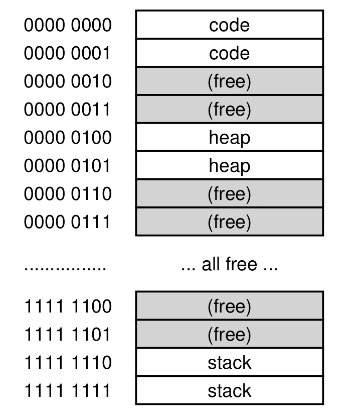

为了构造一个二级页表，我们需要将 VPN 分为两部分。假设 PTE 为 4 字节，那么页表的大小为 $256\times 4\text{ Byte}=1\text{ KB}$，又因为页大小为 64 字节，因此一个页表可以分为 16 个页，每个页包括 16 个 PTE

页表中的每个页都需要一个页目录项（PDE）指向，一共有 16 个页，因此需要 4 位 VPN 来索引页目录，如下图所示

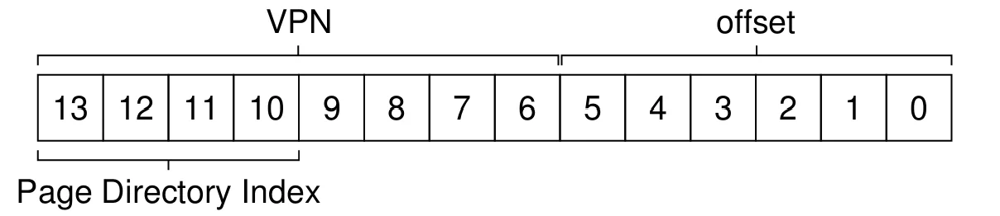

一旦从 VPN 中分解出了**页目录索引**(page-directory index)，可以通过简单的计算得到 PDE 的地址：
```c
PDEAddr = PDBR + (PDIndex * sizeof(PDE))
```

如果 PDE 是无效的，那么访问也是无效的，此时应抛出异常
如果 PDE 是有效的，那么需要从 PDE 指向的页中找到对应的 PTE，我们使用 VPN 中剩下的位来索引 PTE，如下图所示

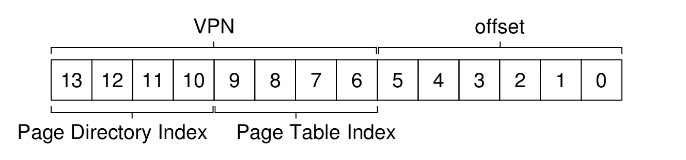

可以使用下面的方法得到所需的 PTE 的地址

```c
PTEAddr = (PDE.PFN << SHIFT) + (PTIndex * sizeof(PTE))
```

页目录和页表如下图所示

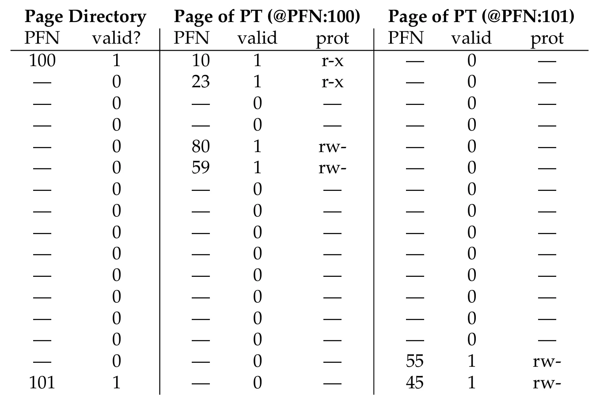

!!! example "地址翻译示例"
	虚拟地址 `0x3F80` (二进制为 `11 1111 1000 0000`)，最高的 4 位(`1111`)表示页目录索引，该索引表示最后一个 PDE，其指向页表地址为 101 的有效页。VPN 的另外 4 位(`1110`)用于在页表中寻找对应的 PTE，可以找到其 PFN 为 55，将 PFN 与 offset 组合可以得到物理地址 `(PTE.PFN << SHIFT) + offset = 0x0DC0`

#### More Than Two Levels

在有些情况下，可能需要更深的树。对于一个页大小为 512 字节的 30 位地址空间，虚拟地址由 9 位 offset 和 21 位 VPN 组成。我们的目标是让多级页表中的每一级都刚好放入一个页

现在页大小为 512 字节，假设 PTE 为 4 字节，一个单独的页可以放下 128 个 PTE，因此需要 7 位作为索引，如下图所示

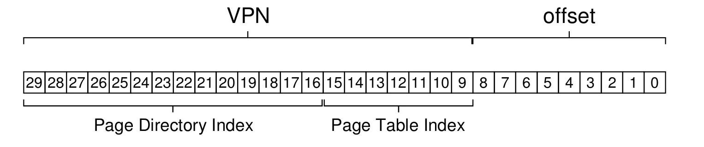

如果使用两级页表，页目录中还剩 14 位 VPN，即 $2^{14}$ 个 PDE；假设 PDE 为 4 字节，页目录大小为 64 KB，跨越 128 个页，「每一级刚好放入一个页」的目标就此落空

为了解决页目录自身放不进一个页的问题，可以再增加一层页表：把页目录本身也划分为多个页，并在其之上再放一个页目录来指向这些页，于是形成**三级页表**。此时 21 位的 VPN 被平分为三段，各 7 位，加上 9 位 offset，如下图所示

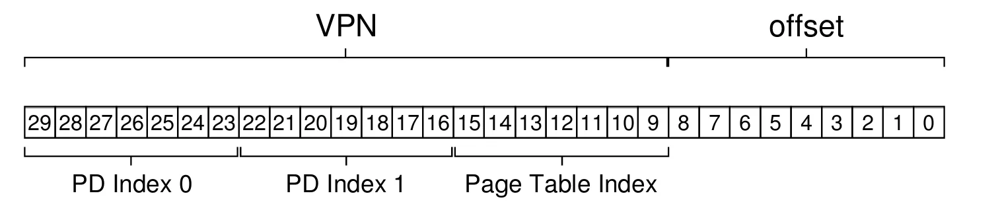

#### The Translation Process

多级页表并没有改变翻译的流程，只是让 TLB 缺失之后的查找变长。每次内存访问时先查询 TLB：命中则直接用 TLB 项中的 PFN 与 offset 拼出物理地址，不需要访问页表；只有缺失时才需要逐级遍历多级页表

```c
VPN = (VirtualAddress & VPN_MASK) >> SHIFT
(Success, TlbEntry) = TLB_Lookup(VPN)
if (Success == True) // TLB Hit
	if (CanAccess(TlbEntry.ProtectBits) == True)
		Offset = VirtualAddress & OFFSET_MASK
		PhysAddr = (TlbEntry.PFN << SHIFT) | Offset
		Register = AccessMemory(PhysAddr)
	else
		RaiseException(PROTECTION_FAULT)
else
	// TLB Miss
	PDIndex = (VPN & PD_MASK) >> PD_SHIFT
	PDEAddr = PDBR + (PDIndex * sizeof(PDE))
	PDE = AccessMemory(PDEAddr)
	if (PDE.Valid == False)
		RaiseException(SEGMENTATION_FAULT)
	else
		PTIndex = (VPN & PT_MASK) >> PT_SHIFT
		PTEAddr = (PDE.PFN << SHIFT) + (PTIndex * sizeof(PTE))
		PTE = AccessMemory(PTEAddr)
		if (PTE.Valid == False)
			RaiseException(SEGMENTATION_FAULT)
		else if (CanAccess(PTE.ProtectBits) == False)
			RaiseException(PROTECTION_FAULT)
		else
			TLB_Insert(VPN, PTE.PFN, PTE.ProtectBits)
			RetryInstruction()
```

多级页表的开销只体现在 TLB 缺失的情况下：二级页表在缺失时需要**两次额外的内存访问**（取 PDE 与取 PTE）才能确认翻译有效，层级越深访问次数越多。因此 TLB 是掩盖多级页表开销的关键

### Inverted Page Tables

**反转页表**(inverted page table)是更极端的节省空间的做法：不再为每个进程各维护一张页表，而是整个系统只保留**一张页表**，其中每一项对应物理内存的一个**页帧**，记录该页帧正被哪个进程使用，以及它对应这个进程的哪个虚拟页

因此寻找正确的翻译就变成了在这张表中搜索。线性扫描的代价太高，所以通常在基础结构之上再构造一个**哈希表**来加速定位

### Swapping Page Tables to Disk

此前一直假定页表驻留在内核拥有的**物理内存**中，但即便用了各种技巧缩小页表，某些情况下一页表仍然太大，无法全部放入内存

因此一些系统将页表放在内核的**虚拟内存**中，从而可以在内存紧张时把一部分页表换出到磁盘。具体内容后面讨论