截至目前，我们都假设每个正在运行进程的地址空间可以完全放置在物理内存中。若要同时运行多个较大的地址空间，就需要在[**内存层级**(memory hierarchy)](../co/5.md#introduction)中引入一个新的层级。在现代系统中，这一层级通常是**硬盘**(hard disk drive)

出于**易用性**的考虑，操作系统为进程提供了一个足够大的地址空间，进程不必担心是否有足够的内存空间

## Mechanisms

### Swap Space

为了支持更大的地址空间，首先需要在硬盘上预留一部分空间用于存放页，这部分空间被称为**交换空间**(swap space)：内存中的页将被**换出**(swap out)到此处；而此处的页也将被**换入**(swap in)到内存。操作系统需要保存每个页的**硬盘地址**(disk address)

交换空间的大小十分重要，其决定了系统在某一时刻能使用的内存页的最大数量

下面是一个简单的例子，3 个正在运行的进程共享物理内存，但每个进程只有部分有效页位于内存，其余页位于硬盘的交换空间。第四个进程当前没有运行，因此它的所有页都在交换空间中

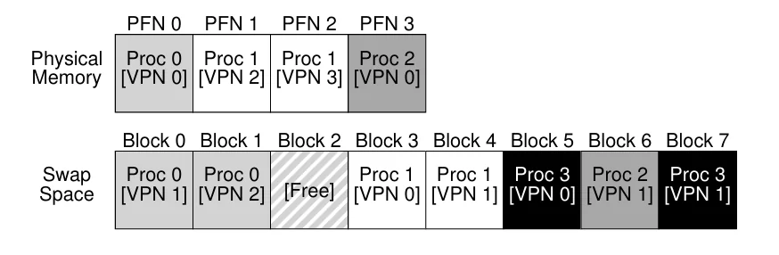

!!!note "代码页"
    交换空间并不是硬盘上唯一需要与内存进行交换的区域。可执行文件的代码页最早位于硬盘上，在程序运行时，这些页会被加载到内存中

### Present Bit

如果想要实现将页换到硬盘，我们需要增加更多的机制。通过在 PTE 中增加一个**存在位**(present bit)，硬件可以判断该页是否位于物理内存中

- 存在位为 1，那么该页位于物理内存，内存访问的过程和之前一样；
- 存在位为 0，那么该页位于硬盘的交换空间中，访问一个不在内存中的页通常会造成**页错误**(page fault)

一旦发生页错误，操作系统将运行一段被称为**页错误处理函数**(page-fault handler)的代码来处理页错误

### Page Fault

无论 TLB 是由硬件管理还是由软件管理，页错误都通过软件（操作系统）来处理。如果页被换出到交换空间，操作系统需要将该页换入到内存中以处理页错误。当存在位为 0 时，PTE 中原本存放 PFN 的位置将改为存放页在硬盘上的地址

操作系统会首先查看 PTE 获得页在硬盘上的地址，然后发起请求将页从硬盘加载到物理内存。当硬盘 I/O 完成时，操作系统将 PTE 中的存在位设为 1，更新 PFN 为页在物理内存中的地址，并再次尝试执行指令

再次执行指令将造成 TLB 缺失，此时操作系统将会如之前描述的流程处理 TLB 缺失并再次尝试执行指令

执行 I/O 时，进程处于**被阻塞**(blocked)的状态，操作系统将在处理页错误时运行另一个进程，这样的重叠执行能够更高效地利用硬件

### Page Replacement

当物理内存被占满时，操作系统会将一些页换出，为即将换入的页留出空间，选择哪一个页进行换出被称为**页替换策略**(page-replacement policy)

大部分操作系统通过**低水位线**(low watermark, LW)和**高水位线**(high watermark, HW)来决定何时将页换出内存：当可用页小于 LW 时，操作系统将会运行一个释放内存的后台线程，直到可用页达到 HW。这个后台线程通常被称为**交换守护进程**(swap daemon)

这种方式还带来一些优化空间，例如把多个页聚成一组，一次性写入交换空间，以提高硬盘效率

有了后台线程后，触发页错误的进程不再自己做替换：

1. 它先检查是否有可用的空闲页，
2. 如果没有就进入睡眠，由交换守护进程负责释放出一批页；
3. 空闲页就绪后，该进程被唤醒，把想要的页调入内存，再继续自己的工作

### Page Fault Control Flow

在处理页错误时，硬件的控制逻辑如下：
```c
VPN = (VirtualAddress & VPN_MASK) >> SHIFT 
(Success, TlbEntry) = TLB_Lookup(VPN) 
if (Success == True) // TLB Hit 
	if (CanAccess(TlbEntry.ProtectBits) == True) 
		Offset = VirtualAddress & OFFSET_MASK 
		PhysAddr = (TlbEntry.PFN << SHIFT) | Offset 
		Register = AccessMemory(PhysAddr) 
	else 
		RaiseException(PROTECTION_FAULT) 
else // TLB Miss 
	PTEAddr = PTBR + (VPN * sizeof(PTE)) 
	PTE = AccessMemory(PTEAddr) 
	if (PTE.Valid == False) 
		RaiseException(SEGMENTATION_FAULT) 
	else if (CanAccess(PTE.ProtectBits) == False) 
		RaiseException(PROTECTION_FAULT) 
	else if (PTE.Present == True) 
		// assuming hardware-managed TLB 
		TLB_Insert(VPN, PTE.PFN, PTE.ProtectBits) 
		RetryInstruction() 
	else if (PTE.Present == False) 
		RaiseException(PAGE_FAULT)
```

现在 TLB 缺失需要分四种情况：

1. 页的有效位和存在位都为 1，此时从 PTE 中取出 PFN 写入 TLB，再重新尝试指令即可
2. 页的有效位为 1 但存在位为 0，此时需要调用页错误处理程序
3. 页的有效位为 1，但保护位不允许本次访问，此时抛出保护错误
4. 页的有效位为 0，此时直接抛出异常

而操作系统的控制逻辑如下：
```c
PFN = FindFreePhysicalPage() 
if (PFN == -1) // no free page found 
	PFN = EvictPage() // replacement algorithm 
DiskRead(PTE.DiskAddr, PFN) // sleep (wait for I/O) 
PTE.Present = True // update page table: 
PTE.PFN = PFN // (present/translation) 
RetryInstruction() // retry instruction
```

首先，操作系统必须为即将出现页错误的页找到一个物理页帧；如果没有这样的页，就得等待替换算法运行，把一些页从内存中踢出去。有了页帧后，处理程序会发出 I/O 请求，从交换空间读取该页。最后，当这个慢操作完成后，操作系统会更新页表并重试指令。重试会导致 TLB 缺失，然后再次重试时会 TLB 命中，这时硬件就能访问到需要的内容了

## Policy

### Cache Management

内存只包含了系统中所有页的子集，因此可以将内存看作虚拟内存页的**高速缓存**(cache)。页替换策略的目标是最小化**缓存缺失率**(cache miss rate)，即最小化从硬盘读取页的次数

通过缓存命中率和缺失率可以计算出一个程序的**平均内存访问时间**(average memory access time, AMAT)
$$
AMAT=T_M+(P_{Miss}\cdot T_D)
$$
其中 $T_M$ 表示访问内存的时间，$T_D$ 表示访问硬盘的时间，$P_{Miss}$ 表示缺失率（0 到 1 的小数）

!!!example "AMAT 的例子"
    假设现在有一个页大小为 256 字节的 4KB 地址空间，那么一共有 16 个页。现在进一步假设除了虚拟页 3 之外，其余页都位于内存，进程依次访问 `0x000`、`0x100`、$\cdots$、`0x900` 这 10 个地址

    除了对虚拟页 3 的访问（`0x300`）缺失外，其余访问均命中，因此命中率为 $90\%$，缺失率为 $10\%$。如果 $T_M$ 为 100 纳秒，$T_D$ 为 10 毫秒，则该程序的 AMAT 为 $100\,\text{ns}+0.1\times 10\,\text{ms}\approx 1.0001\,\text{ms}$


对现代系统来说，访问硬盘的时间极长，即使缺失率很小，也会主导整体的 AMAT

### The Optimal Replacement Policy

与最好的替换策略进行比较，可以更好地理解一个特定替换策略的表现。最优策略能造成最少的缺失，其原理十分简单：每次替换**未来最晚才会被访问**的页。但实现起来非常困难，因为需要预知未来的访问序列

接下来看一个简单的例子，假设缓存可容纳 3 个页，一个程序依次访问 0,1,2,0,1,3,0,3,1,2,1 ，下图展示了最优策略的情况

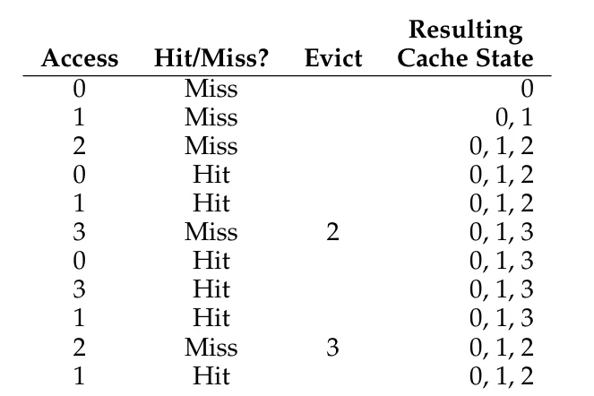

从图中可以看出

- 缓存一开始是空的，所以首次访问 0、1、2 都会导致**冷启动缺失**（cold-start miss，也称**强制缺失**，compulsory miss）
- 首次访问页 3 时，由于缓存已满，需要选一个页替换。按最优策略，应换出未来最晚才会被访问的页，即页 2
- 整个序列共命中 6 次、缺失 5 次，命中率为 $\frac{6}{6+5} = 54.5\%$
- 如果不计强制缺失，则命中率为 $\frac{6}{6+1} = 85.7\%$。强制缺失共有 4 次，即 0、1、2、3 各自的首次访问，剩下的 1 次缺失是最后访问页 2 时产生的

在通用操作系统上无法实现一个最优替换策略，它只作为一个对照组，告诉我们距离完美有多远

### FIFO

早期系统使用一些非常简单的替换策略，例如 FIFO：当页进入系统时将其加入**队列**；需要进行替换时，将队列**尾部**（即最先进入的）页换出内存

FIFO 的优点是容易实现，但是它几乎无法判断页的重要性

下图展示了 FIFO 在之前的访问序列上的情况

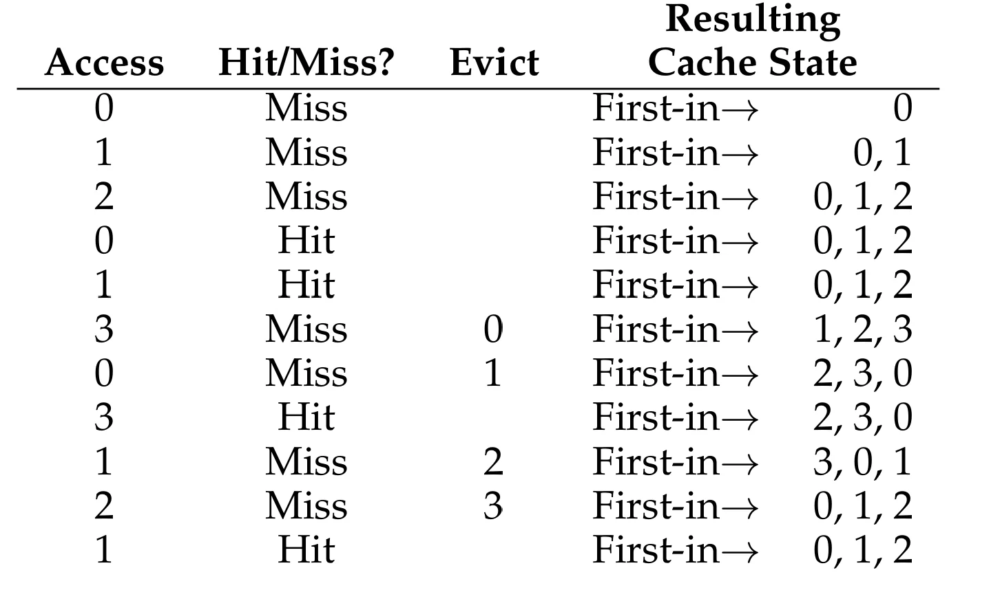

从图中可以看出

- 缓存一开始是空的，所以首次访问 0、1、2 都会导致**强制缺失**
- 在访问页 3 时，由于缓存已满，需要选一个页替换。按照 FIFO，应换出最先进入缓存的页，即页 0
- 与最优替换策略相比，FIFO 表现较差，命中率只有 $36.4\%$ （ 不计强制缺失时命中率为 $57.1\%$）

### Random

另一种简单的替换策略是**随机**(random)：在缓存满后随机选择一个页进行替换

随机的优点是容易实现，但是性能完全取决于运气

下图展示了在之前的访问序列上运行 10000 次后的情况

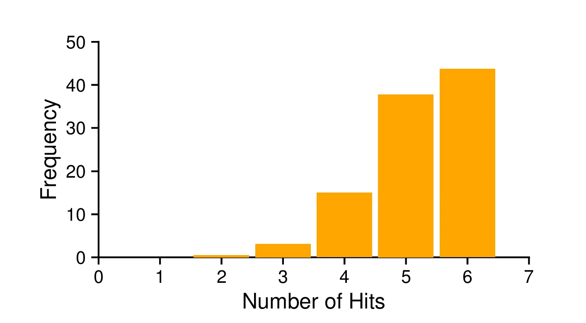

从图中可以看出：有时随机与最优策略一样，有时情况非常糟

### LRU

FIFO 和随机有一个相同的问题：可能会将一个即将被访问的重要页踢出。因此，FIFO、随机以及其他一些简单的替换策略都很难接近最优策略

根据局部性原理，我们可以借助过去的情况来预测未来。替换策略可以利用的历史信息有两类：

- **频率**(frequency)：一个页被访问得越频繁，未来越可能被访问
- **近期性**(recency)：一个页越近被访问过，未来越可能再次被访问

因此，出现了两种基于以上历史信息的算法：

- **LFU**(least frequently used)：选择使用频率最低的页进行替换
- **LRU**(least recently used)：选择最近最少使用的页进行替换

下图展示了 LRU 在之前的访问序列上的情况

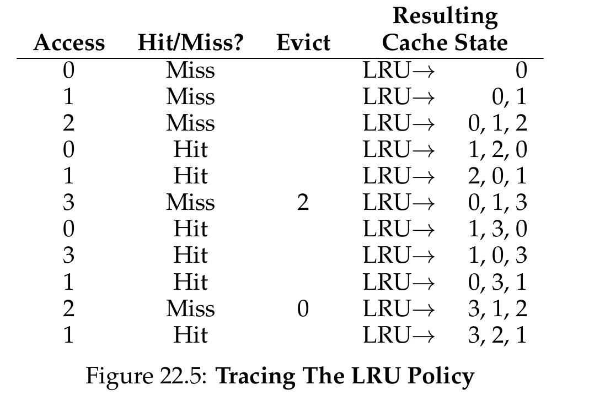

它共命中 6 次，与最优策略相同

还存在着与这些算法相对的算法：**MFU**（Most-Frequently-Used）和 **MRU**（Most-Recently-Used），不过它们在大部分情况下都表现不佳

### Workload Examples

为了更好地理解这些策略的表现，我们来看几个例子。这里使用比之前的小序列更复杂的**工作负载**，不过这些工作负载仍然是经过简化的

第一个工作负载**没有局部性**，即每次访问都从 100 个不同的页中随机选择一个，总共访问 10000 次。记录不同缓存大小下的命中率，各个替换策略的情况如下图

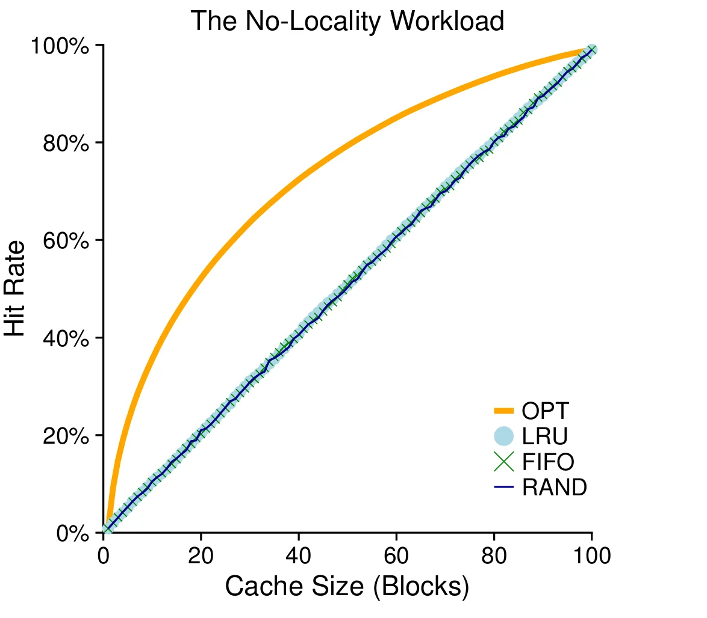

从图中可以得出如下结论：

- 对于没有局部性的工作负载，LRU,FIFO 与随机表现几乎完全相同
- 当缓存足以容纳整个工作负载时，替换策略将不再重要
- 最优策略明显优于其他现实可行的策略

第二个工作负载被称为"**80-20工作负载**"，$80\%$ 的访问集中在 $20\%$ 的页上（热门页），其余 $20\%$ 的访问分散在另外 $80\%$ 的页上（冷门页）
各策略的表现如下图

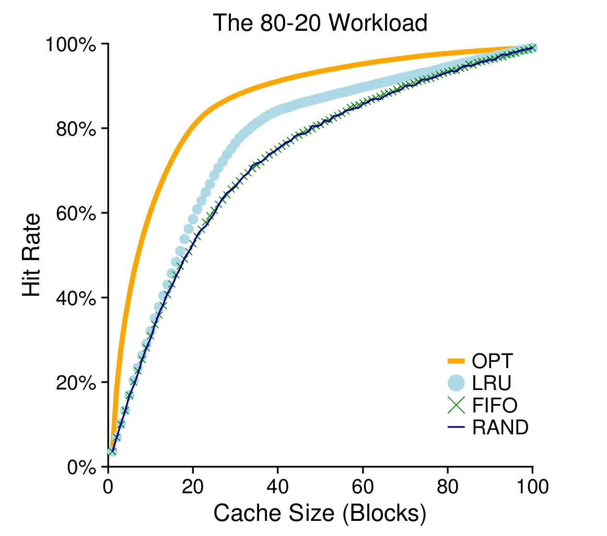

从图中可以看出： FIFO 与随机表现相近，LRU 相对更好，最优策略表现最好

LRU 相对于 FIFO 和随机策略的提升是否重要，取决于缓存缺失的代价：如果缺失代价高昂，命中率哪怕只提升一点，也能显著提升性能；如果缺失代价不大，LRU 的提升就没那么重要

最后一个工作负载是**循环序列**，按顺序依次访问 50 个页（0, 1, …, 49），然后从头循环，它代表着 LRU 与 FIFO 的最差情况

各个替换策略如下图

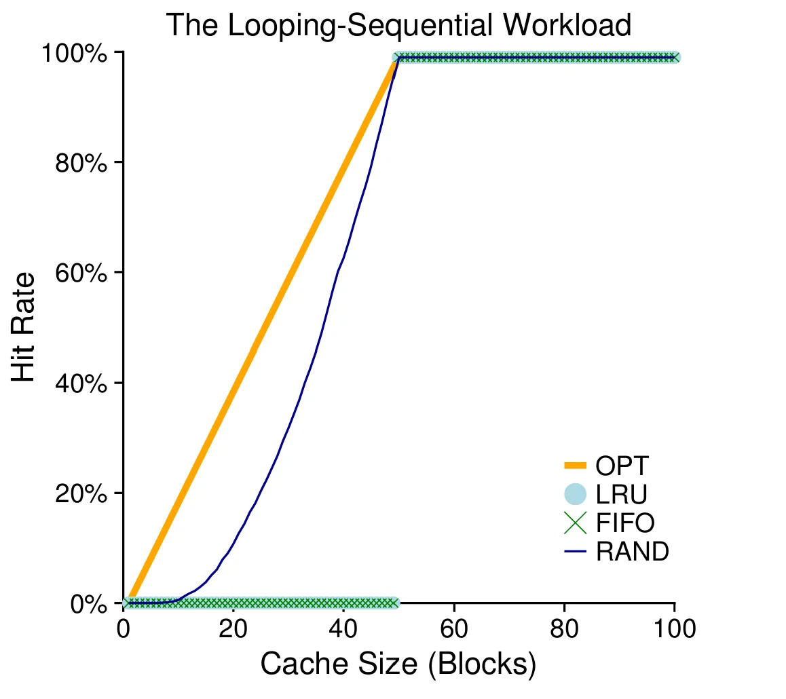


### Approximating LRU

LRU 通常能获得比 FIFO 或随机这样的简单算法更好的性能，但如何实现 LRU 成为了一个新的问题。为了实现完美的 LRU，每次页访问时都需要更新一些信息，将被访问的页移动到队列的前面；操作系统需要在每次内存访问时做这样的记录，才能知道哪个页最近最少或最近最多被使用，这将极大地影响性能

一个方法是使用硬件来加速这一过程，由硬件负责更新内存的访问信息。但是，随着系统中页数量的增长，在所有页中寻找最近最少使用的页是非常耗时的

事实证明，**近似 LRU** 是一个更可行的方案，它需要借助**使用位**(used bit，也称为**引用位**，reference bit)。当一个页被访问时，硬件会将其引用位设为 1，但硬件不会将引用位设为 0，这是操作系统的工作

操作系统通过**时钟算法**(clock algorithm)利用引用位近似 LRU：系统中的页排列成一个环形队列，时钟指针开始时指向一个特定的页。当需要替换一个页时，操作系统检查当前指向的页 $P$ 的引用位

- 引用位为 1 ：页 $P$ 最近被使用过，因此不是一个好的选择。操作系统会将它的引用位设为 0 并增加指针查看下一个页 $P+1$
- 引用位为 0 ：页 $P$ 最近没有被使用，选择当前页即可

时钟算法的表现如下图所示

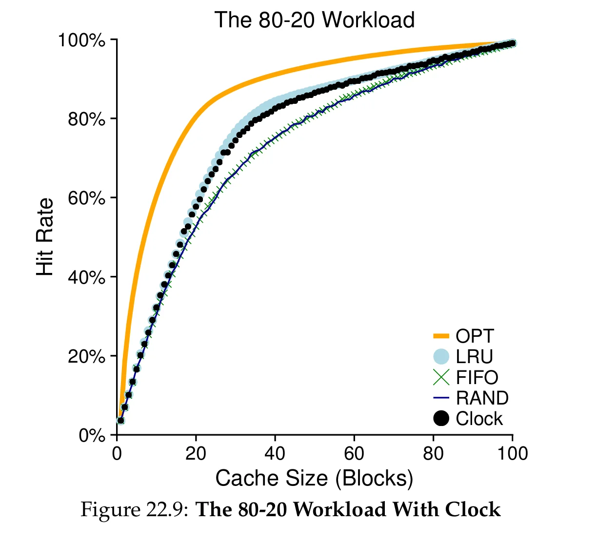

关于时钟算法还有一点需要考虑：如果一个页被修改过（即**脏页**，dirty），将其换出到硬盘的成本十分高昂；如果一个页没有被修改，替换的成本相当低，物理页可以直接被重新使用而不需要进行 I/O

为了支持这一行为，硬件需要提供一个**修改位**（modified bit，也称为**脏位**，dirty bit），在页被写入时设置该位。时钟算法会首先寻找既没有被使用也没有被修改的页；如果没有这样的页，再寻找未使用的脏页，以此类推

### Other VM Policy

尽管页替换可能是最重要的策略，但它并不是虚拟内存系统唯一的策略。操作系统还需要决定**何时**将页调入内存，这被称为**页选择策略**(page selection policy)

- **按需分页**(demand paging)：大多数页采用这种方式，在页被访问时才将其调入内存
- **预取**(prefetching)：操作系统猜测某个页即将被使用，提前将其调入内存。只有在成功的可能性较大时才应这样做
	
> 例如：如果代码页 $P$ 被调入内存，那么代码页 $P+1$ 很可能很快会被访问，也应一并调入

另一个策略决定操作系统如何将页写入硬盘。与其一次写一个页，许多系统会先在内存中收集一批待写入的页，再一次性写入硬盘，这被称为**聚簇**(clustering)或**写入分组**(grouping of writes)。这样做是有效的，因为硬盘执行一次大的写入比执行多次小的写入更高效

### Thrashing

当内存被**过度订阅**(oversubscribed)，即正在运行的进程所需的内存总量超过可用物理内存时，系统将不断地进行换页，这种情况被称为**抖动**(thrashing)

应对抖动有两类做法：

- **准入控制**(admission control)：早期的一些系统会检测并处理抖动
	- 做法：系统暂不运行一部分进程，希望剩余进程的**工作集**(working set，即进程正在活跃使用的页)能够放入内存，从而继续推进
	- 思想：做好少量的工作，往往比同时做所有工作却都做不好更好
- **内存不足杀手**(out-of-memory killer)：一些当前的系统采取更激进的方式
	- 做法：内存过度订阅时，某些版本的 Linux 会运行该守护进程，选择一个占用内存多的进程并将其杀死
	- 问题：虽然能有效缓解内存压力，但可能误杀关键进程，例如杀死 X 服务器，导致所有需要显示的应用无法使用

## Complete Virtual Memory Systems

完整的虚拟内存系统除了页表机制与替换策略，还包含大量面向**性能**、**功能**与**安全**的特性。这里看两个系统：**VAX/VMS**（最早的「现代」虚拟内存系统之一）与 **Linux**

## VAX/VMS Virtual Memory

### Memory Management Hardware

VAX-11 的虚拟地址为 32 位，页大小仅 512 字节：**23 位 VPN** + **9 位 offset**。VPN 最高 2 位用于区分段，因此 VAX 是**分页与分段的混合**

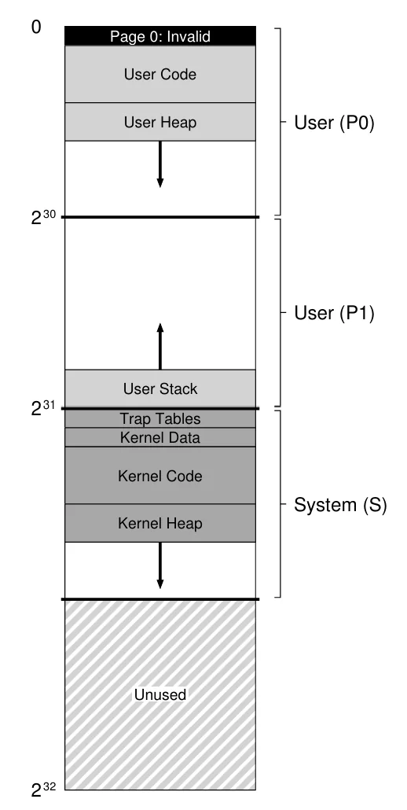{height=400px}

P0、P1 属于每进程独有的**进程空间**，S 属于**系统空间**。页太小使**线性页表极其庞大**，VMS 的首要目标之一就是缓解页表压力

### Reducing Page-Table Pressure

1. **按段拆分页表**：P0、P1 各一张页表，用**基址与界限寄存器**管理，栈与堆之间的空洞不占页表空间
2. **用户页表放进内核虚拟内存**：内存紧张时，**页表的页也能被换出**

!!! note "代价"
    翻译地址时要先查**系统页表**才能找到用户页表的页，查找变复杂，好在通常被 TLB 掩盖

!!!warning "通用性的诅咒 (the curse of generality)"
    操作系统要通用地支持各种应用与机器，往往对任何一种都做不好

### A Real Address Space

- **页 0 不可访问**：使空指针访问能被检测到（段错误），便于调试
- **内核被映射进每个用户地址空间**：上下文切换只改 P0、P1，不改 S。内核可直接访问用户指针，像一个受保护的库
- **保护**：保护位规定访问页所需的 **CPU 特权级**，用户访问系统页会陷入内核

### VMS Page Replacement

VAX 的 PTE 包含有效位、保护字段、修改位、OS 保留字段和 PFN，但**没有引用位**

!!!note "用保护位模拟引用位"
    把页标为不可访问，被访问时陷入，OS 再改回正常权限。替换时，仍不可访问的页就是近期未被使用的页

为防止**内存大户**(memory hog)，VMS 采用**分段 FIFO**：每个进程有**常驻集大小**(RSS)上限，超过时按 FIFO 踢出页。为弥补 FIFO 性能一般的问题，被踢出的页先进入两条全局**再机会链表**（干净页表与脏页表），若在复用前被再次访问，可直接取回，无需磁盘 I/O。链表越长，越接近 LRU

VMS 最重要的优化是**聚簇**：从脏页表中成批取出页，一次写入硬盘

### Other Neat Tricks

!!!tip "懒惰是一种美德 (be lazy)"
    延后工作可以降低延迟，有些工作甚至根本不必做

- **按需清零**(demand zeroing)：加入页时先只放一个不可访问的表项，进程真正访问时才分配、清零、映射
- **写时复制**(copy-on-write, COW)：拷贝页时不搬数据，只映射并两边标为只读；某一方写入时才分配新页并拷贝
	- 用途：共享库、`fork()`（子进程常随即 `exec()`，省去无用拷贝）

## Linux Virtual Memory

### The Linux Address Space

Linux 地址空间分为用户部分与内核部分，经典 32 位下分界在 `0xC0000000`。内核部分对所有进程相同，用户态无法访问。内核地址有两类：

- **内核逻辑地址**(`kmalloc`)：与物理内存低端一一对应，**不能换出**，物理上连续，适合 **DMA**
- **内核虚拟地址**(`vmalloc`)：虚拟上连续、物理上可能不连续，易于分配大缓冲区，不适合 DMA

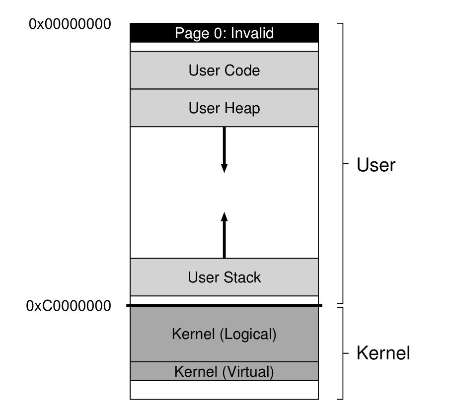

### Page Table Structure

x86 提供**硬件管理**的多级页表，OS 只在进程创建、销毁、上下文切换时介入。64 位使用低 48 位，是**四级页表**：每级 9 位，加 12 位 offset（4 KB 页）

### Large Page Support

x86 支持 2 MB、1 GB 的**巨页**(huge page)，主要动机是 **TLB 收益**：更少的表项覆盖更大范围，减少 TLB 缺失

- 先要求应用**显式**申请（`mmap()`、`shmget()`），后来加入**透明巨页**，由 OS 自动分配
- 代价：**内部碎片**，换出时放大 I/O

### The Page Cache

Linux 用统一的**页缓存**(page cache)缓存三类页：内存映射文件、文件系统数据与元数据、进程的堆与栈（**匿名内存**，后端是交换空间）。脏页由后台线程在**超时**或**脏页过多**时回写

替换采用改进版的 **2Q** 算法。动机是 LRU 会被「反复读一个大文件」欺骗，把其他有用的页全部挤出内存

- 页首次访问时放入 **inactive list**，再次访问时升入 **active list**
- 替换候选只从 inactive list 取，active 约占页缓存的三分之二
- 两条链表都用近似 LRU 管理

!!!note "mmap 无处不在"
    `mmap()` 把文件映射为一段虚拟内存，访问未调入的部分会触发页错误，OS **按需分页**。可执行文件和共享库的代码也是这样装入内存的

### Security and Buffer Overflows

现代 VM 系统最大的变化是对**安全**的重视。**缓冲区溢出**(buffer overflow)可让攻击者注入代码并接管程序，若打中内核则可**提权**

防御手段按出现顺序：

- **NX 位**：禁止从该页取指执行，注入到栈上的代码无法运行
	- 绕过方式：**返回导向编程**(ROP)，把程序中已有的代码片段（gadget）串起来执行
- **地址空间布局随机化**(ASLR)：代码、栈、堆随机摆放，使 ROP 所需的地址难以确定。内核也有对应的 **KASLR**

!!!warning "Meltdown 与 Spectre"
    利用 CPU 的**投机执行**在缓存等结构中留下的痕迹，读出受 MMU 保护的内存。一种防御是**内核页表隔离**(KPTI)：把大部分内核地址空间从用户进程中移除，代价是进入内核时必须切换页表，开销很大
