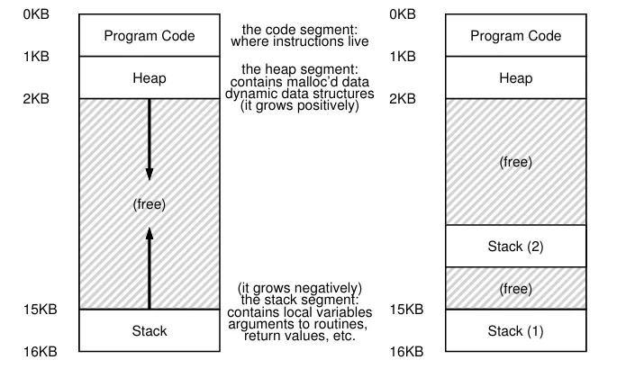
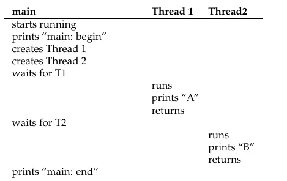
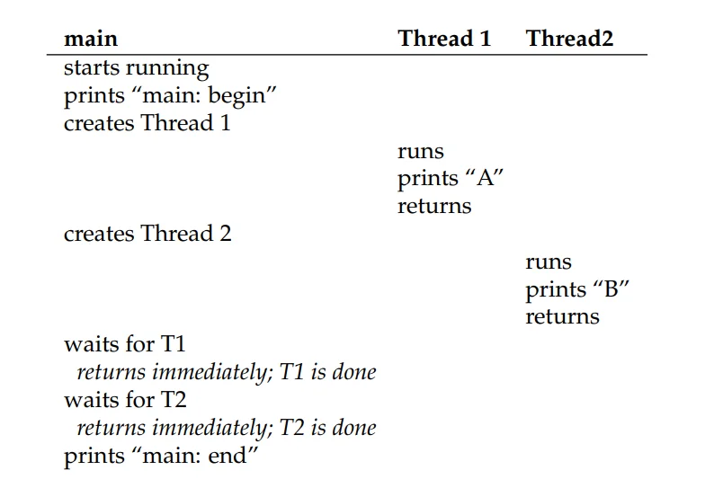
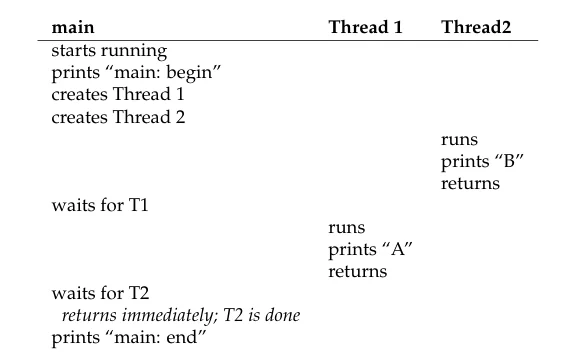
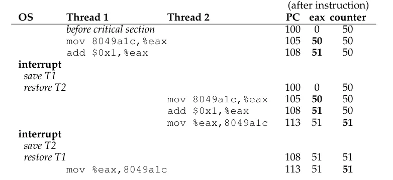

## Introduction

**线程**(thread)是对系统中正在运行的程序的另一种抽象。一个**多线程程序**(multi-threaded)拥有多个用于取指与执行的程序计数器。每个线程可以看作是**共享地址空间**的独立进程

线程的状态与进程十分类似，其拥有：

- 独立的 PC 用于取指
- 独立的寄存器用于计算
- 独立的栈用于保存局部变量与进行函数调用

假设系统中有两个线程 $T_1$ 和 $T_2$ 运行在单处理器上，可以通过**上下文切换**切换当前运行的线程。线程的上下文切换不需要更换地址空间，只需保存 $T_1$ 的寄存器并恢复 $T_2$ 的寄存器，因此比进程的上下文切换更加**轻量快速**

与进程类似，线程的上下文保存在每个线程的**线程控制块**(thread control block, TCB)中

单线程进程与多线程进程的地址空间如下图所示：



> 多线程地址空间的布局破坏了之前那个比较完美的地址空间布局，每个线程都需要自己的栈，原来"堆在上、栈在下"的单栈布局将不再成立

### Advantages

使用线程主要有以下两点原因：

- **并行**(parallelism)：在多处理器上，把一个任务拆分到多个线程中同时执行，以缩短运行时间。将单线程程序改造为在多个 CPU 上执行此类工作的过程，称为**并行化**(parallelization)
- **避免 I/O 阻塞程序运行**：当某个线程等待 I/O 时，CPU 可以切换去运行同一程序中的其他线程，使计算与 I/O 重叠，而不是让整个程序停下来等待

这两点也可以通过多进程实现，但线程共享地址空间，因此更容易共享数据；进程则更适用于逻辑独立、不需要共享内存中数据结构的任务

!!!note "在操作系统中讲解并发的原因"
    操作系统是第一个并发程序

    - 早期的操作系统需要同时处理多个事务，例如多个进程并发地陷入内核、发起系统调用，因此必须面对并发带来的问题
    - 内核中的数据结构（如页表、进程列表、文件系统结构等）会被多个执行流同时访问，如果不加以保护，就会出现不一致的状态
    - 后来这些问题也出现在支持多线程的应用程序中，因此在操作系统中讲解并发，既是为了理解操作系统自身，也是为了写出正确的多线程程序

### Thread Creation

现在我们将运行一个会创建两个线程的程序，这两个线程会独立地打印出 `A` 和 `B`，具体代码[^1]如下：
```c
#include <stdio.h>
#include <pthread.h>
#include <assert.h>
#include "common.h"
#include "common_threads.h"

void* mythread(void* myarg)
{
    printf("%s\n", (char*)myarg);
    return NULL;
}

int main(int argc, char* argv[])
{
    pthread_t p1, p2;
    int rc;
    printf("main: begin\n");
    Pthread_create(&p1, NULL, mythread, (char*)"A");
    Pthread_create(&p2, NULL, mythread, (char*)"B");
    
    // join waits for the thread to finish
    Pthread_join(p1, NULL);
    Pthread_join(p2, NULL);

    printf("main: end\n");

    return 0;
}
```

[^1]: `common.h` 和 `common_threads.h` 见 [Github](https://github.com/remzi-arpacidusseau/ostep-code/tree/master/include){:target="_blank"}

`main()` 函数通过传入不同参数创建了两个运行 `mythread()` 的子线程（分别记为 $T_1$ 与 $T_2$）。一旦线程被创建，根据调度器的策略，它可能会立即开始运行，也可能先处于就绪状态等待调度

> 在多处理器上，多个线程可以真正同时并行运行

当线程 $T_1$ 和 $T_2$ 创建完成后，系统中同时存在主线程（`main`）、$T_1$ 与 $T_2$ 三个线程。主线程通过调用 `Pthread_join()` 等待指定的子线程执行完毕后再继续运行

接下来看一下该程序可能的执行顺序。其中一种可能的执行时序如下图所示：



上图并不是唯一可能的执行顺序。具体以何种顺序交替执行，完全取决于调度器在每个时刻决定运行哪个线程。下图展示了另一种可能的执行时序：



如果调度器在创建后先运行线程 $T_2$，我们甚至会看到先输出 `B` 再输出 `A`，其执行过程如下图所示：



并发的引入让程序的执行轨迹变得难以预测：下一个运行的线程完全由系统调度器决定。尽管调度器内部实现了精细的算法，我们依然无法确切预知在任意时刻究竟是哪个线程正在运行

### Shared Data

假设两个线程希望更新一个全局变量，代码如下：
```c
#include <pthread.h>
#include <stdio.h>
#include "common.h"
#include "common_threads.h"

static volatile int counter = 0;

void *mythread(void *myargs)
{
    printf("%s: begin\n", (char *)myargs);
    int i;
    for (i = 0; i < 1e7; i++)
    {
        counter = counter + 1;
    }
    printf("%s: end\n", (char *)myargs);
    return NULL;
}

int main(int argc, char *argv[])
{
    pthread_t p1, p2;
    printf("main: begin (counter = %d)\n", counter);
    Pthread_create(&p1, NULL, mythread, (char *)"A");
    Pthread_create(&p2, NULL, mythread, (char *)"B");

    Pthread_join(p1, NULL);
    Pthread_join(p2, NULL);
    printf("main: end (counter = %d)\n", counter);
    return 0;
}
```

上面的代码创建了两个线程，每个线程都会将全局变量 `counter` 递增一千万次（$10^7$ 次）。因此，期望的最终结果为 20,000,000

然而在实际运行这段代码时，即使在单核处理器上，往往也得不到正确的结果，并且每次运行的结果都**不确定**

为了理解产生这种现象的原因，需要观察处理器在底层是如何执行 `counter = counter + 1` 的。在 x86 指令集的处理器上，该递增操作通常会被分解为如下三条汇编指令：

```asm
mov 0x8049a1c, %eax
add $0x1, %eax
mov %eax, 0x8049a1c
```

上述代码假设变量 `counter` 的内存地址为 `0x8049a1c`。递增过程包含三个步骤：

1. 第一条 `mov` 指令将内存中 `counter` 的值加载到 `%eax` 寄存器中；
2. `add` 指令将 `%eax` 寄存器的值加 1；
3. 第二条 `mov` 指令将 `%eax` 中的新值写回内存

假设线程 1（$T_1$）先执行这段代码：它将 `counter` 的当前值（假设为 50）加载到其 `%eax` 寄存器，并执行加 1 操作，此时其 `%eax` 的值为 51。就在 $T_1$ 即将把结果写回内存前，发生了一次时钟中断。系统执行上下文切换，将 $T_1$ 的状态保存到其 TCB 中，并切换到线程 2（$T_2$）运行

现在 $T_2$ 开始执行相同的代码：它将 `counter` 的值加载到自己的 `%eax` 寄存器中。由于 $T_1$ 尚未将计算结果写回内存，此时内存中的 `counter` 仍为 50。接着 $T_2$ 将 `%eax` 的值加 1 变为 51，并将其写回内存，此时全局变量 `counter` 的值为 51

最后，再次发生上下文切换，$T_1$ 重新恢复执行。它从中断处继续执行第三条指令，将其 `%eax` 中的值（51）写入内存。最终，虽然两个线程各自完成了一次递增，但全局变量 `counter` 的值仅为 51，而不是正确的 52

整个执行时序如下图所示：



这种情况被称为**竞态条件**(race condition)或更具体地称为**数据竞争**(data race)。最终的计算结果取决于代码执行的时序，多次运行可能得到截然不同的结果。因此，这不是一个**确定性**(deterministic)的计算，其执行结果是**不确定的**(indeterminate)

像这样访问共享资源的代码片段被称为**临界区**(critical section)，多个线程并发执行临界区时就可能产生竞态条件。为了保证计算的正确性，临界区的执行必须满足**互斥**(mutual exclusion)，即确保在任意时刻最多只有一个线程能够执行临界区中的代码

### Atomicity

解决上述问题的一种核心思想是实现**原子性**(atomicity)。所谓原子操作，是指该操作要么完整执行完成，要么完全不执行，不存在任何中间状态（即 "all or none"）。如果一段操作具有原子性，执行过程中即使发生中断，也不会暴露不一致的中间状态

在实际系统中，硬件通常无法为任意复杂的临界区直接提供单一的原子指令。因此，硬件提供了一些支持原子操作的基础指令，借助这些指令可以构建出通用的**同步原语**(synchronization primitives)。通过在临界区前后添加获取与释放（如加锁与解锁）的同步操作，就能保证同一时刻只有一个线程进入临界区，从而实现互斥

### Waiting For Another

前面主要讨论了线程之间的一种经典交互——**并发访问共享变量**，并为此需要对临界区提供互斥与原子性保护。实际上还有另一种常见的交互模式：**一个线程必须等待另一个线程完成某个动作后才能继续**

例如，当一个线程等待另一个线程产生结果或等待 I/O 完成时，它需要被**置为睡眠**(put to sleep)；待目标动作完成后，它再被**唤醒**(wake up / roused)以继续执行

因此，后续不仅要研究保障互斥与原子性的同步原语（如锁），还需要研究支持这种**睡眠/唤醒**(sleeping/waking)交互的机制，这正是**条件变量**(condition variables)所要解决的问题

## Thread API

### Thread Creation

在 POSIX 中，可以使用下面的函数创建一个线程：
```c
#include <pthread.h>

int pthread_create(
	pthread_t*				thread,
	const pthread_attr_t* 	attr,
	void* 					(*start_routine)(void*),
	void*					arg
);
```

这个函数有四个参数：

- `thread`：指向 `pthread_t` 类型的指针，用于保存新创建线程的标识，之后通过它与该线程交互
- `attr`：指定线程的属性，大多数情况下直接设为 `NULL` 使用默认值
- `start_routine`：函数指针，指向线程需要运行的函数
- `arg`：传递给线程函数的参数

下面是一个例子：
```c
#include <stdio.h>
#include <pthread.h>

typedef struct {
    int a;
    int b;
} myarg_t;

void* mythread(void* arg) {
    myarg_t* args = (myarg_t*)arg;
    printf("%d %d\n", args->a, args->b);
    return NULL;
}

int main(int argc, char** argv) {
    pthread_t p;
    myarg_t args = {10, 20};

    pthread_create(&p, NULL, mythread, &args);
}
```

这里将两个参数打包在一个结构体中传给新线程，新线程再将 `void*` 参数转换回正确的类型

### Thread Completion

可以使用 `pthread_join` 等待一个线程完成：
```c
int pthread_join(
	pthread_t thread,
	void**	  value_ptr	
);
```

这个函数有两个参数：

- `thread`：指定需要等待的线程
- `value_ptr`：指向返回值的指针，用于获取线程函数的返回值（不关心时可设为 `NULL`）

> 线程函数返回的是 `void*`，而 `pthread_join` 需要修改调用者中的这个 `void*` 变量，因此参数类型是 `void**`

下面是一个例子：
```c
#include <stdio.h>
#include <pthread.h>
#include <stdlib.h>

typedef struct {int a; int b;} myarg_t;
typedef struct {int x; int y;} myret_t;

void* mythread(void* arg) {
    myret_t* rvals = malloc(sizeof(myret_t));
    rvals->x = 1;
    rvals->y = 2;
    return (void*)rvals;
}

int main(int argc, char *argv[])
{
    pthread_t p;
    myret_t* rvals;
    myarg_t args = {10, 20};
    pthread_create(&p, NULL, mythread, &args);
    pthread_join(p, (void**)&rvals);
    printf("returned %d %d\n", rvals->x, rvals->y);
    free(rvals);
    return 0;
}
```

关于这个程序，有以下几点需要注意：

- 如果只有一个参数或者不需要参数，就不必用结构体打包
- 不能返回指向线程**栈上局部变量**的指针：线程返回后其栈被回收，该指针将指向无效内存
- 创建线程后立刻调用 join 等待它，这与**过程调用**(procedure call)没有区别
- 并不是所有的多线程程序都需要使用 join，例如长期运行的服务器线程

### Locks

**锁**(lock)是 POSIX 线程库为临界区提供互斥的机制，主要包括下面两个函数：
```c
int pthread_mutex_lock(pthread_mutex_t* mutex);
int pthread_mutex_unlock(pthread_mutex_t* mutex);
```

使用方式如下：
```c
pthread_mutex_t lock;
pthread_mutex_lock(&lock);
// critical section
pthread_mutex_unlock(&lock);
```

如果没有其他线程持有锁，调用线程将获得锁并进入临界区；如果锁已被其他线程持有，`pthread_mutex_lock` 不会返回，直到持有者释放锁。因此同一时刻只有一个线程能进入临界区

上面的代码有两个问题：

1. **锁没有初始化**：所有锁都必须正确初始化，有两种方法：
	- 使用宏 `PTHREAD_MUTEX_INITIALIZER`
	- 调用 `pthread_mutex_init()` 函数
2. **没有检查返回的错误码**：lock 与 unlock 都可能失败，忽略错误码可能导致多个线程同时进入临界区

### Condition Variables

线程库中另一个重要组件是**条件变量**(condition variable)，适用于一个线程需要等待另一个线程发出信号的场景。主要函数如下：
```c
int pthread_cond_wait(pthread_cond_t *cond, 
					  pthread_mutex_t *mutex); 
int pthread_cond_signal(pthread_cond_t *cond);
```

使用条件变量时需要一个与之关联的锁，调用上面两个函数时线程必须持有该锁

`pthread_cond_wait` 让调用线程进入睡眠，等待其他线程**唤醒**(signal)它——通常是程序中发生了睡眠线程所关心的变化

一个典型的用法如下：
```c
pthread_mutex_t lock = PTHREAD_MUTEX_INITIALIZER; 
pthread_cond_t  cond = PTHREAD_COND_INITIALIZER;

pthread_mutex_lock(&lock); 
while (ready == 0) 
	pthread_cond_wait(&cond, &lock); 
pthread_mutex_unlock(&lock);
```

线程检查 `ready` 是否已被设为非 0 值，如果没有，就调用 `pthread_cond_wait` 睡眠，直到被其他线程唤醒

另一个线程负责修改条件并唤醒它：
```c
pthread_mutex_lock(&lock); 
ready = 1; 
pthread_cond_signal(&cond); 
pthread_mutex_unlock(&lock);
```

需要注意的是：

- 修改条件和发送信号时都应持有锁，避免竞态条件
- `pthread_cond_wait` 在让线程睡眠的同时会**释放锁**，否则另一个线程无法获取锁来唤醒它；被唤醒后、返回之前，它会**重新获取锁**。因此等待线程从获取锁到最终释放锁的整个过程中，执行代码时始终持有锁
- 使用 `while` 而不是 `if` 检查条件：被唤醒后条件未必成立，需要重新检查

!!! tip "" 
    后面会更详细的讨论锁和条件变量 

### Compiling and Running

使用 pthread 相关函数需要包含 `pthread.h` 头文件，编译时需要添加 `-pthread` 选项来链接 pthread 库

例如：
```bash
gcc -o main main.c -Wall -pthread
```