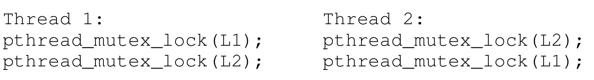
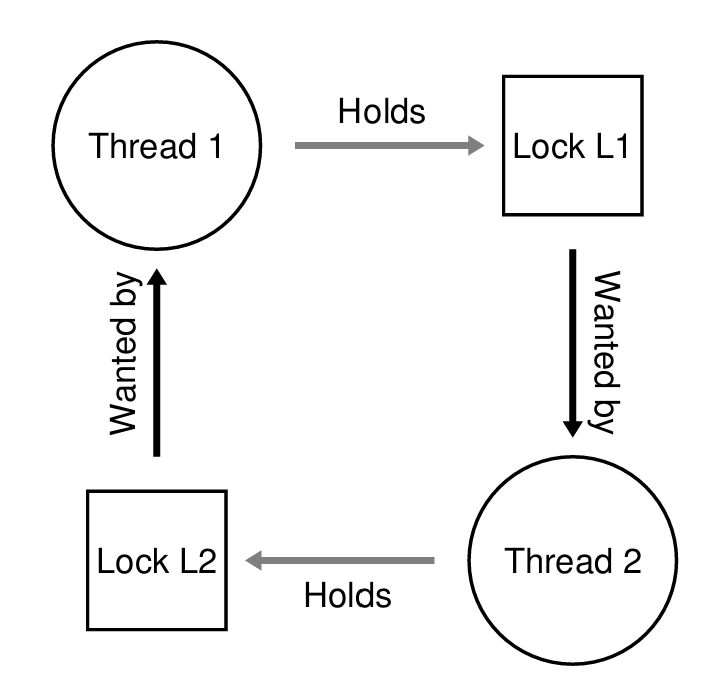
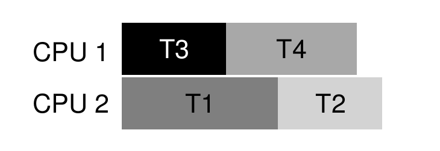
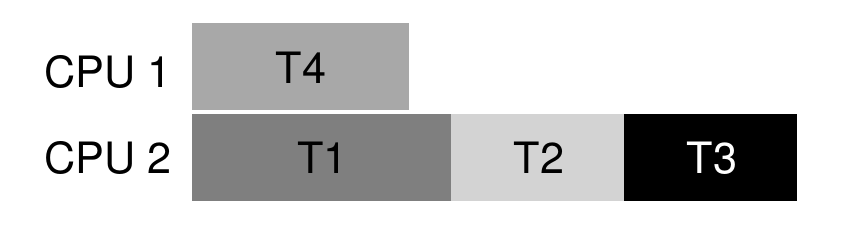

## Common Concurrency Problems

常见的并发问题可以分为**死锁**(deadlock)和**非死锁**(nondeadlock)问题两大类

### Non-Deadlock Bugs

大部分并发问题都是非死锁问题，常见的非死锁问题主要有两类：

- **违反原子性**(atomicity violation)
- **错误顺序**(order violation)

#### Atomicity Violation

违反原子性指的是某段包含代码本应作为一个整体原子地执行，但在实际运行时却并未强制保证这种原子性

下面是一个例子
```c
Thread 1:
if  (thd->proc_info) {
	fputs(thd->proc_info, ...);
}

Thread 2:
thd->proc_info = NULL;
```

如果在线程 1 判断 `thd->proc_info` 不为空后发生了上下文切换，那么线程 2 将开始运行并将 `thd->proc_info` 设为空。当再次轮到线程 1 运行时，`fputs` 将会访问一个空指针

只需要在访问共享资源的代码周围加上**互斥锁**即可解决这一问题，改进后的代码类似下面
```c
pthread_mutex_t mutex = PTHREAD_MUTEX_INITIALIZER;

Thread 1:
pthread_mutex_lock(&mutex);
if  (thd->proc_info) {
	fputs(thd->proc_info, ...);
}
pthread_mutex_unlock(&mutex);

Thread 2:
pthread_mutex_lock(&mutex);
thd->proc_info = NULL;
pthread_mutex_unlock(&mutex);
```

> 任何需要访问 `thd` 的代码都应该使用锁

#### Order-Violation Bugs

错误顺序指的是 A 应该总是在 B 之前执行，但在运行时没有保证这一顺序

下面是一个例子
```c
Thread 1:
void init() {
	mThread = PR_CreateThread(mMain, ...);
}

Thread 2:
void mMain(...) {
	mState = mThread->State;
}
```

如果线程 2 在创建后立即开始执行，那么它将访问一个还没有初始化的变量 `mThread` ，这将导致空指针错误

只需要保证两个函数的执行顺序即可解决这个问题，使用条件变量是一个简单可行的方法。改进后的代码类似下面

```c
pthread_mutex_t mutex = PTHREAD_MUTEX_INITIALIZER;
pthread_cond_t cond = PTHREAD_COND_INITIALIZER;
int mtInit = 0;

Thread 1:
void init() {
	mThread = PR_CreateThread(mMain, ...);
	
	pthread_mutex_lock(&mutex);
	mtInit = 1;
	pthread_cond_signal(&cond);
	pthread_mutex_unlock(&mutex);
}

Thread 2:
void mMain(...) {
	pthread_mutex_lock(&mutex);
	while (mtInit == 0)
		pthread_cond_wait(&cond, &mutex);
	pthread_mutex_unlock(&mutex);
	mState = mThread->State;
}
```

当需要保证线程的执行顺序时，需要使用条件变量或者信号量

!!!info  "总结"
    违反原子性的问题通常可以通过加**互斥锁**来解决；而当需要强制保证不同线程间的执行顺序时，则需要使用**条件变量**或**信号量**

### Deadlock Bugs

除了上述非死锁问题外，另一类经典的并发缺陷便是**死锁** (deadlock)。当线程 1 持有锁 `L1` 并尝试获取锁 `L2` ，与此同时线程 2 正持有锁 `L2` 并尝试获取锁 `L1`，双方都在等待对方释放锁，程序便会彻底卡死，如下图所示：



>  注意上面这段代码不是一定会导致死锁

只有当线程 1 持有锁 L1 ，上下文切换后线程 2 尝试获取锁 L2 时才会导致死锁，如下图所示，图中的圈就表示发生了死锁

{width="50%"}

死锁的出现的原因主要包括以下两点：

- 在大型项目中，各组件之间存在复杂的依赖关系，可能因为循环依赖导致死锁
- 通过封装实现的模块化与锁不是很契合，某些看似没有关系的接口也会导致死锁

#### Conditions for Deadlock

死锁的产生需要**同时满足**下面四个条件：

- **互斥**：线程对资源进行互斥访问
- **持有并等待**：线程在持有某些资源的同时等待其他资源
- **非抢占**：线程获得的资源不会被其他线程抢占
- **循环等待**：存在一个线程的环，每个线程持有一些资源并且需要下一个线程的资源

上面的四个条件只要有一个不满足就不会导致死锁，接下来介绍的四种死锁预防策略，将分别从破坏这四个条件入手来消除死锁

#### Circular Wait

预防死锁最可行的方法是确保代码永远不会产生循环等待，实现这一目标最直接的方法是为系统中锁的获取定义一个**全序**(total ordering)。例如系统中只有 L1 和 L2两个锁，规定总是先获取 L1 ，再获取 L2 即可避免死锁

在更复杂的系统中，全序关系可能很难实现。此时在局部相关联的锁之间建立**偏序** (partial ordering) 是一种更为切实可行的办法。

!!! tip ""
    无论是全序还是偏序，都要求开发者精心设计加锁策略，并对底层代码的调用关系有深入的理解。因为加锁顺序本质上只是一种人为的**约定**，一旦有粗心的开发者在某处忽略了这一约定，依然很容易引发死锁

#### Hold and Wait

可以通过**一次性地、原子地**获得所有锁来避免由持有并等待引发的死锁，这通常需要引入一把额外的全局锁。实践中可以通过下面的代码来实现
```c
pthread_mutex_lock(prevention);
pthread_mutex_lock(L1);
pthread_mutex_lock(L2);
...
pthread_mutex_unlock(prevention);
```

当一个线程想要获取多把锁时，必须首先获取全局保护锁 `prevention`。这能确保在当前线程依次获取 `L1`、`L2` 等锁的过程中，不会有其他线程中途插进来争抢这些锁，从而彻底消除了边持有边等待的死锁风险

!!! note "局限性"
    由于该方法需要提前知道需要获得的锁，因此这种方法不适用于封装，并且有可能会降低并发度

#### No Preemption

许多并发库提供了更加灵活的接口来避免线程在等待其他线程时一直占有已有的锁。例如 pthread 库中的 `pthread_mutex_trylock()` 会在锁可用时获取锁并返回成功；在锁被持有时，返回一个错误代码表明锁被占用，调用者可以在稍后再次尝试获取该锁

可以通过这个接口构建一个无死锁的获取锁的方法：
```c
top:
	pthread_mutex_lock(L1);
	if (pthread_mutex_trylock(L2) != 0) {
		pthread_mutex_unlock(L1);
		goto top;
	}
```

!!! info "活锁"
    以上的方法引出一个新的问题：**活锁**(livelock)，两个线程可能尝试运行以上代码但是反复的出现失败又释放锁的情况，此时虽然系统仍在不停的运行，但是并没有取得实质性进展。可以通过在循环结束时增加一个随机的延迟来解决这一问题

使用 `trylock` 时可能会遇到一些困难，如果一个锁封装在函数内部，那么一旦获取失败，将很难跳转到循环的开头。当线程通过这种方式获取某些资源时，同时也要保证正确释放这些资源

#### Mutual Exclusion

想要完全不使用互斥几乎是不可能的，因此可以通过强大的**硬件指令**构建**无锁**(lock-free)数据结构来避免显式地使用锁，不过这种通过循环重试来更新数据的方式依然存在发生**活锁**的潜在风险

#### Scheduling

相较于死锁预防，某些场景更适合使用**死锁避免**(avoidance)策略。我们需要掌握线程在运行时会获取哪些锁，从而在调度器编排线程时主动避免死锁

来看一个例子，假设系统有一个双核处理器以及四个待调度的线程。已知线程 T1 和 T2会获取锁 L1 和 L2 ；T3 只会获取 L2 ；T4 不会获取锁。可以将以上信息整理为下表：

|     | T1  | T2  | T3  | T4  |
| :-: | :-: | :-: | :-: | :-: |
| L1  | yes | yes | no  | no  |
| L2  | yes | yes | yes | no  |

由于只有 T1 和 T2 会同时需要两把锁，只要不让 T1 和 T2 同时运行，就不会发生死锁。下面是一个可能的调度方法



接下来看另一个例子，此时线程 T3 也会同时获取 L1 和 L2 ，将信息总结如下表

|     | T1  | T2  | T3  | T4  |
| :-: | :-: | :-: | :-: | :-: |
| L1  | yes | yes | yes | no  |
| L2  | yes | yes | yes | no  |

现在，T1,T2 和 T3 不能同时运行，下面是一种可能的调度方式



!!! info "适用限制"
    死锁避免不是一个广泛使用的通用解决方法，其只在受限环境中有效。除此之外，死锁避免也会降低系统的并发度，如第二个例子所示

#### Detect and Recover

最后一种策略是允许死锁偶尔发生，并在检测到死锁后再采取恢复措施。例如，系统可以定期构建资源分配图并检查其中是否存在环路，一旦发现死锁，便通过重启系统或强制终止某些线程来解除死锁。这种策略在**数据库系统**中尤为常见

## Event-Based Concurrency

截至目前所讨论的并发都是基于线程的，但这并不是并发的全部，另一种被广泛应用在 GUI 程序和部分网络服务器上的并发编程风格，被称为**基于事件的并发**(event-based concurrency)

基于事件的并发主要是为了解决以下两个问题：

- 在多线程程序中正确的处理并发极具挑战性
- 在多线程程序中，线程调度几乎完全由调度器掌控，通用调度器很难对具体的程序做出最优的选择

### Event Loop

基于事件的并发的基本思想非常简单：等待某些事件发生，在事件发生后根据其类型进行相应的操作。这类程序通常基于一个**事件循环**(event loop)，其伪代码如下：

```c
while (1) {
	events = getEvents();
	for (e in events)
		processEvent(e);
}
```

主循环通过不断调用 `getEvents()` 等待事件的发生，一旦有事件发生，便依次针对每个事件调用相应的**事件处理函数** (event handler) `processEvent()` 进行处理。决定接下来处理哪一个事件的过程等价于调度，显式的控制调度是基于事件的并发最基本的优点之一

### `select` / `poll` API

现代操作系统提供了 `select` 或 `poll` 系统调用来接收事件，这些系统调用允许程序检查是否有需要处理的 I/O 请求

以 `select` 为例，其 API 定义如下：
```c
int select(int nfds,
		   fd_set* restrict readfds,
		   fd_set* restrict writefds,
		   fd_set* restrict errorfds,
		   struct timeval* restrict timeout);
```

关于 `select` 有以下几点内容需要注意：

- `select` 可以检查文件描述符集合是否可以读写。前者让服务器能够确定新数据包已到达，而后者则让服务器知道何时可以发送回复
- 对于 `timeout` 参数，一种常见用法是将其设为 `NULL` ，此时 `select` 会无限期阻塞，直到某个描述符就绪为止。另一种常见的用法是将其设为 0 ，此时 `select` 将会检查描述符后立刻返回

下面是一个使用 `select` 的简单例子

??? info "`select` Example"
    ```c
    #include <stdio.h>
    #include <stdlib.h>
    #include <sys/time.h>
    #include <sys/types.h>
    #include <unistd.h>

    int main(void) { 
        // open and set up a bunch of sockets (not shown) 
        // main loop 
        while (1) { 
            // initialize the fd_set to all zero 
            fd_set readFDs; 
            FD_ZERO(&readFDs); 
            
            // now set the bits for the descriptors 
            // this server is interested in 
            // (for simplicity, all of them from min to max) 
            int fd; 
            for (fd = minFD; fd < maxFD; fd++) 
                FD_SET(fd, &readFDs); 
                
            // do the select 
            int rc = select(maxFD+1, &readFDs, NULL, NULL, NULL);
            
            // check which actually have data using FD_ISSET() 
            int fd; 
            for (fd = minFD; fd < maxFD; fd++) 
                if (FD_ISSET(fd, &readFDs)) 
                    processFD(fd); 
        } 
    }
    ```

- 在进行一系列初始化后，服务器会进入一个无限主循环
- 进入循环后，服务器会首先使用 `FD_ZERO` 宏清空描述符集合，接着使用 `FD_SET` 宏将从 `minFD` 到 `maxFD` 的描述符加入到 `readFDs`  集合中
- 随后服务器调用 `select` 检查哪些连接存在数据。当 `select` 返回后，服务器通过在循环中调用 `FD_ISSET` 宏，就能逐一检查具体是哪个描述符就绪，并调用 `processFD()` 进行处理

!!! tip "提示"
    在单 CPU 的事件驱动模型中，由于同一时刻只处理一个事件，中途不会被其他线程打断，因此完全不需要加锁或解锁，从而天然避免了多线程编程中的各种并发缺陷

### Blocking System Calls


在事件发起一个可能被阻塞的系统调用时，例如某个事件调用 `open` 打开文件之后进行一系列 `read` 。这将导致系统长时间的进行 I/O 操作，对于基于线程的服务器，当线程进行 I/O 时调度器会将线程挂起并运行其他线程，从而更高效的利用 CPU；但基于事件的并发除了主循环之外没有其他线程运行，当事件执行 I/O 时系统将处于空闲状态直到 I/O完成

为了解决这一问题，现代操作系统引入了**异步 I/O**(asynchronous I/O)，允许应用在发起 I/O 请求后将控制权立刻返回给调用者，并提供额外的接口检测 I/O 是否完成

以 Mac 为例，其 API 主要基于 **AIO 控制块**(AIO control block)，结构定义如下
```c
struct aiocb {
	int 			aio_fileds; // File descriptor
	off_t			aio_offset; // File offset
	volatile void* 	aio_buffer; // Location of buffer
	size_t			aio_nbytes;	// Length of transfer
}
```

当需要异步读取文件时，程序应当先在该结构体中填好目标文件描述符、文件偏移量、目标缓冲区地址以及读取长度等信息，随后调用 `aio_read` 发起异步读取请求；若发起成功，该函数会立即返回而不会阻塞。其定义如下
```c
int aio_read(struct aiocb* aiocbp);
```

可以使用 `aio_error` 来检测 I/O 是否完成，其定义为
```c
int aio_error(const struct aiocb* aiocbp);
```

程序通过不断的调用 `aio_error` 轮询系统从而判断 I/O 请求是否完成

面对同时发起数以千计的 I/O 请求时，一些系统提供了基于**中断**的方法来避免系统一直进行轮询。利用 UNIX **信号**(signal)在异步 I/O 完成时主动通知应用，从而省去了反复轮询的开销

### State Management

基于事件的并发所面临的另一个挑战是**状态管理** (state management)，这往往会使事件驱动的代码比传统的多线程代码更加复杂

当事件处理函数发起一次异步 I/O 请求时，其必须打包一些状态以便供另一个处理函数在 I/O 完成时使用，这被称为**手工栈管理**(manual stack management)；而基于线程的并发则不需要这一额外步骤，因为程序所需的信息保存在线程的栈上


###  Difficulties of Events 

基于事件的并发在实际应用中依然面临以下几项困难：

- **多核扩展问题**：当系统从单 CPU 转向多 CPU 时，为了利用多核性能，事件驱动服务器不得不并行运行多个事件处理函数；这导致久违的同步问题卷土重来，程序依然需要重新引入锁机制来保护共享状态。
- **隐式阻塞问题**：事件驱动模型与操作系统的某些底层机制如虚拟内存配合得并不好。即便程序全部采用了非阻塞的异步 I/O，但如果事件处理函数在执行时触发了**缺页中断** (page fault)，由于缺页是由内核隐式处理的，应用程序对此毫无察觉，整个事件循环依然会被迫阻塞，直到磁盘完成页面换入。
- **接口演进的维护成本**：函数的接口语义可能会随着版本迭代而改变，如果某个原本非阻塞的函数在后续更新中变成了阻塞实现，所有调用它的事件处理函数都必须重新拆解为异步模式，导致代码维护较为困难