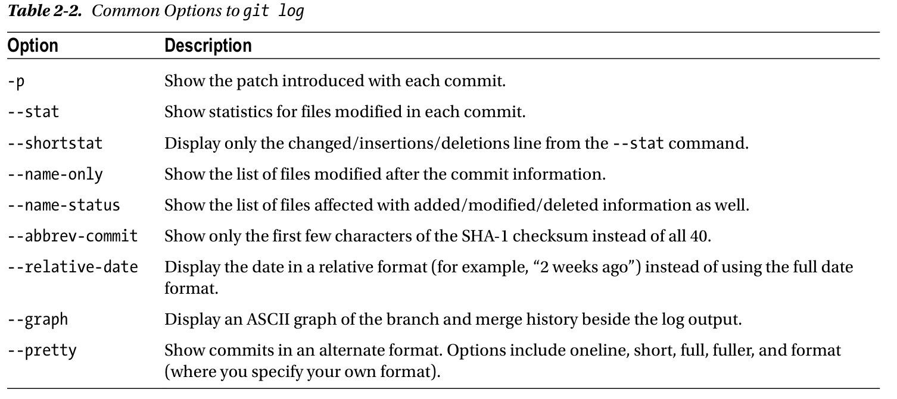
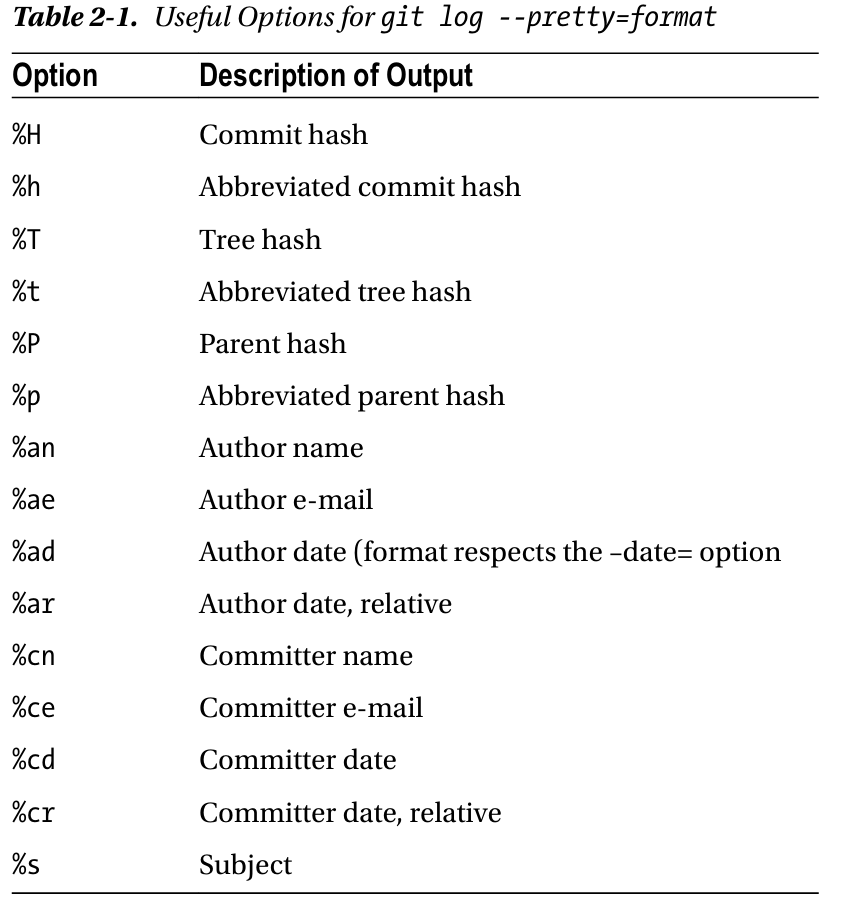
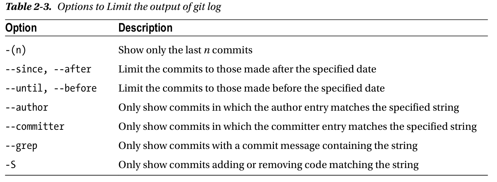

## Getting a Git Repository

有两种主要的方式创建一个 git 项目，其一是将一个已经存在的项目(目录)导入 git;其二是从其他 clone 一个已经存在的 git 储存库

### Initializing a repository

在需要创建git repository的目录下输入

```bash
git init
```

这将在目录下创建一个包含所有必要文件的子目录 `.git` 。此时，目录中还没有文件被跟踪。如果需要版本控制已经存在的文件，需要使用几个 `git add` 命令指明需要被跟踪的文件，然后再使用一个 `git commit`

### Clone an Existing Repository

使用命令
```bash
git clone [url]
```
可以获得一个已经存在的 git 项目

`git clone` 后面可以跟自定义目录名：

```bash
git clone https://github.com/libgit2/libgit2 mylibgit
```

!!! note "clone 不只是下载快照"
    `git clone` 会下载目标项目中的所有版本的数据，即该仓库历史上的每一次更新版本都会被拉取到本地。clone 后即使原仓库服务器宕机，本地依然拥有完整的历史记录

## Recording Changes

Git 中的文件有四种状态：**已跟踪(Tracked)** 与 **未跟踪(Untracked)**；已跟踪的文件又处于 **暂存(Staged)**、**已修改(Modified)**、**已提交(Committed)** 三种状态之一

- 未跟踪：文件不在 `.git` 目录中，还没有被纳入版本控制
- 已修改：文件被跟踪后，内容有改动但尚未提交到数据库
- 已暂存：对已修改文件的当前版本做了标记，使之包含在下次提交的快照中
- 已提交：数据已经安全地保存在本地数据库中

这四种状态对应 Git 项目的三个工作区域：工作目录(Working Directory)、暂存区(Staging Area) 和 Git 目录(.git Directory)

!!! tip "基本工作流"
    1. 在工作目录中修改文件
    2. 使用 `git add` 暂存文件，将文件的快照放入暂存区域
    3. 使用 `git commit` 提交更新，找到暂存区域的文件，将快照永久性存储到 Git 仓库目录

### Checking the Status of Your Files

```bash
git status
```

输出会依次显示：当前分支、是否有分支落后于远端、已暂存待提交的文件(`Changes to be committed`)、已修改未暂存的文件(`Changes not staged for commit`)、未跟踪的文件(`Untracked files`)

较新版本的 Git 支持简写形式：

```bash
git status -s
```

其中 `M` 表示已修改，`A` 表示新增，`R` 表示重命名，`C` 表示新拷贝，未暂存的修改标记在第二列(如 ` M` 表示已修改未暂存，`M ` 表示已修改已暂存)，`??` 表示未跟踪

### Tracking New Files

未跟踪的文件要纳入版本控制，使用：

```bash
git add README.md
```

`git add` 命令一般用于开始跟踪某个文件、将修改加入暂存区等操作。执行后该文件会出现在 `Changes to be committed` 中，即已被暂存

!!! warning "git add 暂存的是当前快照"
    如果在 `git add` 之后又修改了文件，需要**再次执行 `git add`** 才能把最新的修改暂存，否则提交的是执行 `git add` 那一刻的内容

### Staging Modified Files

对已跟踪的文件做出修改后，同样使用 `git add` 将其暂存：

```bash
git add CONTRIBUTING.md
```

### Ignoring Files

可以通过创建 `.gitignore` 文件告诉 Git 忽略某些文件。常用规则：

```gitignore
# 注释不会生效
*.a          # 忽略所有 .a 结尾的文件
!lib.a       # 但 lib.a 除外
/TODO        # 仅忽略项目根目录下的 TODO，不包括 subdir/TODO
build/       # 忽略 build/ 目录下所有文件
doc/*.txt    # 会匹配 doc/notes.txt，但不匹配 doc/server/arch.txt
```

!!! note "忽略已跟踪的文件"
    `.gitignore` 只对**未跟踪**的文件生效。如果某个文件已被跟踪，需要先用 `git rm --cached <file>` 将其从暂存区移除，忽略规则才会生效

### Viewing the Staged and Unstaged Changes

`git status` 只能显示文件是否被修改，要看**具体改了什么**，使用 `git diff`：

```bash
git diff              # 查看尚未暂存的更新
git diff --staged     # 查看将要提交的内容（已暂存的更新，Git 2.11.1 之前为 git diff --cached）
```

`git diff` 比较的是工作目录与暂存区的差异；`git diff --staged` 比较的是暂存区与最后一次提交的差异

### Committing Changes

```bash
git commit
```

不带参数会启动编辑器(由 `core.editor` 配置决定)编写提交信息。常用选项：

```bash
git commit -m "commit message"   # 直接在命令行写提交信息
git commit -a                    # 自动暂存所有已跟踪文件的修改并提交（跳过 git add）
```

!!! warning "git commit -a 不包含新文件"
    `-a` 选项只会暂存**已跟踪文件**的修改，未跟踪的新文件不会被提交，仍需显式 `git add`

## Viewing the Commit History

可以使用 `git log` 查看提交历史记录。`git log` 默认按时间倒序显示提交历史，包含校验和(checksum)、作者、邮箱、提交时间以及提交说明

`git log` 的几个常用选项如下：



其中 `--pretty` 支持的格式包括：`oneline`、`short`、`full`、`fuller`，以及 `format`. `format` 比较特殊，它允许**自定义格式化**提交历史记录的输出，在使用机器解析输出结果时十分有用。下表是其常用的占位符：



??? example "例子"
    ```bash
    $ git log --pretty=format:"%h - %an, %ar : %s"
    ca82a6d - Scott Chacon, 19 years ago : changed the verison number
    085bb3b - Scott Chacon, 19 years ago : removed unnecessary test code
    a11bef0 - Scott Chacon, 19 years ago : first commit
    ```

可以给`git log`添加其他选项从而筛选出符合条件的提交历史记录。常用选项如下



## Undoing Things

!!! warning ""
    并非所有撤销操作都是安全的。有些操作(如丢弃未提交的修改)不可恢复，还有些操作(如改写已推送的历史)会造成协作冲突

常见的撤销操作发生在过早地提交了修改可能忘记添加一些文件或者提交说明错误，这时可以使用`git commit --amend` 将最后一次提交重新提交

```bash
git commit -m "initial commit"
git add forgotted_file
git commit --amend 
```

在修改了两个文件之后不小心使用了 `git add *` 将两个文件都暂存了，这时可以使用

```bash
git restore --staged <file>    # New version recommended
git reset HEAD <file>          # Old version
```
将其中一个文件(`<file>`)从暂存区移除，这会把文件从暂存区撤回，但**保留工作目录中的修改**


如果文件已经修改但尚未暂存，想要将文件恢复到最后一次提交的状态，可以使用

```bash
git restore <file>             # New version recommended
git checkout -- <file>         # Old version
```

!!! note ""
    在 Git 中几乎任何提交的内容都是可以恢复的。即使是存在于已删除分支上的提交，或者被 `--amend` 提交覆盖的提交，也可以恢复。但是，任何从未提交过的内容一旦丢失，很可能再也见不到了。

## Working with Remotes

远程仓库是托管在网络上的项目版本。常用命令：

可以使用 `git remote` 命令查看已配置的服务器，这将列出了指定的每个远程句柄的简称。如果 `clone` 了一个项目，至少会看到 `origin` ，这是 Git 为服务器分配的默认名称

也可以指定 `-v` 选项，这会显示 Git 为短名称存储的 URL，以便在读取和写入该远程仓库时使用，如果你有多个远程 URL，这个命令会将它们都列出

```bash
git remote -v
```

---

可以使用
```bash
git remote add <shortname> <url>
```
来添加一个新的远程仓库，其中 `<shortname>` 可以代替完整 URL 与远端交互

### Fetching and Pulling

```bash
git fetch <remote>     # 拉取远端本地没有的数据（不会自动合并）
git pull               # 抓取并自动合并到当前分支
```

!!! note "fetch 与 pull 的区别"
    `git fetch` 只把远端更新下载到本地，存放在 `origin/master` 等远程跟踪分支中，需要手动 `merge` 或 `rebase`；`git pull` 相当于 `git fetch` 加上 `git merge FETCH_HEAD`。团队协作中推荐先 `fetch` 检查再合并

### Pushing

```bash
git push <remote> <branch>
# 例如
git push origin master
```

!!! tip "设置上游跟踪分支"
    执行 `git push -u origin master` 后，`master` 会与 `origin/master` 建立跟踪关系，之后直接 `git push` / `git pull` 即可，无需再指定远程和分支

### Removing a Remote

```bash
git remote remove pb   # 移除名为 pb 的远程仓库
```

### Renaming a Remote

```bash
git remote rename pb paul
```

### Inspecting a Remote

```bash
git remote show origin
```

输出包含远端分支、本地分支跟踪关系、`git pull` 会合并哪些分支、`git push` 会推送哪些分支

### Tagging

给历史中的重要节点(通常是发布版本)打标签：

```bash
git tag                        # 列出所有标签
git tag v1.4.2-lw              # 轻量标签(lightweight)
git tag -a v1.4 -m "my version 1.4"   # 附注标签(annotated)，推荐
git tag -s v1.5 -m "signed"    # 带私钥签名的标签
git tag v1.2-lw <checksum>     # 为过去的某次提交补打标签
```

查看标签详情：

```bash
git show v1.4
```

推送标签：

```bash
git push origin v2.0.0         # 推送单个标签
git push origin --tags         # 推送所有本地标签
```

!!! warning "push 不会自动带上标签"
    默认的 `git push` **不会**传输标签，必须显式推送。删除远端标签使用 `git push origin --delete <tagname>`

检出某个标签的版本：

```bash
git checkout v2.0.0
```

## Git Aliases

Git 不会自动推断子命令，但可以通过 `.gitconfig` 自定义别名：

```ini
[alias]
    ci = commit
    co = checkout
    st = status
    br = branch
    unstage = reset HEAD --
    last = log -1 HEAD
```

之后即可使用 `git ci`、`git st` 等简写。也可以在命令行配置：

```bash
git config --global alias.last 'log -1 HEAD'
```

!!! tip "多行别名"
    别名中可以调用外部命令(以 `!` 开头)，例如：

    ```ini
    [alias]
        visual = "!gitk"
        lg = log --color --graph --pretty=format:'%Cred%h%Creset -%C(yellow)%d%Creset %s %Cgreen(%cr) %C(bold blue)<%an>%Creset' --abbrev-commit
    ```

## Summary

Git 的基本命令一览：

| 命令 | 作用 |
| ---- | ---- |
| `git init` | 初始化新仓库 |
| `git clone <url>` | 克隆已有仓库 |
| `git status` | 查看文件状态 |
| `git add <file>` | 跟踪文件 / 暂存修改 |
| `git diff` | 查看未暂存的修改 |
| `git diff --staged` | 查看已暂存的修改 |
| `git commit -m "<msg>"` | 提交暂存的修改 |
| `git commit --amend` | 修补上一次提交 |
| `git log` | 查看提交历史 |
| `git restore --staged <file>` | 取消暂存 |
| `git restore <file>` | 丢弃工作目录修改 |
| `git remote -v` | 查看远程仓库 |
| `git fetch <remote>` | 下载远端数据 |
| `git pull` | 下载并合并远端数据 |
| `git push <remote> <branch>` | 推送到远端 |
| `git tag -a <name> -m "<msg>"` | 打附注标签 |
